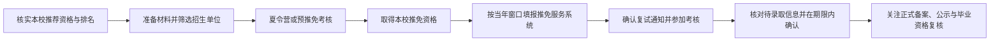

# 中国保研（推免）全流程知识手册

**轻保研整理** · 公开版 v1.12.0 · 内容更新于 2026 年 10 月 30 日

这是一份面向中国大陆本科生的保研知识库，按准备阶段与常见问题组织，覆盖资格评定、择校准备、申请考核、推免系统、录取确认和入学衔接。**全书共 21 章、215 个主题节、1,509 个问答**；问题索引直接展示在本页，章节正文和来源均可逐条回溯。

推免政策和院校要求会逐年变化。涉及资格、时间、材料、考核、奖助或录取手续时，请以教育主管部门、所在学校和目标招生单位当年发布的正式文件为准。本手册不承诺资格、入营或录取结果。

关注最新资讯，可关注：

## 内容规模

**21 章 · 215 个主题节 · 1,509 个问答 · PDF v1.12.0**

问答按真实申请流程分章整理，并链接至对应章节正文；正文引用可追溯至 661 项参考来源。完整问题清单默认显示在本页下方，无需展开。

## 快速入口

- [从头了解制度与准备节奏：第 1 章](docs/chapters/ch01.md)
- [核对推免资格、名额与排名：第 2 章](docs/chapters/ch02.md)
- [准备绩点、英语、科研与竞赛：第 4 章](docs/chapters/ch04.md)
- [开始申请与准备材料：第 5 章](docs/chapters/ch05.md)
- [了解夏令营、预推免和九推：第 7 章](docs/chapters/ch07.md) · [第 8 章](docs/chapters/ch08.md) · [第 9 章](docs/chapters/ch09.md)
- [准备复试与考核：第 10 章](docs/chapters/ch10.md)
- [核对录取确认和后续手续：第 11 章](docs/chapters/ch11.md) · [第 15 章](docs/chapters/ch15.md)
- [按编号查看正文引用来源（PDF来源表编号 1–661）：参考来源清单](docs/references.md)
- [在线阅读《保研全解》](https://qingbaoyan.cn/baoyan-quanjie/)

- [下载最新版 PDF（v1.12.0）](books/baoyan/v1.12.0/中国保研（推免）全流程知识手册-v1.12.0.pdf) · [v1.11.0 历史版](books/baoyan/v1.11.0/中国保研（推免）全流程知识手册-v1.11.0.pdf) · [v1.10.0 历史版](books/baoyan/v1.10.0/中国保研（推免）全流程知识手册-v1.10.0.pdf) · [v1.9.0 历史版](books/baoyan/v1.9.0/中国保研（推免）全流程知识手册-v1.9.0.pdf) · [v1.8.0 历史版](books/baoyan/v1.8.0/中国保研（推免）全流程知识手册-v1.8.0.pdf) · [v1.6.0 历史版](books/baoyan/v1.6.0/中国保研（推免）全流程知识手册-v1.6.0.pdf) · [v1.5.0 历史版（422 页）](books/baoyan/v1.5.0/中国保研（推免）全流程知识手册-v1.5.0.pdf) · [v1.3.0 历史版](books/baoyan/v1.3.0/中国保研（推免）全流程知识手册-v1.3.0.pdf) · [v1.2.0 历史版](books/baoyan/v1.2.0/中国保研（推免）全流程知识手册-v1.2.0.pdf) · [v1.0.0 历史版（411 页）](books/baoyan/v1.0.0/中国保研（推免）全流程知识手册-v1.0.0.pdf)

## 推免流程速览

时间点每年变化；上图说明常见办理顺序，不代表所有单位采用相同批次。

## 全书章节

| 章节 | 主要内容 | GitHub 阅读 |
|---|---|---|
| 01 | 认识保研：制度、路径与时间线 | [阅读第 1 章](docs/chapters/ch01.md) |
| 02 | 推免资格、名额分配与成绩排名 | [阅读第 2 章](docs/chapters/ch02.md) |
| 03 | 自我定位与择校择专业 | [阅读第 3 章](docs/chapters/ch03.md) |
| 04 | 背景提升：绩点、英语、科研与竞赛 | [阅读第 4 章](docs/chapters/ch04.md) |
| 05 | 申请材料准备与文书 | [阅读第 5 章](docs/chapters/ch05.md) |
| 06 | 联系导师与师生双向选择 | [阅读第 6 章](docs/chapters/ch06.md) |
| 07 | 夏令营：申请、入营与考核 | [阅读第 7 章](docs/chapters/ch07.md) |
| 08 | 预推免：第二轮机会 | [阅读第 8 章](docs/chapters/ch08.md) |
| 09 | 九推与推免服务系统填报 | [阅读第 9 章](docs/chapters/ch09.md) |
| 10 | 复试与考核：面试、机试与笔试 | [阅读第 10 章](docs/chapters/ch10.md) |
| 11 | 录取、待录取确认与 offer 取舍 | [阅读第 11 章](docs/chapters/ch11.md) |
| 12 | 失败路径、补救与心态 | [阅读第 12 章](docs/chapters/ch12.md) |
| 13 | 特殊通道与专项计划 | [阅读第 13 章](docs/chapters/ch13.md) |
| 14 | 学费、奖助与读研成本 | [阅读第 14 章](docs/chapters/ch14.md) |
| 15 | 录取之后：资格复审与入学准备 | [阅读第 15 章](docs/chapters/ch15.md) |
| 16 | 不同背景考生的专门问题 | [阅读第 16 章](docs/chapters/ch16.md) |
| 17 | 策略、博弈与信息运用 | [阅读第 17 章](docs/chapters/ch17.md) |
| 18 | 路径比较与取舍 | [阅读第 18 章](docs/chapters/ch18.md) |
| 19 | 常见误区与辟谣 | [阅读第 19 章](docs/chapters/ch19.md) |
| 20 | 学科与院校差异 | [阅读第 20 章](docs/chapters/ch20.md) |
| 21 | 信息渠道与工具 | [阅读第 21 章](docs/chapters/ch21.md) |

## 按章检索全部问题

以下问题标题对应章节正文中的原始问答标题。使用浏览器或 GitHub 页面搜索（Ctrl+F / ⌘F）可查找标题关键词。自动生成与校验方法见 [`scripts/generate_readme_index.py`](scripts/generate_readme_index.py)。

<!-- BEGIN GENERATED QUESTION INDEX -->
本索引由 21 章源 Markdown 自动生成，共 1,509 个问答。问题标题可在页面内搜索，点击可跳转到章节正文。

### 第 1 章（60 个问题）

- [保研和考研到底差在哪？听说保研能省一整年是真的吗](docs/chapters/ch01.md#保研和考研到底差在哪听说保研能省一整年是真的吗)
- [大一高数挂过一次，是不是直接跟保研说再见了](docs/chapters/ch01.md#大一高数挂过一次是不是直接跟保研说再见了)
- [保研率一般多少算正常？我们专业2% 是不是太低了](docs/chapters/ch01.md#保研率一般多少算正常我们专业2-是不是太低了)
- [直博是啥？保研选了直博是不是就退不出来了](docs/chapters/ch01.md#直博是啥保研选了直博是不是就退不出来了)
- [家里人说保研比考研稳，是这样吗](docs/chapters/ch01.md#家里人说保研比考研稳是这样吗)
- [少数民族骨干计划算保研名额吗](docs/chapters/ch01.md#少数民族骨干计划算保研名额吗)
- [保研是不是更看关系背景](docs/chapters/ch01.md#保研是不是更看关系背景)
- [保研名额会不会被内定？公示只是走个过场吗](docs/chapters/ch01.md#保研名额会不会被内定公示只是走个过场吗)
- [我想跨专业保研，是不是太天真了](docs/chapters/ch01.md#我想跨专业保研是不是太天真了)
- [保研的人是不是都不用考研了](docs/chapters/ch01.md#保研的人是不是都不用考研了)
- [保研和高考比哪个更公平](docs/chapters/ch01.md#保研和高考比哪个更公平)
- [保研名额没用完会顺延给下一名吗](docs/chapters/ch01.md#保研名额没用完会顺延给下一名吗)
- [我现在大二下，绩点3.4 还能保研吗？来得及补吗](docs/chapters/ch01.md#我现在大二下绩点34-还能保研吗来得及补吗)
- [我准备考公，还能保研吗？会不会冲突](docs/chapters/ch01.md#我准备考公还能保研吗会不会冲突)
- [大三下才决定保研，还来得及吗？需要补什么](docs/chapters/ch01.md#大三下才决定保研还来得及吗需要补什么)
- [保研上岸的学长学姐一般什么时候开始准备的](docs/chapters/ch01.md#保研上岸的学长学姐一般什么时候开始准备的)
- [我是中外合作办学的，我们这种能保研吗](docs/chapters/ch01.md#我是中外合作办学的我们这种能保研吗)
- [专升本的同学有机会保研吗？听说名额特别少](docs/chapters/ch01.md#专升本的同学有机会保研吗听说名额特别少)
- [公费师范生能保研吗？听说要履行协议](docs/chapters/ch01.md#公费师范生能保研吗听说要履行协议)
- [我现在大一，想保研，这三年应该怎么规划](docs/chapters/ch01.md#我现在大一想保研这三年应该怎么规划)
- [保研夏令营大概什么时候开始投？会不会撞期末](docs/chapters/ch01.md#保研夏令营大概什么时候开始投会不会撞期末)
- [我们学校没有推免资格，我还能保研吗](docs/chapters/ch01.md#我们学校没有推免资格我还能保研吗)
- [独立学院有保研名额吗](docs/chapters/ch01.md#独立学院有保研名额吗)
- [在职的人还能走保研这条路吗](docs/chapters/ch01.md#在职的人还能走保研这条路吗)
- [保研信息一般从哪看？光看学院官网够吗](docs/chapters/ch01.md#保研信息一般从哪看光看学院官网够吗)
- [双非真的能保到985 吗？我们学院去年好像只有一个去了211](docs/chapters/ch01.md#双非真的能保到985-吗我们学院去年好像只有一个去了211)
- [保研有没有卷不卷的说法，怎么判断我们学院卷不卷](docs/chapters/ch01.md#保研有没有卷不卷的说法怎么判断我们学院卷不卷)
- [保研失败的话还有退路吗？能不能转头考研](docs/chapters/ch01.md#保研失败的话还有退路吗能不能转头考研)
- [医学生保研和临床实习会冲突吗？怎么安排时间](docs/chapters/ch01.md#医学生保研和临床实习会冲突吗怎么安排时间)
- [我们学院保研细则每年都改，以哪一版为准](docs/chapters/ch01.md#我们学院保研细则每年都改以哪一版为准)
- [保研后能不能反悔去工作](docs/chapters/ch01.md#保研后能不能反悔去工作)
- [保研拿到的offer 有法律效力吗？学校能反悔吗](docs/chapters/ch01.md#保研拿到的offer-有法律效力吗学校能反悔吗)
- [保研信息差真的那么大吗？怎么才能不落后](docs/chapters/ch01.md#保研信息差真的那么大吗怎么才能不落后)
- [保研到底是怎么个流程？是不是大四开学直接填个志愿就行了](docs/chapters/ch01.md#保研到底是怎么个流程是不是大四开学直接填个志愿就行了)
- [别人都在说夏令营预推免九推，这三个到底啥区别](docs/chapters/ch01.md#别人都在说夏令营预推免九推这三个到底啥区别)
- [保研名额是国家给的还是学校自己分的？为什么我们学院今年多了一个](docs/chapters/ch01.md#保研名额是国家给的还是学校自己分的为什么我们学院今年多了一个)
- [学硕和专硕在保研里有什么区别？听说专硕好保一点](docs/chapters/ch01.md#学硕和专硕在保研里有什么区别听说专硕好保一点)
- [港澳台学生保研是走什么渠道](docs/chapters/ch01.md#港澳台学生保研是走什么渠道)
- [保研是不是有个推免系统？什么时候开放](docs/chapters/ch01.md#保研是不是有个推免系统什么时候开放)
- [推免服务系统里可以填几个志愿](docs/chapters/ch01.md#推免服务系统里可以填几个志愿)
- [保研一定要参加预推免吗？只在夏令营拿到offer 行不行](docs/chapters/ch01.md#保研一定要参加预推免吗只在夏令营拿到offer-行不行)
- [我在国外读的本科，能申请国内高校的推免吗](docs/chapters/ch01.md#我在国外读的本科能申请国内高校的推免吗)
- [保研是不是只能保本校？想出去是不是很难](docs/chapters/ch01.md#保研是不是只能保本校想出去是不是很难)
- [保研和出国同时搞现实吗？语言考试和夏令营时间撞了怎么办](docs/chapters/ch01.md#保研和出国同时搞现实吗语言考试和夏令营时间撞了怎么办)
- [保研去外校，本校不放人怎么办](docs/chapters/ch01.md#保研去外校本校不放人怎么办)
- [保研失败是被退学吗？还是只是没名额](docs/chapters/ch01.md#保研失败是被退学吗还是只是没名额)
- [保研里说的全聚德是什么意思？被全拒了怎么办](docs/chapters/ch01.md#保研里说的全聚德是什么意思被全拒了怎么办)
- [保研是不是一定要有科研？没进过实验室是不是没戏](docs/chapters/ch01.md#保研是不是一定要有科研没进过实验室是不是没戏)
- [保研要花很多钱吗？跑夏令营是不是特别烧钱](docs/chapters/ch01.md#保研要花很多钱吗跑夏令营是不是特别烧钱)
- [文科生保研是不是比理工科难？没有实验室没有论文](docs/chapters/ch01.md#文科生保研是不是比理工科难没有实验室没有论文)
- [经管的保研是不是特别卷？要不要考个CPA 加分](docs/chapters/ch01.md#经管的保研是不是特别卷要不要考个cpa-加分)
- [保研要考政治英语吗？有没有笔试](docs/chapters/ch01.md#保研要考政治英语吗有没有笔试)
- [保研一定要提前联系导师吗？不联系会怎样](docs/chapters/ch01.md#保研一定要提前联系导师吗不联系会怎样)
- [保研后大四是不是就轻松了？还要修课吗](docs/chapters/ch01.md#保研后大四是不是就轻松了还要修课吗)
- [我现在大四了，九推还有机会吗？是不是都招满了](docs/chapters/ch01.md#我现在大四了九推还有机会吗是不是都招满了)
- [保研要不要提前学研究生课程？有意义吗](docs/chapters/ch01.md#保研要不要提前学研究生课程有意义吗)
- [我们学校保研要笔试吗？还是只看排名](docs/chapters/ch01.md#我们学校保研要笔试吗还是只看排名)
- [退役大学生士兵专项计划是保研还是考研](docs/chapters/ch01.md#退役大学生士兵专项计划是保研还是考研)
- [保研是看专业排名还是年级排名？小专业吃亏吗](docs/chapters/ch01.md#保研是看专业排名还是年级排名小专业吃亏吗)
- [保研看成绩还是综合测评？哪个占比高](docs/chapters/ch01.md#保研看成绩还是综合测评哪个占比高)

### 第 2 章（68 个问题）

- [挂了科但补考过了，还算不算挂科记录](docs/chapters/ch02.md#挂了科但补考过了还算不算挂科记录)
- [挂科超过几门会取消推免资格](docs/chapters/ch02.md#挂科超过几门会取消推免资格)
- [竞赛加分只认国奖吗？省赛一等奖算不算](docs/chapters/ch02.md#竞赛加分只认国奖吗省赛一等奖算不算)
- [少数民族预科班转正后算不算应届推免生](docs/chapters/ch02.md#少数民族预科班转正后算不算应届推免生)
- [辅导员专项思政骨干专项是怎么报的，算不算推免](docs/chapters/ch02.md#辅导员专项思政骨干专项是怎么报的算不算推免)
- [创新学分不够会不会影响推免资格](docs/chapters/ch02.md#创新学分不够会不会影响推免资格)
- [体测不及格会不会取消保研资格](docs/chapters/ch02.md#体测不及格会不会取消保研资格)
- [学术不端被记录后还能不能推免](docs/chapters/ch02.md#学术不端被记录后还能不能推免)
- [拿到推免资格但不去读会不会被记入诚信档案](docs/chapters/ch02.md#拿到推免资格但不去读会不会被记入诚信档案)
- [推免资格名单上报教育部后还能改吗](docs/chapters/ch02.md#推免资格名单上报教育部后还能改吗)
- [学院说综合素质测评前X% 才有推免资格，综测怎么算](docs/chapters/ch02.md#学院说综合素质测评前x-才有推免资格综测怎么算)
- [保研政策里德智体美劳具体卡哪些硬指标](docs/chapters/ch02.md#保研政策里德智体美劳具体卡哪些硬指标)
- [推免资格到底是学校评还是学院评？为什么学院之间名额差别那么大](docs/chapters/ch02.md#推免资格到底是学校评还是学院评为什么学院之间名额差别那么大)
- [我们学院保研名额是怎么分的？按专业人数还是按往年升学率](docs/chapters/ch02.md#我们学院保研名额是怎么分的按专业人数还是按往年升学率)
- [保研加分项一般都有哪些？哪些是通用的哪些是学校自定](docs/chapters/ch02.md#保研加分项一般都有哪些哪些是通用的哪些是学校自定)
- [保研率是按专业算还是按学院算？转专业后算哪个专业的名额](docs/chapters/ch02.md#保研率是按专业算还是按学院算转专业后算哪个专业的名额)
- [大类招生的，专业分流后才定排名，保研名额怎么分](docs/chapters/ch02.md#大类招生的专业分流后才定排名保研名额怎么分)
- [基地班实验班的保研名额是单列的吗](docs/chapters/ch02.md#基地班实验班的保研名额是单列的吗)
- [卓越班珠峰计划的保研率是不是更高](docs/chapters/ch02.md#卓越班珠峰计划的保研率是不是更高)
- [研究生支教团的保研名额是额外的还是占学院名额](docs/chapters/ch02.md#研究生支教团的保研名额是额外的还是占学院名额)
- [有人放弃保研名额，名额会回到学院还是学校收回](docs/chapters/ch02.md#有人放弃保研名额名额会回到学院还是学校收回)
- [学校把名额调给别的学院，原学院的学生能反对吗](docs/chapters/ch02.md#学校把名额调给别的学院原学院的学生能反对吗)
- [港澳台侨学生的推免名额是单列的吗](docs/chapters/ch02.md#港澳台侨学生的推免名额是单列的吗)
- [四六级成绩算不算保研加分或门槛](docs/chapters/ch02.md#四六级成绩算不算保研加分或门槛)
- [学生会主席有没有保研加分](docs/chapters/ch02.md#学生会主席有没有保研加分)
- [志愿服务时长算不算保研加分](docs/chapters/ch02.md#志愿服务时长算不算保研加分)
- [定向生委培生能不能保研](docs/chapters/ch02.md#定向生委培生能不能保研)
- [免费医学生公费农科生能保研吗](docs/chapters/ch02.md#免费医学生公费农科生能保研吗)
- [国防生现在还能保研吗](docs/chapters/ch02.md#国防生现在还能保研吗)
- [受过违纪处分还能保研吗](docs/chapters/ch02.md#受过违纪处分还能保研吗)
- [五级制成绩优良中怎么折算成保研用的分数](docs/chapters/ch02.md#五级制成绩优良中怎么折算成保研用的分数)
- [P/NP 的课算不算入排名](docs/chapters/ch02.md#pnp-的课算不算入排名)
- [第二学位在读能不能保研](docs/chapters/ch02.md#第二学位在读能不能保研)
- [选修课算不算进保研排名？专业选修和通识选修要分开算吗](docs/chapters/ch02.md#选修课算不算进保研排名专业选修和通识选修要分开算吗)
- [体育课成绩算保研排名吗？我体育只有70 分会不会拖后腿](docs/chapters/ch02.md#体育课成绩算保研排名吗我体育只有70-分会不会拖后腿)
- [转专业的学生保研排名怎么算？原来专业的课还算吗](docs/chapters/ch02.md#转专业的学生保研排名怎么算原来专业的课还算吗)
- [我大二去交换了一学期，交换的成绩算保研排名吗](docs/chapters/ch02.md#我大二去交换了一学期交换的成绩算保研排名吗)
- [降级转专业后跟下一届一起排名，吃亏吗](docs/chapters/ch02.md#降级转专业后跟下一届一起排名吃亏吗)
- [辅修双学位的成绩算不算保研排名](docs/chapters/ch02.md#辅修双学位的成绩算不算保研排名)
- [辅修挂科会不会影响主修保研](docs/chapters/ch02.md#辅修挂科会不会影响主修保研)
- [交换期间修的课如果没认定学分，排名怎么算](docs/chapters/ch02.md#交换期间修的课如果没认定学分排名怎么算)
- [保研名额出现并列排名怎么处理？有没有并列规则](docs/chapters/ch02.md#保研名额出现并列排名怎么处理有没有并列规则)
- [保研排名到底按加权平均分还是学分绩点算？教务处和学院说法不一样](docs/chapters/ch02.md#保研排名到底按加权平均分还是学分绩点算教务处和学院说法不一样)
- [算术平均分和加权平均分差0.3，会不会影响排名](docs/chapters/ch02.md#算术平均分和加权平均分差03会不会影响排名)
- [重修后的成绩是按重修分算还是按第一次算？会不会标注重修](docs/chapters/ch02.md#重修后的成绩是按重修分算还是按第一次算会不会标注重修)
- [发一篇普刊能不能加分？会不会被认定为水刊反而扣分](docs/chapters/ch02.md#发一篇普刊能不能加分会不会被认定为水刊反而扣分)
- [休学一年会不会影响保研资格和年级归属](docs/chapters/ch02.md#休学一年会不会影响保研资格和年级归属)
- [保研排名里的学分绩点到底是4.0 制还是5.0 制，能直接比较吗](docs/chapters/ch02.md#保研排名里的学分绩点到底是40-制还是50-制能直接比较吗)
- [我们学校的保研细则里前10% 是按什么基数的前10%](docs/chapters/ch02.md#我们学校的保研细则里前10-是按什么基数的前10)
- [候补的第11 名有没有机会递补？什么时候能知道](docs/chapters/ch02.md#候补的第11-名有没有机会递补什么时候能知道)
- [我们学校把大一成绩也算进去，大二想翻盘还有机会吗](docs/chapters/ch02.md#我们学校把大一成绩也算进去大二想翻盘还有机会吗)
- [保研名额公示期一般几天？有异议该找谁](docs/chapters/ch02.md#保研名额公示期一般几天有异议该找谁)
- [公示排名跟自己算的不一样，能申诉吗？流程是什么](docs/chapters/ch02.md#公示排名跟自己算的不一样能申诉吗流程是什么)
- [退役复学后保研有什么优惠？士兵计划是加名额还是单独划线](docs/chapters/ch02.md#退役复学后保研有什么优惠士兵计划是加名额还是单独划线)
- [艺术团高水平运动队的保研通道跟普通学生一样吗](docs/chapters/ch02.md#艺术团高水平运动队的保研通道跟普通学生一样吗)
- [保研是前六学期还是前五学期成绩？大三下成绩出得晚怎么办](docs/chapters/ch02.md#保研是前六学期还是前五学期成绩大三下成绩出得晚怎么办)
- [我们学校大三下才出成绩，夏令营只能用前五学期排名吗](docs/chapters/ch02.md#我们学校大三下才出成绩夏令营只能用前五学期排名吗)
- [强基计划的学生保研是走推免还是转段](docs/chapters/ch02.md#强基计划的学生保研是走推免还是转段)
- [保研排名的截止时间点是怎么定的？期末考完才截止吗](docs/chapters/ch02.md#保研排名的截止时间点是怎么定的期末考完才截止吗)
- [保研排名证明谁开？教务处的章和学院的章哪个有效](docs/chapters/ch02.md#保研排名证明谁开教务处的章和学院的章哪个有效)
- [排名证明上写的是专业排名还是年级排名，外校怎么看](docs/chapters/ch02.md#排名证明上写的是专业排名还是年级排名外校怎么看)
- [保研资格是有资格就够了还是要排名靠前才算](docs/chapters/ch02.md#保研资格是有资格就够了还是要排名靠前才算)
- [公示前发现成绩录入有误，怎样申请正式更正而不影响推免排名？](docs/chapters/ch02.md#公示前发现成绩录入有误怎样申请正式更正而不影响推免排名)
- [推免细则在我入学后修订了，低年级学生该按哪一版准备？](docs/chapters/ch02.md#推免细则在我入学后修订了低年级学生该按哪一版准备)
- [推免课程从百分制改成等级制，怎样核对成绩折算是否准确？](docs/chapters/ch02.md#推免课程从百分制改成等级制怎样核对成绩折算是否准确)
- [推免资格公示后成绩被教务正式更正，排名和名单会自动更新吗？](docs/chapters/ch02.md#推免资格公示后成绩被教务正式更正排名和名单会自动更新吗)
- [大四毕业体测不到50分，会拿不到毕业证并影响研究生入学吗？](docs/chapters/ch02.md#大四毕业体测不到50分会拿不到毕业证并影响研究生入学吗)
- [体测免测、缓测怎么申请？在外交换或实习不能回校测怎么办？](docs/chapters/ch02.md#体测免测缓测怎么申请在外交换或实习不能回校测怎么办)

### 第 3 章（58 个问题）

- [保研定位到底该怎么定？我现在完全不知道自己能冲什么学校](docs/chapters/ch03.md#保研定位到底该怎么定我现在完全不知道自己能冲什么学校)
- [怎么判断自己够不够某个学校？看绩点还是看排名百分比](docs/chapters/ch03.md#怎么判断自己够不够某个学校看绩点还是看排名百分比)
- [想读博是不是必须选直博或者学硕](docs/chapters/ch03.md#想读博是不是必须选直博或者学硕)
- [怎么知道某个导师的方向好不好、人品怎么样](docs/chapters/ch03.md#怎么知道某个导师的方向好不好人品怎么样)
- [怎么判断某个项目是不是保底校？看什么指标](docs/chapters/ch03.md#怎么判断某个项目是不是保底校看什么指标)
- [我们学校规定保内保外有比例限制，这样还怎么冲](docs/chapters/ch03.md#我们学校规定保内保外有比例限制这样还怎么冲)
- [法学保研该怎么定位？法硕和法学学硕怎么选](docs/chapters/ch03.md#法学保研该怎么定位法硕和法学学硕怎么选)
- [经管保研里金融会计管理哪个更容易上岸](docs/chapters/ch03.md#经管保研里金融会计管理哪个更容易上岸)
- [直博定位怎么排？直博比学硕好申还是难申](docs/chapters/ch03.md#直博定位怎么排直博比学硕好申还是难申)
- [保研定位用绩点还是用排名百分比更准](docs/chapters/ch03.md#保研定位用绩点还是用排名百分比更准)
- [我们学院往年去top 校的都是什么人，怎么对标自己](docs/chapters/ch03.md#我们学院往年去top-校的都是什么人怎么对标自己)
- [双非专业第一能冲什么层次的学校？985 有可能吗](docs/chapters/ch03.md#双非专业第一能冲什么层次的学校985-有可能吗)
- [本科出身到底有多重要？双非会被一刀切卡掉吗](docs/chapters/ch03.md#本科出身到底有多重要双非会被一刀切卡掉吗)
- [211 本和985 本在保研时的差距有多大](docs/chapters/ch03.md#211-本和985-本在保研时的差距有多大)
- [同样是双非，行业特色院校会不会好一点](docs/chapters/ch03.md#同样是双非行业特色院校会不会好一点)
- [学科评估A+ 但学校是双非，和985 的B+ 该选哪个](docs/chapters/ch03.md#学科评估a-但学校是双非和985-的b-该选哪个)
- [学校排名重要还是专业排名重要，读博的话呢](docs/chapters/ch03.md#学校排名重要还是专业排名重要读博的话呢)
- [保研选城市到底有多重要？一线城市机会真的多吗](docs/chapters/ch03.md#保研选城市到底有多重要一线城市机会真的多吗)
- [北京上海的普通211 和中西部的985，怎么选](docs/chapters/ch03.md#北京上海的普通211-和中西部的985怎么选)
- [本校保底到底该不该留？会不会影响外校投递](docs/chapters/ch03.md#本校保底到底该不该留会不会影响外校投递)
- [双一流学科和双一流学校在保研里一样吗](docs/chapters/ch03.md#双一流学科和双一流学校在保研里一样吗)
- [冲稳保应该按几比几来排？冲太多是不是浪费机会](docs/chapters/ch03.md#冲稳保应该按几比几来排冲太多是不是浪费机会)
- [保研可以同时报同一个学校的不同学院吗](docs/chapters/ch03.md#保研可以同时报同一个学校的不同学院吗)
- [报同一个学校多个专业会不会被认为是海王](docs/chapters/ch03.md#报同一个学校多个专业会不会被认为是海王)
- [保研可以申请国外高校的联培或双学位项目吗](docs/chapters/ch03.md#保研可以申请国外高校的联培或双学位项目吗)
- [某些学校只接受985211 推免生，这种限制合理吗](docs/chapters/ch03.md#某些学校只接受985211-推免生这种限制合理吗)
- [怎么判断一个学校的隐性门槛，比如卡四六级](docs/chapters/ch03.md#怎么判断一个学校的隐性门槛比如卡四六级)
- [保研投递要不要海投？投太多会不会被拉黑](docs/chapters/ch03.md#保研投递要不要海投投太多会不会被拉黑)
- [怎么通过学长学姐了解某学校某项目真实情况](docs/chapters/ch03.md#怎么通过学长学姐了解某学校某项目真实情况)
- [同一学校不同学院难度差异很大，怎么判断哪个好进](docs/chapters/ch03.md#同一学校不同学院难度差异很大怎么判断哪个好进)
- [保研选学硕还是专硕？以后想读博该怎么选](docs/chapters/ch03.md#保研选学硕还是专硕以后想读博该怎么选)
- [想去互联网大厂，保研该选什么专业和城市](docs/chapters/ch03.md#想去互联网大厂保研该选什么专业和城市)
- [冷门专业保研是不是更容易上岸](docs/chapters/ch03.md#冷门专业保研是不是更容易上岸)
- [目标专业只招学硕不招专硕，是不是竞争更激烈](docs/chapters/ch03.md#目标专业只招学硕不招专硕是不是竞争更激烈)
- [想跨专业保研，怎么判断目标专业接不接受跨专业](docs/chapters/ch03.md#想跨专业保研怎么判断目标专业接不接受跨专业)
- [跨专业保研是选相近专业好还是完全转行好](docs/chapters/ch03.md#跨专业保研是选相近专业好还是完全转行好)
- [文科跨保理工科现实吗？会不会面试直接被刷](docs/chapters/ch03.md#文科跨保理工科现实吗会不会面试直接被刷)
- [医学保研只能保本专业吗？能不能转基础医学](docs/chapters/ch03.md#医学保研只能保本专业吗能不能转基础医学)
- [理工科保研选方向时怎么判断三年后好不好就业](docs/chapters/ch03.md#理工科保研选方向时怎么判断三年后好不好就业)
- [选导师重要还是选学校重要](docs/chapters/ch03.md#选导师重要还是选学校重要)
- [保研选方向时，热门方向和冷门方向怎么权衡](docs/chapters/ch03.md#保研选方向时热门方向和冷门方向怎么权衡)
- [保研捡漏一般捡的是哪类学校或项目](docs/chapters/ch03.md#保研捡漏一般捡的是哪类学校或项目)
- [保研选导师的研究方向和自己本科学的差别大，能跟上吗](docs/chapters/ch03.md#保研选导师的研究方向和自己本科学的差别大能跟上吗)
- [保研择校要不要考虑对象或家庭所在地](docs/chapters/ch03.md#保研择校要不要考虑对象或家庭所在地)
- [家里希望我留省内，我该妥协吗](docs/chapters/ch03.md#家里希望我留省内我该妥协吗)
- [保研择校是不是要提前一年就定下来](docs/chapters/ch03.md#保研择校是不是要提前一年就定下来)
- [怎么查目标学校往年的录取名单和生源背景](docs/chapters/ch03.md#怎么查目标学校往年的录取名单和生源背景)
- [学校官网不公布录取数据怎么办？还有别的渠道吗](docs/chapters/ch03.md#学校官网不公布录取数据怎么办还有别的渠道吗)
- [目标学校今年突然缩招，之前的数据还有参考价值吗](docs/chapters/ch03.md#目标学校今年突然缩招之前的数据还有参考价值吗)
- [冲稳保里的保底校如果都没中，还有补救办法吗](docs/chapters/ch03.md#冲稳保里的保底校如果都没中还有补救办法吗)
- [目标院校的面试淘汰率高不高，怎么查](docs/chapters/ch03.md#目标院校的面试淘汰率高不高怎么查)
- [目标学校去年扩招今年会不会缩，有没有规律](docs/chapters/ch03.md#目标学校去年扩招今年会不会缩有没有规律)
- [去中科院各所读研和去高校读研有什么区别](docs/chapters/ch03.md#去中科院各所读研和去高校读研有什么区别)
- [社科院研究院所保研值得去吗？会不会不如高校](docs/chapters/ch03.md#社科院研究院所保研值得去吗会不会不如高校)
- [交叉学科专业保研值得报吗](docs/chapters/ch03.md#交叉学科专业保研值得报吗)
- [中外合作办学的硕士项目值不值得走保研去](docs/chapters/ch03.md#中外合作办学的硕士项目值不值得走保研去)
- [保研去香港澳门的高校是走什么流程](docs/chapters/ch03.md#保研去香港澳门的高校是走什么流程)
- [保研选研究所还是选高校，就业认可度差多少](docs/chapters/ch03.md#保研选研究所还是选高校就业认可度差多少)

### 第 4 章（65 个问题）

- [大二进实验室晚不晚？怎么找愿意带本科生的老师](docs/chapters/ch04.md#大二进实验室晚不晚怎么找愿意带本科生的老师)
- [进组之后发现只是打杂，怎么才能有产出](docs/chapters/ch04.md#进组之后发现只是打杂怎么才能有产出)
- [保研看重的科研潜力具体怎么体现](docs/chapters/ch04.md#保研看重的科研潜力具体怎么体现)
- [没有科研经历，面试时怎么回答相关问题](docs/chapters/ch04.md#没有科研经历面试时怎么回答相关问题)
- [怎么把课程设计包装成科研经历](docs/chapters/ch04.md#怎么把课程设计包装成科研经历)
- [文科没有实验室，科研经历可以怎么攒](docs/chapters/ch04.md#文科没有实验室科研经历可以怎么攒)
- [保研推荐信找科研导师写还是任课老师写](docs/chapters/ch04.md#保研推荐信找科研导师写还是任课老师写)
- [怎么在短时间内和老师建立能写推荐信的关系](docs/chapters/ch04.md#怎么在短时间内和老师建立能写推荐信的关系)
- [保研资格里综合素质怎么体现，需要准备什么材料](docs/chapters/ch04.md#保研资格里综合素质怎么体现需要准备什么材料)
- [保研目标校看重本科学校的课程难度吗](docs/chapters/ch04.md#保研目标校看重本科学校的课程难度吗)
- [自学了目标方向的课程，怎么在申请里体现](docs/chapters/ch04.md#自学了目标方向的课程怎么在申请里体现)
- [实习对保研有帮助吗？还是只对就业有帮助](docs/chapters/ch04.md#实习对保研有帮助吗还是只对就业有帮助)
- [去大厂实习会不会耽误保研准备时间](docs/chapters/ch04.md#去大厂实习会不会耽误保研准备时间)
- [社工经历在保研面试里会被问吗](docs/chapters/ch04.md#社工经历在保研面试里会被问吗)
- [当过班长团支书对保研有实质帮助吗](docs/chapters/ch04.md#当过班长团支书对保研有实质帮助吗)
- [志愿活动支教经历算不算保研软实力](docs/chapters/ch04.md#志愿活动支教经历算不算保研软实力)
- [出国交换一学期对保研是加分还是减分](docs/chapters/ch04.md#出国交换一学期对保研是加分还是减分)
- [参加暑期学校或暑期科研营对保研有用吗](docs/chapters/ch04.md#参加暑期学校或暑期科研营对保研有用吗)
- [海外暑研对保研申请有帮助吗](docs/chapters/ch04.md#海外暑研对保研申请有帮助吗)
- [拿过国家奖学金对保研有没有实质加成](docs/chapters/ch04.md#拿过国家奖学金对保研有没有实质加成)
- [大三了还没竞赛没科研，怎么补救](docs/chapters/ch04.md#大三了还没竞赛没科研怎么补救)
- [保研前的暑假该做科研还是实习](docs/chapters/ch04.md#保研前的暑假该做科研还是实习)
- [时间怎么分配？绩点科研竞赛英语社工全都要吗](docs/chapters/ch04.md#时间怎么分配绩点科研竞赛英语社工全都要吗)
- [大三还要不要继续做学生工作，会不会太占时间](docs/chapters/ch04.md#大三还要不要继续做学生工作会不会太占时间)
- [保研准备和专业课冲突，要不要翘课去跑夏令营](docs/chapters/ch04.md#保研准备和专业课冲突要不要翘课去跑夏令营)
- [保研和考研能不能同时准备，怎么分配精力](docs/chapters/ch04.md#保研和考研能不能同时准备怎么分配精力)
- [大三下还有必要刷绩点吗，还是全力准备材料](docs/chapters/ch04.md#大三下还有必要刷绩点吗还是全力准备材料)
- [背景提升有没有优先级排序，先补哪块](docs/chapters/ch04.md#背景提升有没有优先级排序先补哪块)
- [四六级多少分才够保研用？425 够吗](docs/chapters/ch04.md#四六级多少分才够保研用425-够吗)
- [六级没过能不能保研？哪些学校卡六级](docs/chapters/ch04.md#六级没过能不能保研哪些学校卡六级)
- [保研要不要考雅思托福？多少分算有竞争力](docs/chapters/ch04.md#保研要不要考雅思托福多少分算有竞争力)
- [英语专业保研看专四专八吗？专八没过影响大吗](docs/chapters/ch04.md#英语专业保研看专四专八吗专八没过影响大吗)
- [保研面试有英文问答吗？口语差怎么办](docs/chapters/ch04.md#保研面试有英文问答吗口语差怎么办)
- [经管类保研要不要考CPA 或CFA](docs/chapters/ch04.md#经管类保研要不要考cpa-或cfa)
- [英语不好是不是注定保研吃亏](docs/chapters/ch04.md#英语不好是不是注定保研吃亏)
- [保研前要不要考相关职业资格证](docs/chapters/ch04.md#保研前要不要考相关职业资格证)
- [专利对保研有用吗？实用新型和发明差别大吗](docs/chapters/ch04.md#专利对保研有用吗实用新型和发明差别大吗)
- [大创项目对保研有什么用？结题了才有用吗](docs/chapters/ch04.md#大创项目对保研有什么用结题了才有用吗)
- [保研准备要不要报班？报班有用吗](docs/chapters/ch04.md#保研准备要不要报班报班有用吗)
- [保研文书找中介改值不值](docs/chapters/ch04.md#保研文书找中介改值不值)
- [保研要不要花钱买论文或竞赛奖，风险在哪](docs/chapters/ch04.md#保研要不要花钱买论文或竞赛奖风险在哪)
- [理工科要不要学编程或发专利来提升背景](docs/chapters/ch04.md#理工科要不要学编程或发专利来提升背景)
- [内卷环境下怎么判断自己的背景在同档位里算什么水平](docs/chapters/ch04.md#内卷环境下怎么判断自己的背景在同档位里算什么水平)
- [保研辅导机构说的背景提升项目靠谱吗](docs/chapters/ch04.md#保研辅导机构说的背景提升项目靠谱吗)
- [竞赛到底哪些在保研里被认？教育部的榜单在哪看](docs/chapters/ch04.md#竞赛到底哪些在保研里被认教育部的榜单在哪看)
- [数学建模国赛和美赛哪个更值钱](docs/chapters/ch04.md#数学建模国赛和美赛哪个更值钱)
- [挑战杯互联网加拿省奖有用吗，还是必须要国奖](docs/chapters/ch04.md#挑战杯互联网加拿省奖有用吗还是必须要国奖)
- [哪些竞赛是水赛，参加了反而减分](docs/chapters/ch04.md#哪些竞赛是水赛参加了反而减分)
- [竞赛要不要组队？队长和队员在保研认定上有区别吗](docs/chapters/ch04.md#竞赛要不要组队队长和队员在保研认定上有区别吗)
- [竞赛证书上没我名字能不能算](docs/chapters/ch04.md#竞赛证书上没我名字能不能算)
- [大三参加竞赛还来得及吗，会不会影响夏令营](docs/chapters/ch04.md#大三参加竞赛还来得及吗会不会影响夏令营)
- [大二绩点只有3.3，还有机会靠大三拉起来吗](docs/chapters/ch04.md#大二绩点只有33还有机会靠大三拉起来吗)
- [怎么把绩点刷上去？选水课算不算投机取巧](docs/chapters/ch04.md#怎么把绩点刷上去选水课算不算投机取巧)
- [为了保研选水课拉高绩点，会不会被学院查](docs/chapters/ch04.md#为了保研选水课拉高绩点会不会被学院查)
- [专业课给分低，是不是应该多修通识课拉平均](docs/chapters/ch04.md#专业课给分低是不是应该多修通识课拉平均)
- [转专业后要补课，绩点被拉低怎么办](docs/chapters/ch04.md#转专业后要补课绩点被拉低怎么办)
- [大二成绩下滑一门课会不会影响整体印象](docs/chapters/ch04.md#大二成绩下滑一门课会不会影响整体印象)
- [本科生发论文现实吗？要多久才能出一篇](docs/chapters/ch04.md#本科生发论文现实吗要多久才能出一篇)
- [发一篇SCI 二作和一篇中文核心一作哪个更有用](docs/chapters/ch04.md#发一篇sci-二作和一篇中文核心一作哪个更有用)
- [论文还在投没有录用，申请时怎么写在简历上](docs/chapters/ch04.md#论文还在投没有录用申请时怎么写在简历上)
- [保研申请时论文挂预印本算不算成果](docs/chapters/ch04.md#保研申请时论文挂预印本算不算成果)
- [医学本科五年，前四年成绩怎么排，实习期怎么提升](docs/chapters/ch04.md#医学本科五年前四年成绩怎么排实习期怎么提升)
- [本科科研项目尚未结题，申请材料里怎样写阶段性成果？](docs/chapters/ch04.md#本科科研项目尚未结题申请材料里怎样写阶段性成果)
- [项目代码或数据暂时不能公开，面试时怎样证明自己的实际贡献？](docs/chapters/ch04.md#项目代码或数据暂时不能公开面试时怎样证明自己的实际贡献)
- [还没有论文或获奖，怎么把课程和科研训练整理成可信的申请证据？](docs/chapters/ch04.md#还没有论文或获奖怎么把课程和科研训练整理成可信的申请证据)

### 第 5 章（68 个问题）

- [个人陈述一般写多少字？有没有模板](docs/chapters/ch05.md#个人陈述一般写多少字有没有模板)
- [个人陈述怎么写才不像流水账](docs/chapters/ch05.md#个人陈述怎么写才不像流水账)
- [个人陈述里要不要写自己为什么选这个学校](docs/chapters/ch05.md#个人陈述里要不要写自己为什么选这个学校)
- [简历应该一页还是两页？要放照片吗](docs/chapters/ch05.md#简历应该一页还是两页要放照片吗)
- [简历上没东西写怎么办，怎么填充](docs/chapters/ch05.md#简历上没东西写怎么办怎么填充)
- [简历要不要写高考成绩和本科学校层次](docs/chapters/ch05.md#简历要不要写高考成绩和本科学校层次)
- [申请材料需要邮寄纸质版吗？截止时间按寄出还是按到达](docs/chapters/ch05.md#申请材料需要邮寄纸质版吗截止时间按寄出还是按到达)
- [材料寄丢了怎么办，能不能补寄](docs/chapters/ch05.md#材料寄丢了怎么办能不能补寄)
- [材料造假被查出来会有什么后果](docs/chapters/ch05.md#材料造假被查出来会有什么后果)
- [个人陈述找人代写靠谱吗，会不会被查重](docs/chapters/ch05.md#个人陈述找人代写靠谱吗会不会被查重)
- [申请直博要额外准备什么材料](docs/chapters/ch05.md#申请直博要额外准备什么材料)
- [跨专业申请需要补交什么说明材料](docs/chapters/ch05.md#跨专业申请需要补交什么说明材料)
- [材料里写错了信息怎么补救](docs/chapters/ch05.md#材料里写错了信息怎么补救)
- [申请材料里的自我评价怎么写才不空](docs/chapters/ch05.md#申请材料里的自我评价怎么写才不空)
- [材料里的研究计划或学习计划要不要写，写了会不会被挑刺](docs/chapters/ch05.md#材料里的研究计划或学习计划要不要写写了会不会被挑刺)
- [邮寄材料用顺丰还是EMS，有没有学校指定](docs/chapters/ch05.md#邮寄材料用顺丰还是ems有没有学校指定)
- [夏令营申请材料一般要准备哪些？有清单吗](docs/chapters/ch05.md#夏令营申请材料一般要准备哪些有清单吗)
- [申请人材料里哪些是硬性的哪些是加分项](docs/chapters/ch05.md#申请人材料里哪些是硬性的哪些是加分项)
- [各种证明材料要盖什么章？学院章和教务章区别在哪](docs/chapters/ch05.md#各种证明材料要盖什么章学院章和教务章区别在哪)
- [盖章要跑好几个部门，有没有省事的办法](docs/chapters/ch05.md#盖章要跑好几个部门有没有省事的办法)
- [所有学校材料要求都不一样，有没有办法批量准备](docs/chapters/ch05.md#所有学校材料要求都不一样有没有办法批量准备)
- [推荐信成绩单这些能不能一次开多份备用](docs/chapters/ch05.md#推荐信成绩单这些能不能一次开多份备用)
- [申请专硕和学硕的材料有区别吗](docs/chapters/ch05.md#申请专硕和学硕的材料有区别吗)
- [电子签名或电子章的材料外校认不认](docs/chapters/ch05.md#电子签名或电子章的材料外校认不认)
- [申请材料里的照片有什么要求](docs/chapters/ch05.md#申请材料里的照片有什么要求)
- [申请时用的邮箱有什么讲究？QQ 邮箱可以吗](docs/chapters/ch05.md#申请时用的邮箱有什么讲究qq-邮箱可以吗)
- [材料打包命名有没有规范，会不会影响印象](docs/chapters/ch05.md#材料打包命名有没有规范会不会影响印象)
- [申请同一学校多个学院要重复交材料吗](docs/chapters/ch05.md#申请同一学校多个学院要重复交材料吗)
- [保研材料需不需要提前扫描存档？怎么整理](docs/chapters/ch05.md#保研材料需不需要提前扫描存档怎么整理)
- [推荐信一般要几封？找谁写最合适](docs/chapters/ch05.md#推荐信一般要几封找谁写最合适)
- [推荐信必须找教授或院长吗，讲师行不行](docs/chapters/ch05.md#推荐信必须找教授或院长吗讲师行不行)
- [推荐信是自己写让老师签字吗，这样算不算造假](docs/chapters/ch05.md#推荐信是自己写让老师签字吗这样算不算造假)
- [推荐信要不要密封？现在很多是线上提交还要密封吗](docs/chapters/ch05.md#推荐信要不要密封现在很多是线上提交还要密封吗)
- [推荐信模板都长什么样？有没有可以参考的框架](docs/chapters/ch05.md#推荐信模板都长什么样有没有可以参考的框架)
- [老师答应写推荐信但一直拖，快截止了怎么办](docs/chapters/ch05.md#老师答应写推荐信但一直拖快截止了怎么办)
- [推荐信里能写缺点吗，写缺点会不会减分](docs/chapters/ch05.md#推荐信里能写缺点吗写缺点会不会减分)
- [换过导师，推荐信该找谁写](docs/chapters/ch05.md#换过导师推荐信该找谁写)
- [实习单位领导能写推荐信吗](docs/chapters/ch05.md#实习单位领导能写推荐信吗)
- [推荐信提交后还能修改吗](docs/chapters/ch05.md#推荐信提交后还能修改吗)
- [政审表什么时候要，内容是什么](docs/chapters/ch05.md#政审表什么时候要内容是什么)
- [政审表谁签字盖章？辅导员还是学院党委](docs/chapters/ch05.md#政审表谁签字盖章辅导员还是学院党委)
- [体检是什么时候做？保研体检和考研体检一样吗](docs/chapters/ch05.md#体检是什么时候做保研体检和考研体检一样吗)
- [体检有指标不合格会不会影响录取](docs/chapters/ch05.md#体检有指标不合格会不会影响录取)
- [乙肝携带或色盲等情况会被卡吗](docs/chapters/ch05.md#乙肝携带或色盲等情况会被卡吗)
- [无犯罪记录证明保研需要吗](docs/chapters/ch05.md#无犯罪记录证明保研需要吗)
- [保研成绩单要去哪里开？教务处自助打印机开的够用吗](docs/chapters/ch05.md#保研成绩单要去哪里开教务处自助打印机开的够用吗)
- [成绩单要不要英文版？什么时候需要](docs/chapters/ch05.md#成绩单要不要英文版什么时候需要)
- [成绩单上显示挂科重修记录有影响吗，能不能申请不显示](docs/chapters/ch05.md#成绩单上显示挂科重修记录有影响吗能不能申请不显示)
- [成绩单上有些课是P 或NP，外校看得懂吗](docs/chapters/ch05.md#成绩单上有些课是p-或np外校看得懂吗)
- [海外本科的成绩单和评分体系怎么转换成国内认可的形式](docs/chapters/ch05.md#海外本科的成绩单和评分体系怎么转换成国内认可的形式)
- [排名证明必须写专业排名吗？学院只肯开年级排名怎么办](docs/chapters/ch05.md#排名证明必须写专业排名吗学院只肯开年级排名怎么办)
- [排名证明上的排名和成绩单对不上，外校会怀疑吗](docs/chapters/ch05.md#排名证明上的排名和成绩单对不上外校会怀疑吗)
- [材料提交系统崩溃或超时了怎么办](docs/chapters/ch05.md#材料提交系统崩溃或超时了怎么办)
- [学院不给开排名证明怎么办](docs/chapters/ch05.md#学院不给开排名证明怎么办)
- [获奖证书需要盖章复印件吗？电子版怎么处理](docs/chapters/ch05.md#获奖证书需要盖章复印件吗电子版怎么处理)
- [论文没发表，提交录用通知或投稿记录可以吗](docs/chapters/ch05.md#论文没发表提交录用通知或投稿记录可以吗)
- [学校要求提供课程大纲或培养方案，去哪找](docs/chapters/ch05.md#学校要求提供课程大纲或培养方案去哪找)
- [排名证明和成绩单需要公证吗](docs/chapters/ch05.md#排名证明和成绩单需要公证吗)
- [保研文书要不要做作品集？艺术类怎么做](docs/chapters/ch05.md#保研文书要不要做作品集艺术类怎么做)
- [多所院系要求不同材料文件名，如何避免上传错件？](docs/chapters/ch05.md#多所院系要求不同材料文件名如何避免上传错件)
- [成绩单更新后，不同院系收到的新旧版本不一致怎么办？](docs/chapters/ch05.md#成绩单更新后不同院系收到的新旧版本不一致怎么办)
- [线上申请显示材料已上传，怎样确认招生单位收到的是完整文件？](docs/chapters/ch05.md#线上申请显示材料已上传怎样确认招生单位收到的是完整文件)
- [申请时还没毕业，学籍报告、学历备案表和学位报告应该交哪一种？](docs/chapters/ch05.md#申请时还没毕业学籍报告学历备案表和学位报告应该交哪一种)
- [学信网报告在初审时有效、复试前却过期了，怎样延长验证期？](docs/chapters/ch05.md#学信网报告在初审时有效复试前却过期了怎样延长验证期)
- [项目要求英文在线验证报告，能把中文报告自行翻译后直接提交吗？](docs/chapters/ch05.md#项目要求英文在线验证报告能把中文报告自行翻译后直接提交吗)
- [新下载的学籍报告与招生通知附件里的旧样本长得不同，需要改成旧版吗？](docs/chapters/ch05.md#新下载的学籍报告与招生通知附件里的旧样本长得不同需要改成旧版吗)
- [申请多所学校时，同一份在线验证报告只能被核验一次吗？](docs/chapters/ch05.md#申请多所学校时同一份在线验证报告只能被核验一次吗)
- [已经交了学信网学籍报告，为什么学院还要完整成绩单和排名证明？](docs/chapters/ch05.md#已经交了学信网学籍报告为什么学院还要完整成绩单和排名证明)

### 第 6 章（56 个问题）

- [联系导师要不要提自己已经拿了别的offer](docs/chapters/ch06.md#联系导师要不要提自己已经拿了别的offer)
- [导师问我还有没有联系别的老师，怎么回答](docs/chapters/ch06.md#导师问我还有没有联系别的老师怎么回答)
- [面试前要不要提前面谈或线下见导师](docs/chapters/ch06.md#面试前要不要提前面谈或线下见导师)
- [去见导师要带什么？要不要带礼物](docs/chapters/ch06.md#去见导师要带什么要不要带礼物)
- [和导师面谈一般聊什么，怎么准备](docs/chapters/ch06.md#和导师面谈一般聊什么怎么准备)
- [导师的方向和我的兴趣不匹配，要不要硬着头皮联系](docs/chapters/ch06.md#导师的方向和我的兴趣不匹配要不要硬着头皮联系)
- [联系导师要不要说自己是双非或排名多少](docs/chapters/ch06.md#联系导师要不要说自己是双非或排名多少)
- [双非学生联系导师会不会直接不理](docs/chapters/ch06.md#双非学生联系导师会不会直接不理)
- [导师问你为什么选我，怎么回答才不假](docs/chapters/ch06.md#导师问你为什么选我怎么回答才不假)
- [导师要求提前进组，要不要答应](docs/chapters/ch06.md#导师要求提前进组要不要答应)
- [问导师毕业要求高不高会不会显得没信心](docs/chapters/ch06.md#问导师毕业要求高不高会不会显得没信心)
- [怎么跟导师说自己还想去别的学校](docs/chapters/ch06.md#怎么跟导师说自己还想去别的学校)
- [已经答应了A 导师又想去B 导师，怎么善后](docs/chapters/ch06.md#已经答应了a-导师又想去b-导师怎么善后)
- [怎么礼貌地拒绝已经给offer 的导师](docs/chapters/ch06.md#怎么礼貌地拒绝已经给offer-的导师)
- [跨专业联系导师怎么写才不露怯](docs/chapters/ch06.md#跨专业联系导师怎么写才不露怯)
- [给导师发邮件一般多久能收到回复](docs/chapters/ch06.md#给导师发邮件一般多久能收到回复)
- [导师一直不回邮件，是不是就凉了？要不要再发一封](docs/chapters/ch06.md#导师一直不回邮件是不是就凉了要不要再发一封)
- [邮件已读不回，还要不要换个方式联系](docs/chapters/ch06.md#邮件已读不回还要不要换个方式联系)
- [导师回复欢迎报考是什么意思，算承诺吗](docs/chapters/ch06.md#导师回复欢迎报考是什么意思算承诺吗)
- [导师回复名额未定先保持联系该怎么解读](docs/chapters/ch06.md#导师回复名额未定先保持联系该怎么解读)
- [导师说可以先来组里看看是不是稳了](docs/chapters/ch06.md#导师说可以先来组里看看是不是稳了)
- [导师回复很冷淡只有两个字，是不是没戏](docs/chapters/ch06.md#导师回复很冷淡只有两个字是不是没戏)
- [导师说要先通过学院面试才谈，这是什么意思](docs/chapters/ch06.md#导师说要先通过学院面试才谈这是什么意思)
- [导师没回复但同组师兄回复了，怎么继续推进](docs/chapters/ch06.md#导师没回复但同组师兄回复了怎么继续推进)
- [怎么打听导师的人品和课题组氛围](docs/chapters/ch06.md#怎么打听导师的人品和课题组氛围)
- [联系年轻导师好还是大牛好](docs/chapters/ch06.md#联系年轻导师好还是大牛好)
- [大牛导师是不是没空管学生](docs/chapters/ch06.md#大牛导师是不是没空管学生)
- [导师的课题组太大或太小各有啥问题](docs/chapters/ch06.md#导师的课题组太大或太小各有啥问题)
- [女导师男导师有区别吗，需要注意什么](docs/chapters/ch06.md#女导师男导师有区别吗需要注意什么)
- [怎么判断导师是不是快退休或要跳槽](docs/chapters/ch06.md#怎么判断导师是不是快退休或要跳槽)
- [导师横向项目很多，对读研是好事还是坏事](docs/chapters/ch06.md#导师横向项目很多对读研是好事还是坏事)
- [给导师发微信合适吗？怎么要微信](docs/chapters/ch06.md#给导师发微信合适吗怎么要微信)
- [海外或港澳导师联系时要注意什么](docs/chapters/ch06.md#海外或港澳导师联系时要注意什么)
- [套磁邮件应该怎么写？有没有模板](docs/chapters/ch06.md#套磁邮件应该怎么写有没有模板)
- [套磁邮件要不要附简历和成绩单](docs/chapters/ch06.md#套磁邮件要不要附简历和成绩单)
- [邮件主题怎么写导师才会点开](docs/chapters/ch06.md#邮件主题怎么写导师才会点开)
- [我想读博，联系导师时要不要说明](docs/chapters/ch06.md#我想读博联系导师时要不要说明)
- [邮件里要不要提自己读过的导师论文](docs/chapters/ch06.md#邮件里要不要提自己读过的导师论文)
- [第一次给导师发邮件可以问哪些问题](docs/chapters/ch06.md#第一次给导师发邮件可以问哪些问题)
- [联系导师时能不能问待遇补助宿舍](docs/chapters/ch06.md#联系导师时能不能问待遇补助宿舍)
- [导师邮件用英文发还是中文发](docs/chapters/ch06.md#导师邮件用英文发还是中文发)
- [联系导师需要附研究计划吗](docs/chapters/ch06.md#联系导师需要附研究计划吗)
- [怎么找导师的邮箱？官网找不到怎么办](docs/chapters/ch06.md#怎么找导师的邮箱官网找不到怎么办)
- [导师承诺只要你来就要你，最后反悔怎么办](docs/chapters/ch06.md#导师承诺只要你来就要你最后反悔怎么办)
- [口头offer 有多少可信度，要不要留证据](docs/chapters/ch06.md#口头offer-有多少可信度要不要留证据)
- [怎么判断导师是不是在养鱼拖着不给准话](docs/chapters/ch06.md#怎么判断导师是不是在养鱼拖着不给准话)
- [导师让签承诺书之类的文件，要不要签](docs/chapters/ch06.md#导师让签承诺书之类的文件要不要签)
- [一封邮件同时发多个导师算不算海王](docs/chapters/ch06.md#一封邮件同时发多个导师算不算海王)
- [联系导师被拒了，还能联系同学院其他老师吗](docs/chapters/ch06.md#联系导师被拒了还能联系同学院其他老师吗)
- [同一个课题组能不能同时联系两个老师](docs/chapters/ch06.md#同一个课题组能不能同时联系两个老师)
- [导师让先做一个小任务或测试，正常吗](docs/chapters/ch06.md#导师让先做一个小任务或测试正常吗)
- [保研什么时候联系导师最合适？夏令营前还是入营后](docs/chapters/ch06.md#保研什么时候联系导师最合适夏令营前还是入营后)
- [夏令营前联系导师有用吗，还是等优营再说](docs/chapters/ch06.md#夏令营前联系导师有用吗还是等优营再说)
- [预推免阶段联系导师会不会太晚](docs/chapters/ch06.md#预推免阶段联系导师会不会太晚)
- [保研系统开的前一天才联系导师来得及吗](docs/chapters/ch06.md#保研系统开的前一天才联系导师来得及吗)
- [导师之间互相认识，鸽了会不会被穿小鞋](docs/chapters/ch06.md#导师之间互相认识鸽了会不会被穿小鞋)

### 第 7 章（61 个问题）

- [夏令营一般投几所比较合适](docs/chapters/ch07.md#夏令营一般投几所比较合适)
- [夏令营要不要海投？投20 所有意义吗](docs/chapters/ch07.md#夏令营要不要海投投20-所有意义吗)
- [夏令营笔试考什么？考专业课还是数学英语](docs/chapters/ch07.md#夏令营笔试考什么考专业课还是数学英语)
- [夏令营时间撞了怎么选，去哪个性价比高](docs/chapters/ch07.md#夏令营时间撞了怎么选去哪个性价比高)
- [夏令营和期末考撞了怎么办](docs/chapters/ch07.md#夏令营和期末考撞了怎么办)
- [学校不放人去做夏令营怎么办](docs/chapters/ch07.md#学校不放人去做夏令营怎么办)
- [夏令营要不要同时准备考研复习](docs/chapters/ch07.md#夏令营要不要同时准备考研复习)
- [夏令营要不要准备英文论文或文献阅读](docs/chapters/ch07.md#夏令营要不要准备英文论文或文献阅读)
- [夏令营专业笔试的参考书去哪找](docs/chapters/ch07.md#夏令营专业笔试的参考书去哪找)
- [夏令营期间身体或心态崩了怎么办](docs/chapters/ch07.md#夏令营期间身体或心态崩了怎么办)
- [夏令营申请材料跟预推免有什么不一样](docs/chapters/ch07.md#夏令营申请材料跟预推免有什么不一样)
- [群面或无领导小组讨论怎么表现](docs/chapters/ch07.md#群面或无领导小组讨论怎么表现)
- [夏令营一个都没入营怎么办](docs/chapters/ch07.md#夏令营一个都没入营怎么办)
- [夏令营全拒还能参加预推免吗](docs/chapters/ch07.md#夏令营全拒还能参加预推免吗)
- [夏令营推荐信能不能重复用](docs/chapters/ch07.md#夏令营推荐信能不能重复用)
- [夏令营没参加上是不是就少一条路](docs/chapters/ch07.md#夏令营没参加上是不是就少一条路)
- [有的学校要两封推荐信有的不要，怎么统一](docs/chapters/ch07.md#有的学校要两封推荐信有的不要怎么统一)
- [报了夏令营还能同时报该校的预推免吗](docs/chapters/ch07.md#报了夏令营还能同时报该校的预推免吗)
- [夏令营的名额和预推免名额是同一批吗](docs/chapters/ch07.md#夏令营的名额和预推免名额是同一批吗)
- [面试会问什么？会不会问很细的专业课](docs/chapters/ch07.md#面试会问什么会不会问很细的专业课)
- [面试被问到不会的问题怎么答](docs/chapters/ch07.md#面试被问到不会的问题怎么答)
- [面试要不要准备自我介绍？中文还是英文](docs/chapters/ch07.md#面试要不要准备自我介绍中文还是英文)
- [夏令营有PPT 汇报环节怎么准备](docs/chapters/ch07.md#夏令营有ppt-汇报环节怎么准备)
- [夏令营前一晚怎么临时抱佛脚](docs/chapters/ch07.md#夏令营前一晚怎么临时抱佛脚)
- [夏令营面试穿什么？要不要正装](docs/chapters/ch07.md#夏令营面试穿什么要不要正装)
- [夏令营自我介绍里要不要说自己是保研边缘](docs/chapters/ch07.md#夏令营自我介绍里要不要说自己是保研边缘)
- [夏令营被问你还投了哪些学校怎么答](docs/chapters/ch07.md#夏令营被问你还投了哪些学校怎么答)
- [夏令营面试被问到为什么跨专业怎么说](docs/chapters/ch07.md#夏令营面试被问到为什么跨专业怎么说)
- [夏令营的入营筛选主要看什么](docs/chapters/ch07.md#夏令营的入营筛选主要看什么)
- [双非能入营985 的夏令营吗？比例大概多少](docs/chapters/ch07.md#双非能入营985-的夏令营吗比例大概多少)
- [夏令营被拒了很多，是不是材料有问题](docs/chapters/ch07.md#夏令营被拒了很多是不是材料有问题)
- [去年入营今年被拒，是不是因为我变了](docs/chapters/ch07.md#去年入营今年被拒是不是因为我变了)
- [夏令营的名额是不是都给了本校](docs/chapters/ch07.md#夏令营的名额是不是都给了本校)
- [有些学校夏令营只是宣传不真招人，怎么识别](docs/chapters/ch07.md#有些学校夏令营只是宣传不真招人怎么识别)
- [夏令营要提前联系导师才能入营吗](docs/chapters/ch07.md#夏令营要提前联系导师才能入营吗)
- [夏令营申请排名用哪几个学期](docs/chapters/ch07.md#夏令营申请排名用哪几个学期)
- [优秀营员是什么意思？比例一般多少](docs/chapters/ch07.md#优秀营员是什么意思比例一般多少)
- [拿到优秀营员就等于录取吗](docs/chapters/ch07.md#拿到优秀营员就等于录取吗)
- [优营了还要不要参加预推免和填系统](docs/chapters/ch07.md#优营了还要不要参加预推免和填系统)
- [优营但最后没被录取，是什么原因](docs/chapters/ch07.md#优营但最后没被录取是什么原因)
- [优营是不是有排名，候补能补上吗](docs/chapters/ch07.md#优营是不是有排名候补能补上吗)
- [夏令营的优秀营员和合格营员区别在哪](docs/chapters/ch07.md#夏令营的优秀营员和合格营员区别在哪)
- [夏令营的结果什么时候出？等结果期间能做什么](docs/chapters/ch07.md#夏令营的结果什么时候出等结果期间能做什么)
- [夏令营期间要不要主动找导师聊天](docs/chapters/ch07.md#夏令营期间要不要主动找导师聊天)
- [夏令营里要不要跟其他营员交流，会不会被套信息](docs/chapters/ch07.md#夏令营里要不要跟其他营员交流会不会被套信息)
- [夏令营拿到口头offer 但没进优营名单，算不算数](docs/chapters/ch07.md#夏令营拿到口头offer-但没进优营名单算不算数)
- [参加多个夏令营要不要跟对方说明](docs/chapters/ch07.md#参加多个夏令营要不要跟对方说明)
- [夏令营结束后要不要发感谢邮件](docs/chapters/ch07.md#夏令营结束后要不要发感谢邮件)
- [夏令营入营后能不能中途退出](docs/chapters/ch07.md#夏令营入营后能不能中途退出)
- [夏令营期间导师当面给offer 要不要当场答应](docs/chapters/ch07.md#夏令营期间导师当面给offer-要不要当场答应)
- [夏令营是线上还是线下？线上会不会更容易](docs/chapters/ch07.md#夏令营是线上还是线下线上会不会更容易)
- [线上夏令营考核会不会更水](docs/chapters/ch07.md#线上夏令营考核会不会更水)
- [夏令营的考核形式一般有哪些](docs/chapters/ch07.md#夏令营的考核形式一般有哪些)
- [夏令营包吃住吗？要自己出多少钱](docs/chapters/ch07.md#夏令营包吃住吗要自己出多少钱)
- [夏令营的费用能不能找学校报销](docs/chapters/ch07.md#夏令营的费用能不能找学校报销)
- [线上的夏令营是不是更容易被鸽](docs/chapters/ch07.md#线上的夏令营是不是更容易被鸽)
- [夏令营一般什么时候开始报名？几月份是高峰](docs/chapters/ch07.md#夏令营一般什么时候开始报名几月份是高峰)
- [夏令营报名系统填错了信息能改吗](docs/chapters/ch07.md#夏令营报名系统填错了信息能改吗)
- [大三下才开始准备夏令营来得及吗](docs/chapters/ch07.md#大三下才开始准备夏令营来得及吗)
- [夏令营的营员手册一般什么时候发](docs/chapters/ch07.md#夏令营的营员手册一般什么时候发)
- [收到陌生邮箱或个人微信发来的入营/复试通知，怎样核验真伪？](docs/chapters/ch07.md#收到陌生邮箱或个人微信发来的入营复试通知怎样核验真伪)

### 第 8 章（56 个问题）

- [预推免还需要重新投材料吗，夏令营的材料能改吗](docs/chapters/ch08.md#预推免还需要重新投材料吗夏令营的材料能改吗)
- [预推免要不要再联系一次导师](docs/chapters/ch08.md#预推免要不要再联系一次导师)
- [预推免要不要降档投学校](docs/chapters/ch08.md#预推免要不要降档投学校)
- [夏令营拿了B 校优营，预推免还要冲A 校吗](docs/chapters/ch08.md#夏令营拿了b-校优营预推免还要冲a-校吗)
- [预推免阶段投递数量要不要比夏令营少](docs/chapters/ch08.md#预推免阶段投递数量要不要比夏令营少)
- [预推免被拒很多，是不是定位太高](docs/chapters/ch08.md#预推免被拒很多是不是定位太高)
- [预推免的录取通知和优营冲突了怎么选](docs/chapters/ch08.md#预推免的录取通知和优营冲突了怎么选)
- [预推免要不要重新找推荐人签字](docs/chapters/ch08.md#预推免要不要重新找推荐人签字)
- [预推免要不要交报名费](docs/chapters/ch08.md#预推免要不要交报名费)
- [预推免面试撞期了怎么选](docs/chapters/ch08.md#预推免面试撞期了怎么选)
- [预推免阶段还能联系夏令营拒绝过我的导师吗](docs/chapters/ch08.md#预推免阶段还能联系夏令营拒绝过我的导师吗)
- [预推免和本校推免资格公示时间冲突怎么办](docs/chapters/ch08.md#预推免和本校推免资格公示时间冲突怎么办)
- [推免系统开放当天要做哪些操作](docs/chapters/ch08.md#推免系统开放当天要做哪些操作)
- [系统里可以填几个志愿，志愿有先后顺序吗](docs/chapters/ch08.md#系统里可以填几个志愿志愿有先后顺序吗)
- [填了志愿多久会收到复试通知](docs/chapters/ch08.md#填了志愿多久会收到复试通知)
- [收到复试通知多长时间内要确认](docs/chapters/ch08.md#收到复试通知多长时间内要确认)
- [待录取通知多久要确认？不确认会怎样](docs/chapters/ch08.md#待录取通知多久要确认不确认会怎样)
- [同时收到两个学校的待录取怎么办](docs/chapters/ch08.md#同时收到两个学校的待录取怎么办)
- [学校发的待录取通知能不能拒绝](docs/chapters/ch08.md#学校发的待录取通知能不能拒绝)
- [系统里的候补状态是什么意思](docs/chapters/ch08.md#系统里的候补状态是什么意思)
- [预推免可以同时参加多个学校的复试吗](docs/chapters/ch08.md#预推免可以同时参加多个学校的复试吗)
- [填系统时第一志愿填错了能改吗](docs/chapters/ch08.md#填系统时第一志愿填错了能改吗)
- [系统开放前必须拿到offer 吗](docs/chapters/ch08.md#系统开放前必须拿到offer-吗)
- [预推免和夏令营到底有什么区别，是不是补录](docs/chapters/ch08.md#预推免和夏令营到底有什么区别是不是补录)
- [预推免是不是比夏令营更容易上岸](docs/chapters/ch08.md#预推免是不是比夏令营更容易上岸)
- [预推免阶段学校是不是更缺人，能捡漏吗](docs/chapters/ch08.md#预推免阶段学校是不是更缺人能捡漏吗)
- [预推免和九推是一回事吗](docs/chapters/ch08.md#预推免和九推是一回事吗)
- [接受了待录取还能反悔吗，怎么操作](docs/chapters/ch08.md#接受了待录取还能反悔吗怎么操作)
- [预推免被放鸽子了还来得及补录吗](docs/chapters/ch08.md#预推免被放鸽子了还来得及补录吗)
- [九推捡漏有没有技巧，什么时候刷系统](docs/chapters/ch08.md#九推捡漏有没有技巧什么时候刷系统)
- [推免系统里没被录取是不是就没学上了](docs/chapters/ch08.md#推免系统里没被录取是不是就没学上了)
- [放弃待录取去二战或出国有什么影响](docs/chapters/ch08.md#放弃待录取去二战或出国有什么影响)
- [九推结束后还没录取，还能走什么渠道](docs/chapters/ch08.md#九推结束后还没录取还能走什么渠道)
- [预推免一般什么时候开始，什么时候截止](docs/chapters/ch08.md#预推免一般什么时候开始什么时候截止)
- [夏令营没参加，直接冲预推免可行吗](docs/chapters/ch08.md#夏令营没参加直接冲预推免可行吗)
- [预推免的录取是不是先到先得](docs/chapters/ch08.md#预推免的录取是不是先到先得)
- [预推免的结果一般几天出](docs/chapters/ch08.md#预推免的结果一般几天出)
- [预推免的夏令营优秀营员优先意味着什么](docs/chapters/ch08.md#预推免的夏令营优秀营员优先意味着什么)
- [预推免材料截止时间卡得很紧怎么应对](docs/chapters/ch08.md#预推免材料截止时间卡得很紧怎么应对)
- [预推免拿到offer 但排名靠后，会被挤掉吗](docs/chapters/ch08.md#预推免拿到offer-但排名靠后会被挤掉吗)
- [预推免名额还剩多少？怎么判断](docs/chapters/ch08.md#预推免名额还剩多少怎么判断)
- [九推还有机会吗](docs/chapters/ch08.md#九推还有机会吗)
- [九推阶段哪些学校还有名额](docs/chapters/ch08.md#九推阶段哪些学校还有名额)
- [预推免阶段本校保底还留着吗](docs/chapters/ch08.md#预推免阶段本校保底还留着吗)
- [预推免名额被本校占满了，外校还有戏吗](docs/chapters/ch08.md#预推免名额被本校占满了外校还有戏吗)
- [有的学校预推免只招本校，怎么判断](docs/chapters/ch08.md#有的学校预推免只招本校怎么判断)
- [预推免的考核形式和夏令营一样吗](docs/chapters/ch08.md#预推免的考核形式和夏令营一样吗)
- [预推免大多是线上吗，会不会只是走过场](docs/chapters/ch08.md#预推免大多是线上吗会不会只是走过场)
- [预推免面试比夏令营难还是简单](docs/chapters/ch08.md#预推免面试比夏令营难还是简单)
- [预推免线上笔试怎么防作弊，会不会更严](docs/chapters/ch08.md#预推免线上笔试怎么防作弊会不会更严)
- [预推免面试问的问题会不会更深](docs/chapters/ch08.md#预推免面试问的问题会不会更深)
- [预推免被问你夏令营为什么没来怎么答](docs/chapters/ch08.md#预推免被问你夏令营为什么没来怎么答)
- [预推免拿了口头offer 但系统里没发通知怎么办](docs/chapters/ch08.md#预推免拿了口头offer-但系统里没发通知怎么办)
- [预推免和考研能不能并行准备](docs/chapters/ch08.md#预推免和考研能不能并行准备)
- [预推免的offer 能不能保留到系统开放](docs/chapters/ch08.md#预推免的offer-能不能保留到系统开放)
- [推免系统里的待录取和学校口头承诺不一致怎么办](docs/chapters/ch08.md#推免系统里的待录取和学校口头承诺不一致怎么办)

### 第 9 章（83 个问题）

- [被锁了48 小时还没收到复试通知，解锁之后还能再填同一所学校吗？](docs/chapters/ch09.md#被锁了48-小时还没收到复试通知解锁之后还能再填同一所学校吗)
- [三个志愿全填同一所学校的不同学院，可以吗？会不会互相冲突？](docs/chapters/ch09.md#三个志愿全填同一所学校的不同学院可以吗会不会互相冲突)
- [志愿提交后想改，必须先撤回吗？撤回有没有次数限制？](docs/chapters/ch09.md#志愿提交后想改必须先撤回吗撤回有没有次数限制)
- [已经收到复试通知了，还能撤回志愿吗？撤了会不会连复试资格一起没？](docs/chapters/ch09.md#已经收到复试通知了还能撤回志愿吗撤了会不会连复试资格一起没)
- [接受了一所学校的复试通知之后，其他志愿还能继续走吗？](docs/chapters/ch09.md#接受了一所学校的复试通知之后其他志愿还能继续走吗)
- [复试通知要求在多少小时内确认？超时不确认会有什么后果？](docs/chapters/ch09.md#复试通知要求在多少小时内确认超时不确认会有什么后果)
- [复试通知是发短信还是只在系统里看？我手机没收到提醒怎么办？](docs/chapters/ch09.md#复试通知是发短信还是只在系统里看我手机没收到提醒怎么办)
- [学校官网发的通知和系统里的通知不一致，以哪个为准？](docs/chapters/ch09.md#学校官网发的通知和系统里的通知不一致以哪个为准)
- [学校在系统外让我签纸质承诺书，这个东西有约束力吗？](docs/chapters/ch09.md#学校在系统外让我签纸质承诺书这个东西有约束力吗)
- [什么时候能在系统里查到自己最终的录取状态？](docs/chapters/ch09.md#什么时候能在系统里查到自己最终的录取状态)
- [系统里手滑点了“拒绝”，还能恢复吗？](docs/chapters/ch09.md#系统里手滑点了拒绝还能恢复吗)
- [是不是在系统里接受了待录取就等于定下来了？后面还会变吗？](docs/chapters/ch09.md#是不是在系统里接受了待录取就等于定下来了后面还会变吗)
- [推免的平行志愿跟高考平行志愿是一回事吗？会按顺序录取吗？](docs/chapters/ch09.md#推免的平行志愿跟高考平行志愿是一回事吗会按顺序录取吗)
- [三个志愿是同时生效还是先填的先处理？先填的学校会先看到我吗？](docs/chapters/ch09.md#三个志愿是同时生效还是先填的先处理先填的学校会先看到我吗)
- [待录取通知的确认时限是几小时？半夜发来的那种从什么时候开始算？](docs/chapters/ch09.md#待录取通知的确认时限是几小时半夜发来的那种从什么时候开始算)
- [待录取通知点了接受之后还能反悔吗？系统上有没有撤回入口？](docs/chapters/ch09.md#待录取通知点了接受之后还能反悔吗系统上有没有撤回入口)
- [接受一个待录取之后，其他志愿是不是自动作废？](docs/chapters/ch09.md#接受一个待录取之后其他志愿是不是自动作废)
- [能不能同时接受两个学校的待录取通知？系统允许吗？](docs/chapters/ch09.md#能不能同时接受两个学校的待录取通知系统允许吗)
- [系统里的“待录取”和“拟录取”到底是不是一回事？](docs/chapters/ch09.md#系统里的待录取和拟录取到底是不是一回事)
- [9 月24 日14:00 才开始确认待录取通知，那之前学校发的算数吗？](docs/chapters/ch09.md#9-月24-日1400-才开始确认待录取通知那之前学校发的算数吗)
- [保研成功之后还能不能报名考研？会不会冲突？](docs/chapters/ch09.md#保研成功之后还能不能报名考研会不会冲突)
- [个人信息填错了（入学年月、政治面貌这种），已经提交了还能改吗？该找学院还是找系统客服？](docs/chapters/ch09.md#个人信息填错了入学年月政治面貌这种已经提交了还能改吗该找学院还是找系统客服)
- [姓名拼音填错了会影响后面的录取和学籍注册吗？](docs/chapters/ch09.md#姓名拼音填错了会影响后面的录取和学籍注册吗)
- [通讯地址、邮编这些填错了要紧吗？录取通知书按这个寄吗？](docs/chapters/ch09.md#通讯地址邮编这些填错了要紧吗录取通知书按这个寄吗)
- [“考生来源”“档案所在地”这些字段到底怎么填？填错影响录取吗？](docs/chapters/ch09.md#考生来源档案所在地这些字段到底怎么填填错影响录取吗)
- [政治面貌填错了会不会影响后面的政审？](docs/chapters/ch09.md#政治面貌填错了会不会影响后面的政审)
- [系统里要填成绩排名和绩点吗？填高了学校会核对吗？](docs/chapters/ch09.md#系统里要填成绩排名和绩点吗填高了学校会核对吗)
- [退役大学生填系统时“现役军人”那一栏怎么选？军校生该选哪个？](docs/chapters/ch09.md#退役大学生填系统时现役军人那一栏怎么选军校生该选哪个)
- [系统客服电话打不通，除了客服还能向谁申诉？](docs/chapters/ch09.md#系统客服电话打不通除了客服还能向谁申诉)
- [推免服务系统什么时候开放注册？我9 月18 号进去怎么查不到自己的推免资格？](docs/chapters/ch09.md#推免服务系统什么时候开放注册我9-月18-号进去怎么查不到自己的推免资格)
- [注册时用手机号还是邮箱好？我换号了收不到验证码怎么办？](docs/chapters/ch09.md#注册时用手机号还是邮箱好我换号了收不到验证码怎么办)
- [学信网账号和推免服务系统的账号是同一个吗？要不要重新注册？](docs/chapters/ch09.md#学信网账号和推免服务系统的账号是同一个吗要不要重新注册)
- [支付时提示支付失败但银行卡已经扣钱，怎么办？](docs/chapters/ch09.md#支付时提示支付失败但银行卡已经扣钱怎么办)
- [提示银行卡未开通网上支付，除了换卡还有别的支付方式吗？](docs/chapters/ch09.md#提示银行卡未开通网上支付除了换卡还有别的支付方式吗)
- [在推免系统里能看到别人的录取公示信息吗？入口在哪？](docs/chapters/ch09.md#在推免系统里能看到别人的录取公示信息吗入口在哪)
- [推免系统里招生单位的联系方式在哪找？电话打不通还能找谁？](docs/chapters/ch09.md#推免系统里招生单位的联系方式在哪找电话打不通还能找谁)
- [登录密码忘了、手机号也换了，怎么找回推免系统账号？](docs/chapters/ch09.md#登录密码忘了手机号也换了怎么找回推免系统账号)
- [推免系统一次能填几个志愿？是三个吗？填不满会不会吃亏？](docs/chapters/ch09.md#推免系统一次能填几个志愿是三个吗填不满会不会吃亏)
- [10 月18 日截止填志愿、10 月20 日结束，中间这两天还能补填或改志愿吗？](docs/chapters/ch09.md#10-月18-日截止填志愿10-月20-日结束中间这两天还能补填或改志愿吗)
- [志愿锁定的48小时跨过10月18日，解锁后还能补填吗？](docs/chapters/ch09.md#志愿锁定的48小时跨过10月18日解锁后还能补填吗)
- [一个志愿能填多个专业方向吗？比如同时报学硕和专硕？](docs/chapters/ch09.md#一个志愿能填多个专业方向吗比如同时报学硕和专硕)
- [填志愿时“招生单位”和“院系所”要选到哪一级？选错了能改吗？](docs/chapters/ch09.md#填志愿时招生单位和院系所要选到哪一级选错了能改吗)
- [专业代码列表里找不到我的专业，选“其他”会不会有问题？](docs/chapters/ch09.md#专业代码列表里找不到我的专业选其他会不会有问题)
- [九推填志愿是越早越好吗？早填会不会更早被处理？](docs/chapters/ch09.md#九推填志愿是越早越好吗早填会不会更早被处理)
- [系统里“推免资格”那一栏显示未查询到，是不是就等于没保上？还有没有翻盘余地？](docs/chapters/ch09.md#系统里推免资格那一栏显示未查询到是不是就等于没保上还有没有翻盘余地)
- [志愿填完是马上被锁定吗？锁定多久才能解锁？](docs/chapters/ch09.md#志愿填完是马上被锁定吗锁定多久才能解锁)
- [锁定48 小时是系统统一规定，还是各招生单位自己定？](docs/chapters/ch09.md#锁定48-小时是系统统一规定还是各招生单位自己定)
- [系统显示“该专业已录满”，是不是就不能再填了？](docs/chapters/ch09.md#系统显示该专业已录满是不是就不能再填了)
- [志愿被学校初审拒了，系统会通知我吗？还是只能自己刷？](docs/chapters/ch09.md#志愿被学校初审拒了系统会通知我吗还是只能自己刷)
- [提交志愿后多久会显示“已查看”？一直停在“已提交”是什么情况？](docs/chapters/ch09.md#提交志愿后多久会显示已查看一直停在已提交是什么情况)
- [系统里下载的报名信息表、登记表要不要盖章？盖学院章还是教务处章？](docs/chapters/ch09.md#系统里下载的报名信息表登记表要不要盖章盖学院章还是教务处章)
- [有的学校还要在它自己的系统里再报一遍，两个系统都必须填吗？](docs/chapters/ch09.md#有的学校还要在它自己的系统里再报一遍两个系统都必须填吗)
- [学校自己的预推免系统和推免服务系统是什么关系？谁说了算？](docs/chapters/ch09.md#学校自己的预推免系统和推免服务系统是什么关系谁说了算)
- [夏令营拿到的优秀营员，九推还要不要在全国系统里再走一遍流程？](docs/chapters/ch09.md#夏令营拿到的优秀营员九推还要不要在全国系统里再走一遍流程)
- [学校说“优秀营员九推直接填系统就行”，这是真的吗？还要复试吗？](docs/chapters/ch09.md#学校说优秀营员九推直接填系统就行这是真的吗还要复试吗)
- [照片上传一直提示格式或尺寸不合格，到底要求什么规格？手机裁的图能用吗？](docs/chapters/ch09.md#照片上传一直提示格式或尺寸不合格到底要求什么规格手机裁的图能用吗)
- [学籍校验一直不通过，提示与学信网信息不一致，该怎么办？会不会耽误填志愿？](docs/chapters/ch09.md#学籍校验一直不通过提示与学信网信息不一致该怎么办会不会耽误填志愿)
- [系统高峰期一直转圈、报错502，是换时间点还是换浏览器？](docs/chapters/ch09.md#系统高峰期一直转圈报错502是换时间点还是换浏览器)
- [只用手机浏览器填报行不行？是不是必须用电脑？](docs/chapters/ch09.md#只用手机浏览器填报行不行是不是必须用电脑)
- [系统崩溃导致我错过了确认时限，这种情况能申诉吗？](docs/chapters/ch09.md#系统崩溃导致我错过了确认时限这种情况能申诉吗)
- [推免报名费是多少？是每填一个学校交一次，还是只交一次？](docs/chapters/ch09.md#推免报名费是多少是每填一个学校交一次还是只交一次)
- [报名费交了但面试没去，能退吗？](docs/chapters/ch09.md#报名费交了但面试没去能退吗)
- [2027 届推免生的录取信息什么时候公开？系统暂时没有日期怎么办？](docs/chapters/ch09.md#2027-届推免生的录取信息什么时候公开系统暂时没有日期怎么办)
- [研招网展示的同专业录取公示，能用来推算完整名额和上岸率吗？](docs/chapters/ch09.md#研招网展示的同专业录取公示能用来推算完整名额和上岸率吗)
- [同专业的公示名单里为什么看不到其他学校或其他方向的录取者？](docs/chapters/ch09.md#同专业的公示名单里为什么看不到其他学校或其他方向的录取者)
- [学校官网已经公示拟录取名单，为什么推免系统里还没有最终备案信息？](docs/chapters/ch09.md#学校官网已经公示拟录取名单为什么推免系统里还没有最终备案信息)
- [推免系统显示录取信息后，还需要核对哪些字段？](docs/chapters/ch09.md#推免系统显示录取信息后还需要核对哪些字段)
- [今天已经拿到一个待录取，系统里应该先核对什么再确认？](docs/chapters/ch09.md#今天已经拿到一个待录取系统里应该先核对什么再确认)
- [2027届10月18日填报截止后，10月19日还能新填志愿吗？](docs/chapters/ch09.md#2027届10月18日填报截止后10月19日还能新填志愿吗)
- [只收到电话或微信口头“拟录取”，系统还没通知，算录取了吗？](docs/chapters/ch09.md#只收到电话或微信口头拟录取系统还没通知算录取了吗)
- [复试通知和待录取通知同时到达，应该先处理哪一个？](docs/chapters/ch09.md#复试通知和待录取通知同时到达应该先处理哪一个)
- [志愿锁定期间收到更想去的学校通知，能不能直接换志愿？](docs/chapters/ch09.md#志愿锁定期间收到更想去的学校通知能不能直接换志愿)
- [系统里的复试确认截止时间和学院邮件不一样，怎么避免错过？](docs/chapters/ch09.md#系统里的复试确认截止时间和学院邮件不一样怎么避免错过)
- [待录取通知点了“拒绝”或错过时限，还有撤回机会吗？](docs/chapters/ch09.md#待录取通知点了拒绝或错过时限还有撤回机会吗)
- [已经接受一所学校待录取，其他学校还在等复试结果，能继续等吗？](docs/chapters/ch09.md#已经接受一所学校待录取其他学校还在等复试结果能继续等吗)
- [系统显示“已接受”后还要不要截图和下载通知？](docs/chapters/ch09.md#系统显示已接受后还要不要截图和下载通知)
- [10月18日至20日只需要等系统自动处理吗？](docs/chapters/ch09.md#10月18日至20日只需要等系统自动处理吗)
- [推免资格还没在系统里显示，能先填志愿等学校补录吗？](docs/chapters/ch09.md#推免资格还没在系统里显示能先填志愿等学校补录吗)
- [复试通知已经接受，但学院迟迟没有安排考核，志愿会自动解锁吗？](docs/chapters/ch09.md#复试通知已经接受但学院迟迟没有安排考核志愿会自动解锁吗)
- [填报截止当天，系统页面没有显示具体截止时刻，应该按几点算？](docs/chapters/ch09.md#填报截止当天系统页面没有显示具体截止时刻应该按几点算)
- [收到短信或邮件说有复试通知，登录系统却看不到，算收到通知了吗？](docs/chapters/ch09.md#收到短信或邮件说有复试通知登录系统却看不到算收到通知了吗)
- [系统里的院系或专业和自己申请的方向不一致，确认复试前怎么处理？](docs/chapters/ch09.md#系统里的院系或专业和自己申请的方向不一致确认复试前怎么处理)
- [2027届推免系统关闭后，我的状态还停在“待录取”，需要担心吗？](docs/chapters/ch09.md#2027届推免系统关闭后我的状态还停在待录取需要担心吗)

### 第 10 章（55 个问题）

- [中文自我介绍讲多长时间合适？一分钟版和三分钟版要各准备一个吗？](docs/chapters/ch10.md#中文自我介绍讲多长时间合适一分钟版和三分钟版要各准备一个吗)
- [自我介绍里要不要主动说想读博？说了会不会被要求直博？](docs/chapters/ch10.md#自我介绍里要不要主动说想读博说了会不会被要求直博)
- [英文自我介绍背模板会不会被听出来？](docs/chapters/ch10.md#英文自我介绍背模板会不会被听出来)
- [英文面试没听懂问题怎么办？能让老师重复一遍吗？](docs/chapters/ch10.md#英文面试没听懂问题怎么办能让老师重复一遍吗)
- [英文面试通常问什么？是问专业问题还是聊家常？](docs/chapters/ch10.md#英文面试通常问什么是问专业问题还是聊家常)
- [英语口语很差，会不会直接被刷掉？](docs/chapters/ch10.md#英语口语很差会不会直接被刷掉)
- [面试老师一直不抬头、气氛冷场，是不是说明没戏了？](docs/chapters/ch10.md#面试老师一直不抬头气氛冷场是不是说明没戏了)
- [机试到底考什么？是LeetCode 风格还是竞赛题？](docs/chapters/ch10.md#机试到底考什么是leetcode-风格还是竞赛题)
- [机试一般多长时间、几道题？做不完整会怎样？](docs/chapters/ch10.md#机试一般多长时间几道题做不完整会怎样)
- [机试没做出来还有机会吗？机试成绩占比大概多少？](docs/chapters/ch10.md#机试没做出来还有机会吗机试成绩占比大概多少)
- [直博面试和硕士面试有什么区别？会问更难的问题吗？](docs/chapters/ch10.md#直博面试和硕士面试有什么区别会问更难的问题吗)
- [线上复试一般用哪个软件？腾讯会议还是学校自己的系统？](docs/chapters/ch10.md#线上复试一般用哪个软件腾讯会议还是学校自己的系统)
- [线上复试要双机位吗？第二个机位手机放哪儿、角度怎么调？](docs/chapters/ch10.md#线上复试要双机位吗第二个机位手机放哪儿角度怎么调)
- [线上复试中途断网了怎么办？会被算缺考吗？](docs/chapters/ch10.md#线上复试中途断网了怎么办会被算缺考吗)
- [面试追问简历里的项目，可我自己写的细节都忘了怎么办？](docs/chapters/ch10.md#面试追问简历里的项目可我自己写的细节都忘了怎么办)
- [机试只能用C++ 吗？能不能用Python？环境里有IDE 吗？](docs/chapters/ch10.md#机试只能用c-吗能不能用python环境里有ide-吗)
- [面试成绩当场公布吗？怎么知道自己过没过？](docs/chapters/ch10.md#面试成绩当场公布吗怎么知道自己过没过)
- [线上复试着要准备身份证、准考证放在旁边吗？中途会核验吗？](docs/chapters/ch10.md#线上复试着要准备身份证准考证放在旁边吗中途会核验吗)
- [面试中途掉线重连，前面答的还算数吗？](docs/chapters/ch10.md#面试中途掉线重连前面答的还算数吗)
- [面试时家里有人说话、敲门怎么办？](docs/chapters/ch10.md#面试时家里有人说话敲门怎么办)
- [复试后被要求现场签“师生互选”或者承诺书，是干嘛的？](docs/chapters/ch10.md#复试后被要求现场签师生互选或者承诺书是干嘛的)
- [家里网不好，能不能去学校机房或者借教室参加线上面试？](docs/chapters/ch10.md#家里网不好能不能去学校机房或者借教室参加线上面试)
- [线上面试对环境有要求吗？背景、灯光、能不能戴耳机？](docs/chapters/ch10.md#线上面试对环境有要求吗背景灯光能不能戴耳机)
- [线上面试时能不能偷偷看稿子或提词器？老师看得出来吗？](docs/chapters/ch10.md#线上面试时能不能偷偷看稿子或提词器老师看得出来吗)
- [面试要不要穿正装？只穿衬衫不打领带可以吗？](docs/chapters/ch10.md#面试要不要穿正装只穿衬衫不打领带可以吗)
- [线上面试上半身穿正装，下半身穿睡裤行不行？](docs/chapters/ch10.md#线上面试上半身穿正装下半身穿睡裤行不行)
- [面试要不要化妆、剪头发？长发要不要扎起来？](docs/chapters/ch10.md#面试要不要化妆剪头发长发要不要扎起来)
- [线上面试前的设备测试必须参加吗？不参加会怎样？](docs/chapters/ch10.md#线上面试前的设备测试必须参加吗不参加会怎样)
- [复试要不要交复试费？交多少、怎么交？](docs/chapters/ch10.md#复试要不要交复试费交多少怎么交)
- [线上面试能用虚拟背景或者开美颜吗？](docs/chapters/ch10.md#线上面试能用虚拟背景或者开美颜吗)
- [专业问题答不上来怎么接话？直接说不会还是硬编比较好？](docs/chapters/ch10.md#专业问题答不上来怎么接话直接说不会还是硬编比较好)
- [老师问的问题完全超出我学过的范围，能直接说“这个我没学过”吗？](docs/chapters/ch10.md#老师问的问题完全超出我学过的范围能直接说这个我没学过吗)
- [老师问“你对我们实验室了解多少”，没提前做功课怎么办？](docs/chapters/ch10.md#老师问你对我们实验室了解多少没提前做功课怎么办)
- [五个老师面一个学生，怎么应对轮番追问？](docs/chapters/ch10.md#五个老师面一个学生怎么应对轮番追问)
- [面试被老师当场否定或者故意刁难，该怎么接？](docs/chapters/ch10.md#面试被老师当场否定或者故意刁难该怎么接)
- [笔试难度是考研难度还是期末难度？](docs/chapters/ch10.md#笔试难度是考研难度还是期末难度)
- [面完一直没消息，要不要主动去问招生老师？怎么问比较好？](docs/chapters/ch10.md#面完一直没消息要不要主动去问招生老师怎么问比较好)
- [九推复试一般几天出结果？当天面完当天就出吗？](docs/chapters/ch10.md#九推复试一般几天出结果当天面完当天就出吗)
- [九推复试是不是就走个过场？拿了优营还会被刷吗？](docs/chapters/ch10.md#九推复试是不是就走个过场拿了优营还会被刷吗)
- [九推笔试考什么科目？参考书在哪儿查？](docs/chapters/ch10.md#九推笔试考什么科目参考书在哪儿查)
- [九推的笔试是不是走形式，随便写写就行？](docs/chapters/ch10.md#九推的笔试是不是走形式随便写写就行)
- [心理测试是测什么？会不会因为心理测试结果被刷？](docs/chapters/ch10.md#心理测试是测什么会不会因为心理测试结果被刷)
- [心理测试答题要注意什么？有没有所谓的“标准答案”？](docs/chapters/ch10.md#心理测试答题要注意什么有没有所谓的标准答案)
- [能不能问招生老师“我排第几”？问了会不会显得功利？](docs/chapters/ch10.md#能不能问招生老师我排第几问了会不会显得功利)
- [机试有几次提交机会？提交记录会不会影响评分？](docs/chapters/ch10.md#机试有几次提交机会提交记录会不会影响评分)
- [体检是什么时候做？是复试时做还是入学后再做？](docs/chapters/ch10.md#体检是什么时候做是复试时做还是入学后再做)
- [体检能在本地三甲医院做吗？必须去学校指定医院吗？](docs/chapters/ch10.md#体检能在本地三甲医院做吗必须去学校指定医院吗)
- [色弱、高度近视、乙肝携带会不会影响推免录取？](docs/chapters/ch10.md#色弱高度近视乙肝携带会不会影响推免录取)
- [复试要带纸质材料吗？成绩单要原件还是复印件？](docs/chapters/ch10.md#复试要带纸质材料吗成绩单要原件还是复印件)
- [复试录像会不会被公开？会不会给别的学校看到？](docs/chapters/ch10.md#复试录像会不会被公开会不会给别的学校看到)
- [被问“你为什么选我们学校”该怎么答才不显得敷衍？](docs/chapters/ch10.md#被问你为什么选我们学校该怎么答才不显得敷衍)
- [被问“你还报了哪些学校”，该不该说实话？](docs/chapters/ch10.md#被问你还报了哪些学校该不该说实话)
- [被问“如果我们和另一所学校同时要你，你来吗”，怎么回答？](docs/chapters/ch10.md#被问如果我们和另一所学校同时要你你来吗怎么回答)
- [群面或者无领导小组讨论是什么形式？该怎么准备？](docs/chapters/ch10.md#群面或者无领导小组讨论是什么形式该怎么准备)
- [复试要求共享屏幕时，怎样避免误露个人信息或违反考场规则？](docs/chapters/ch10.md#复试要求共享屏幕时怎样避免误露个人信息或违反考场规则)

### 第 11 章（58 个问题）

- [系统上接受了待录取，学校还会不会反悔把我鸽了？](docs/chapters/ch11.md#系统上接受了待录取学校还会不会反悔把我鸽了)
- [拟录取之后还会被取消资格吗？什么情况下会被取消？](docs/chapters/ch11.md#拟录取之后还会被取消资格吗什么情况下会被取消)
- [“待录取”和“拟录取”到底哪个才算定下来？](docs/chapters/ch11.md#待录取和拟录取到底哪个才算定下来)
- [导师答应了但学院没录，找导师帮忙有用吗？](docs/chapters/ch11.md#导师答应了但学院没录找导师帮忙有用吗)
- [拟录取之后想换导师还能换吗？](docs/chapters/ch11.md#拟录取之后想换导师还能换吗)
- [拟录取后想换专业方向可以吗？](docs/chapters/ch11.md#拟录取后想换专业方向可以吗)
- [被鸽了之后还能在九推里继续填志愿吗？还来得及吗？](docs/chapters/ch11.md#被鸽了之后还能在九推里继续填志愿吗还来得及吗)
- [确认待录取之后，之前的优秀营员资格还有效吗？能反悔吗？](docs/chapters/ch11.md#确认待录取之后之前的优秀营员资格还有效吗能反悔吗)
- [确认了A 校，B 校又给更好的条件，违约成本到底有多大？](docs/chapters/ch11.md#确认了a-校b-校又给更好的条件违约成本到底有多大)
- [接受了待录取，还需要在考研报名系统里做别的操作吗？](docs/chapters/ch11.md#接受了待录取还需要在考研报名系统里做别的操作吗)
- [推免录取之后还能不能参加考研报名？会不会重复录取？](docs/chapters/ch11.md#推免录取之后还能不能参加考研报名会不会重复录取)
- [学校要求先交意向金、保证金才发待录取，合理吗？](docs/chapters/ch11.md#学校要求先交意向金保证金才发待录取合理吗)
- [待录取通知来了要不要马上点确认？拖一拖会不会更好？](docs/chapters/ch11.md#待录取通知来了要不要马上点确认拖一拖会不会更好)
- [待录取通知确认了还能撤回吗？系统有没有撤回按钮？](docs/chapters/ch11.md#待录取通知确认了还能撤回吗系统有没有撤回按钮)
- [拒绝已经确认的待录取会有什么后果？会被记进诚信档案吗？](docs/chapters/ch11.md#拒绝已经确认的待录取会有什么后果会被记进诚信档案吗)
- [待录取确认后系统状态什么时候变成“已录取”？](docs/chapters/ch11.md#待录取确认后系统状态什么时候变成已录取)
- [已经接受的待录取通知，学校还能单方面取消吗？](docs/chapters/ch11.md#已经接受的待录取通知学校还能单方面取消吗)
- [想催学校发待录取通知，该怎么措辞才不惹老师反感？](docs/chapters/ch11.md#想催学校发待录取通知该怎么措辞才不惹老师反感)
- [同时收到两个待录取通知（时间重叠），系统允许吗？](docs/chapters/ch11.md#同时收到两个待录取通知时间重叠系统允许吗)
- [拒绝待录取通知时有没有二次确认？点错了还能撤销吗？](docs/chapters/ch11.md#拒绝待录取通知时有没有二次确认点错了还能撤销吗)
- [待录取通知书从哪下载？要不要打印签字再寄回？](docs/chapters/ch11.md#待录取通知书从哪下载要不要打印签字再寄回)
- [确认待录取时提示“该志愿已被其他考生确认”，是什么意思？](docs/chapters/ch11.md#确认待录取时提示该志愿已被其他考生确认是什么意思)
- [拟录取名单公示几天？在哪里看？](docs/chapters/ch11.md#拟录取名单公示几天在哪里看)
- [公示期间被举报会怎么样？](docs/chapters/ch11.md#公示期间被举报会怎么样)
- [一个学校发了待录取，但另一个学校复试还没结束，怎么办？](docs/chapters/ch11.md#一个学校发了待录取但另一个学校复试还没结束怎么办)
- [接受了一所学校的待录取，另外那些没处理的志愿会怎样？](docs/chapters/ch11.md#接受了一所学校的待录取另外那些没处理的志愿会怎样)
- [推免阶段有补录或者调剂吗？怎么找这些名额？](docs/chapters/ch11.md#推免阶段有补录或者调剂吗怎么找这些名额)
- [拟录取名单里没有我的名字但老师说录了，怎么回事？](docs/chapters/ch11.md#拟录取名单里没有我的名字但老师说录了怎么回事)
- [公示名单里能不能看到同专业其他人的分数？](docs/chapters/ch11.md#公示名单里能不能看到同专业其他人的分数)
- [怎么礼貌拒绝已经答应了的学校？话术怎么写才不得罪人？](docs/chapters/ch11.md#怎么礼貌拒绝已经答应了的学校话术怎么写才不得罪人)
- [递补和候补是怎么运作的？什么时候能轮到我？](docs/chapters/ch11.md#递补和候补是怎么运作的什么时候能轮到我)
- [学校说我是递补候选人，但系统关闭前还没发待录取，怎么办？](docs/chapters/ch11.md#学校说我是递补候选人但系统关闭前还没发待录取怎么办)
- [候补名单排在前列是不是一定能上？学校什么时候通知？](docs/chapters/ch11.md#候补名单排在前列是不是一定能上学校什么时候通知)
- [导师口头说“肯定要你”，但系统里一直不发通知，怎么办？](docs/chapters/ch11.md#导师口头说肯定要你但系统里一直不发通知怎么办)
- [被锁志愿之后学校一直不处理，是不是变相拖着我不放？](docs/chapters/ch11.md#被锁志愿之后学校一直不处理是不是变相拖着我不放)
- [学校让寄体检表、政审表原件，快递丢了怎么办？](docs/chapters/ch11.md#学校让寄体检表政审表原件快递丢了怎么办)
- [学校要求签就业三方协议，保研需要签三方吗？](docs/chapters/ch11.md#学校要求签就业三方协议保研需要签三方吗)
- [想等更好的学校，又怕手里这个offer 飞了，怎么权衡？](docs/chapters/ch11.md#想等更好的学校又怕手里这个offer-飞了怎么权衡)
- [手里有几个offer 怎么取舍？有没有靠谱的对比维度？](docs/chapters/ch11.md#手里有几个offer-怎么取舍有没有靠谱的对比维度)
- [拒绝offer 会不会被学校拉黑，影响学弟学妹以后保这所学校？](docs/chapters/ch11.md#拒绝offer-会不会被学校拉黑影响学弟学妹以后保这所学校)
- [学校让我签承诺书并放弃其他offer 才发待录取，这合理吗？](docs/chapters/ch11.md#学校让我签承诺书并放弃其他offer-才发待录取这合理吗)
- [推免系统里有没有“招生单位调剂”这种功能？](docs/chapters/ch11.md#推免系统里有没有招生单位调剂这种功能)
- [被学校放鸽子了能投诉吗？找研究生院还是省教育考试院？](docs/chapters/ch11.md#被学校放鸽子了能投诉吗找研究生院还是省教育考试院)
- [学校要求立即确认但我想等另一个结果，能不能拖一拖？](docs/chapters/ch11.md#学校要求立即确认但我想等另一个结果能不能拖一拖)
- [九推后期（10 月中旬）还有学校放名额吗？](docs/chapters/ch11.md#九推后期10-月中旬还有学校放名额吗)
- [外校没保上能不能回本校？本校会给我兜底吗？](docs/chapters/ch11.md#外校没保上能不能回本校本校会给我兜底吗)
- [本校的兜底名额是提前给还是九推再给？](docs/chapters/ch11.md#本校的兜底名额是提前给还是九推再给)
- [录取通知书什么时候发？寄到哪里？](docs/chapters/ch11.md#录取通知书什么时候发寄到哪里)
- [录取通知书能自取或者跟毕业证一起寄吗？](docs/chapters/ch11.md#录取通知书能自取或者跟毕业证一起寄吗)
- [学校说要“等统一录取”，这是什么流程？要等多久？](docs/chapters/ch11.md#学校说要等统一录取这是什么流程要等多久)
- [录取之后学籍、学信网信息什么时候更新？](docs/chapters/ch11.md#录取之后学籍学信网信息什么时候更新)
- [收到待录取通知后，如何判断确认期限是系统统一时间还是学校自设时间？](docs/chapters/ch11.md#收到待录取通知后如何判断确认期限是系统统一时间还是学校自设时间)
- [待录取确认后，户口、档案和党团组织关系现在就要转出吗？](docs/chapters/ch11.md#待录取确认后户口档案和党团组织关系现在就要转出吗)
- [确认待录取后，是否还要核对系统备案和学校公示？](docs/chapters/ch11.md#确认待录取后是否还要核对系统备案和学校公示)
- [待录取通知里的专业或培养层次与已谈妥的方案不同，能先确认再改吗？](docs/chapters/ch11.md#待录取通知里的专业或培养层次与已谈妥的方案不同能先确认再改吗)
- [系统已经确认待录取，但学校公示名单暂时没有我，代表录取失效了吗？](docs/chapters/ch11.md#系统已经确认待录取但学校公示名单暂时没有我代表录取失效了吗)
- [招生单位电话说待录取已确认，系统状态却没有更新，应该怎么留证？](docs/chapters/ch11.md#招生单位电话说待录取已确认系统状态却没有更新应该怎么留证)
- [推免资格已公示，后来发现资格被撤回或信息有变，还能保留已确认的待录取吗？](docs/chapters/ch11.md#推免资格已公示后来发现资格被撤回或信息有变还能保留已确认的待录取吗)

### 第 12 章（60 个问题）

- [现在才没拿到推免资格，马上开始准备考研还来得及吗？](docs/chapters/ch12.md#现在才没拿到推免资格马上开始准备考研还来得及吗)
- [保研失败转考研，专业课现在补还来得及吗？](docs/chapters/ch12.md#保研失败转考研专业课现在补还来得及吗)
- [保研失败后gap 一年再申请，明年还算应届生吗？](docs/chapters/ch12.md#保研失败后gap-一年再申请明年还算应届生吗)
- [保研失败能不能申请保留学籍一年，明年再保？](docs/chapters/ch12.md#保研失败能不能申请保留学籍一年明年再保)
- [大三下才决定要保研，现在准备还来得及吗？](docs/chapters/ch12.md#大三下才决定要保研现在准备还来得及吗)
- [保研失败后还能不能申请本校的直博或者硕博连读？](docs/chapters/ch12.md#保研失败后还能不能申请本校的直博或者硕博连读)
- [保研失败要不要告诉导师和辅导员？会不会有负面影响？](docs/chapters/ch12.md#保研失败要不要告诉导师和辅导员会不会有负面影响)
- [保研失败现在才开始准备出国读研，来不来得及？](docs/chapters/ch12.md#保研失败现在才开始准备出国读研来不来得及)
- [保研失败申请港澳或者海外，需要什么材料、什么时间线？](docs/chapters/ch12.md#保研失败申请港澳或者海外需要什么材料什么时间线)
- [保研失败但想读研，先就业再考非全日制可行吗？](docs/chapters/ch12.md#保研失败但想读研先就业再考非全日制可行吗)
- [保研失败后能不能先做科研助理（RA）过渡一年？](docs/chapters/ch12.md#保研失败后能不能先做科研助理ra过渡一年)
- [秋招、考研、二战能同时准备吗？会不会都做不好？](docs/chapters/ch12.md#秋招考研二战能同时准备吗会不会都做不好)
- [竞赛不算、论文不算，加分材料被卡了怎么办？](docs/chapters/ch12.md#竞赛不算论文不算加分材料被卡了怎么办)
- [夏令营全聚德是不是说明我能力真的很差？](docs/chapters/ch12.md#夏令营全聚德是不是说明我能力真的很差)
- [保研失败心态崩了，每天睡不着，怎么调整？](docs/chapters/ch12.md#保研失败心态崩了每天睡不着怎么调整)
- [学校说不去读要赔违约金，这是真的吗？](docs/chapters/ch12.md#学校说不去读要赔违约金这是真的吗)
- [没保上但成绩还行，能不能走申请考核制读博？](docs/chapters/ch12.md#没保上但成绩还行能不能走申请考核制读博)
- [大四修个双学位或者辅修，对再战有帮助吗？](docs/chapters/ch12.md#大四修个双学位或者辅修对再战有帮助吗)
- [保研失败后怎么跟已经保上的同学相处，怎么调整心态？](docs/chapters/ch12.md#保研失败后怎么跟已经保上的同学相处怎么调整心态)
- [保研失败后秋招是不是也错过了？还能赶上吗？](docs/chapters/ch12.md#保研失败后秋招是不是也错过了还能赶上吗)
- [保研失败是不是意味着一辈子完了？怎么跟父母解释？](docs/chapters/ch12.md#保研失败是不是意味着一辈子完了怎么跟父母解释)
- [放弃推免资格会不会影响正常毕业和学位授予？](docs/chapters/ch12.md#放弃推免资格会不会影响正常毕业和学位授予)
- [推免违约会不会影响以后考公考编的政审？](docs/chapters/ch12.md#推免违约会不会影响以后考公考编的政审)
- [哪些情况会导致推免资格被取消？](docs/chapters/ch12.md#哪些情况会导致推免资格被取消)
- [因为一门挂科丢了推免资格，还有补救办法吗？](docs/chapters/ch12.md#因为一门挂科丢了推免资格还有补救办法吗)
- [因为处分或者学术不端丢了推免资格，还能申辩吗？](docs/chapters/ch12.md#因为处分或者学术不端丢了推免资格还能申辩吗)
- [大四重修一门课，会影响已经到手的推免资格吗？](docs/chapters/ch12.md#大四重修一门课会影响已经到手的推免资格吗)
- [体测不合格会影响推免资格吗？](docs/chapters/ch12.md#体测不合格会影响推免资格吗)
- [四六级没过会不会影响推免资格或者夏令营初审？](docs/chapters/ch12.md#四六级没过会不会影响推免资格或者夏令营初审)
- [二战考研和先工作再考，怎么选才对？](docs/chapters/ch12.md#二战考研和先工作再考怎么选才对)
- [保研边缘人现在应该做什么？怎么两手准备？](docs/chapters/ch12.md#保研边缘人现在应该做什么怎么两手准备)
- [家里人不同意我考研，坚持让我工作，怎么沟通？](docs/chapters/ch12.md#家里人不同意我考研坚持让我工作怎么沟通)
- [保研失败二战的话，档案和户口应该怎么处理？](docs/chapters/ch12.md#保研失败二战的话档案和户口应该怎么处理)
- [二战需要回户籍地考试吗？报考点怎么选？](docs/chapters/ch12.md#二战需要回户籍地考试吗报考点怎么选)
- [保研失败对简历的空窗期有什么影响？怎么解释？](docs/chapters/ch12.md#保研失败对简历的空窗期有什么影响怎么解释)
- [想放弃保研去工作，辅导员施压怎么办？](docs/chapters/ch12.md#想放弃保研去工作辅导员施压怎么办)
- [夏令营全聚德了，九推还有机会吗？](docs/chapters/ch12.md#夏令营全聚德了九推还有机会吗)
- [10 月20 号九推结束之后，还有没有别的机会？](docs/chapters/ch12.md#10-月20-号九推结束之后还有没有别的机会)
- [被学校毁约了怎么维权？有没有成功案例？](docs/chapters/ch12.md#被学校毁约了怎么维权有没有成功案例)
- [学校毁约之后有没有补偿机制？](docs/chapters/ch12.md#学校毁约之后有没有补偿机制)
- [二战要是又失败怎么办？有没有Plan C？](docs/chapters/ch12.md#二战要是又失败怎么办有没有plan-c)
- [保研全聚德之后还有没有第二次推免机会，比如延期毕业？](docs/chapters/ch12.md#保研全聚德之后还有没有第二次推免机会比如延期毕业)
- [推免名额差一名，还能申请破格或者候补吗？](docs/chapters/ch12.md#推免名额差一名还能申请破格或者候补吗)
- [学院推免名单公示期内，还能对加分项提出申诉吗？](docs/chapters/ch12.md#学院推免名单公示期内还能对加分项提出申诉吗)
- [九推一个offer 都没拿到，还有什么退路？](docs/chapters/ch12.md#九推一个offer-都没拿到还有什么退路)
- [已经确认了不理想的offer，还能反悔去考研吗？](docs/chapters/ch12.md#已经确认了不理想的offer还能反悔去考研吗)
- [确认后后悔了想放弃推免去考研，风险到底多大？](docs/chapters/ch12.md#确认后后悔了想放弃推免去考研风险到底多大)
- [推免没有被接收，之前在推免系统报过名，会自动转成2027年统考报名吗？](docs/chapters/ch12.md#推免没有被接收之前在推免系统报过名会自动转成2027年统考报名吗)
- [推免失利转2027年统考，还要等11月再单独做网上确认吗？](docs/chapters/ch12.md#推免失利转2027年统考还要等11月再单独做网上确认吗)
- [2027年统考报名10月24日结束后，还能补材料，是否意味着可以晚几天报名？](docs/chapters/ch12.md#2027年统考报名10月24日结束后还能补材料是否意味着可以晚几天报名)
- [推免失利后正在外地实习，可以直接在实习城市报名参加2027年统考吗？](docs/chapters/ch12.md#推免失利后正在外地实习可以直接在实习城市报名参加2027年统考吗)
- [转统考时学籍在线校验未通过，可以先不处理，等复试再说明吗？](docs/chapters/ch12.md#转统考时学籍在线校验未通过可以先不处理等复试再说明吗)
- [2027年转统考报名，能直接沿用推免材料里的证件照吗？](docs/chapters/ch12.md#2027年转统考报名能直接沿用推免材料里的证件照吗)
- [推免失利后已报统考，临近截止想改招生单位或报考点，能只改原报名表吗？](docs/chapters/ch12.md#推免失利后已报统考临近截止想改招生单位或报考点能只改原报名表吗)
- [2027统考准考证什么时候下载？打印有什么要求？](docs/chapters/ch12.md#2027统考准考证什么时候下载打印有什么要求)
- [2027统考初试两天怎么安排？入场要带什么证件？](docs/chapters/ch12.md#2027统考初试两天怎么安排入场要带什么证件)
- [已经确认推免录取，之前又报了2027统考，报名已截止还能取消吗？](docs/chapters/ch12.md#已经确认推免录取之前又报了2027统考报名已截止还能取消吗)
- [2027统考报名显示“待补充材料”或“审核不通过”，推免失利后还能补救吗？](docs/chapters/ch12.md#2027统考报名显示待补充材料或审核不通过推免失利后还能补救吗)
- [推免失败后读第二学士学位，能当作过渡吗？](docs/chapters/ch12.md#推免失败后读第二学士学位能当作过渡吗)
- [推免没上岸，之前拿的夏令营“优秀营员”还能在统考里用吗？](docs/chapters/ch12.md#推免没上岸之前拿的夏令营优秀营员还能在统考里用吗)

### 第 13 章（58 个问题）

- [退役后想保研，学校有没有单独的推免名额？](docs/chapters/ch13.md#退役后想保研学校有没有单独的推免名额)
- [国防生和军校生的推免政策是什么？跟普通生一样吗？](docs/chapters/ch13.md#国防生和军校生的推免政策是什么跟普通生一样吗)
- [分校区（比如威海、深圳校区）的推免名额和本部一样吗？](docs/chapters/ch13.md#分校区比如威海深圳校区的推免名额和本部一样吗)
- [分校区保研能不能保到本部或者别的校区？](docs/chapters/ch13.md#分校区保研能不能保到本部或者别的校区)
- [第二学士学位在读能不能参加推免？](docs/chapters/ch13.md#第二学士学位在读能不能参加推免)
- [港澳台学生能不能参加内地高校的推免？](docs/chapters/ch13.md#港澳台学生能不能参加内地高校的推免)
- [港澳台生保研和内地生的政策有什么不同？](docs/chapters/ch13.md#港澳台生保研和内地生的政策有什么不同)
- [港澳台生保研是不是要走专门的港澳台招生渠道？](docs/chapters/ch13.md#港澳台生保研是不是要走专门的港澳台招生渠道)
- [定向就业或者委培的本科毕业生能参加推免吗？](docs/chapters/ch13.md#定向就业或者委培的本科毕业生能参加推免吗)
- [中医、中西医结合专业的推免有什么特殊通道？](docs/chapters/ch13.md#中医中西医结合专业的推免有什么特殊通道)
- [国家实验室联培、企业联培的推免项目是什么？](docs/chapters/ch13.md#国家实验室联培企业联培的推免项目是什么)
- [艺术类、体育类的推免有专项通道吗？](docs/chapters/ch13.md#艺术类体育类的推免有专项通道吗)
- [定向选调生的报名和保研冲突了，怎么取舍？](docs/chapters/ch13.md#定向选调生的报名和保研冲突了怎么取舍)
- [退役免初试能不能和推免资格同时使用？](docs/chapters/ch13.md#退役免初试能不能和推免资格同时使用)
- [地方专项计划会不会影响推免资格或者名额分配？](docs/chapters/ch13.md#地方专项计划会不会影响推免资格或者名额分配)
- [中外合作办学项目的学生，推免资格怎么算？](docs/chapters/ch13.md#中外合作办学项目的学生推免资格怎么算)
- [中外合作办学在海外那两年的成绩算不算推免绩点？](docs/chapters/ch13.md#中外合作办学在海外那两年的成绩算不算推免绩点)
- [中外合作办学的学生能不能保研到国内其他学校？](docs/chapters/ch13.md#中外合作办学的学生能不能保研到国内其他学校)
- [专升本的学生到底有没有推免资格？](docs/chapters/ch13.md#专升本的学生到底有没有推免资格)
- [专升本加考研的成绩怎么算？推免认可专科阶段的成绩吗？](docs/chapters/ch13.md#专升本加考研的成绩怎么算推免认可专科阶段的成绩吗)
- [国际学生（留学生）能不能保研到中国的高校？](docs/chapters/ch13.md#国际学生留学生能不能保研到中国的高校)
- [交换生、双学位学生的海外成绩怎么折算进推免排名？](docs/chapters/ch13.md#交换生双学位学生的海外成绩怎么折算进推免排名)
- [支教团、少干、退役这几类专项能不能同时申请？](docs/chapters/ch13.md#支教团少干退役这几类专项能不能同时申请)
- [农村订单定向医学生能保研吗？服务期怎么处理？](docs/chapters/ch13.md#农村订单定向医学生能保研吗服务期怎么处理)
- [医学的5+3 一体化算不算推免？跟保研有什么区别？](docs/chapters/ch13.md#医学的53-一体化算不算推免跟保研有什么区别)
- [强基计划转段怎么确认？10 月13 到20 号这段时间要做什么？](docs/chapters/ch13.md#强基计划转段怎么确认10-月13-到20-号这段时间要做什么)
- [强基转段不想读原来的专业了，能转出去吗？](docs/chapters/ch13.md#强基转段不想读原来的专业了能转出去吗)
- [强基转段能不能放弃，去参加普通推免或者考研？](docs/chapters/ch13.md#强基转段能不能放弃去参加普通推免或者考研)
- [强基转段没通过怎么办？还有别的出路吗？](docs/chapters/ch13.md#强基转段没通过怎么办还有别的出路吗)
- [强基转段是直博还是硕士？能自己选吗？](docs/chapters/ch13.md#强基转段是直博还是硕士能自己选吗)
- [本硕博贯通、拔尖计划实验班怎么进去？进去了还需要自己保研吗？](docs/chapters/ch13.md#本硕博贯通拔尖计划实验班怎么进去进去了还需要自己保研吗)
- [强基、拔尖班的学生能不能放弃转段去参加普通推免？](docs/chapters/ch13.md#强基拔尖班的学生能不能放弃转段去参加普通推免)
- [强基转段信息确认之后还能改吗？](docs/chapters/ch13.md#强基转段信息确认之后还能改吗)
- [硕师计划是什么？怎么申请？要服务几年？](docs/chapters/ch13.md#硕师计划是什么怎么申请要服务几年)
- [少数民族骨干计划怎么报？需要准备哪些材料？](docs/chapters/ch13.md#少数民族骨干计划怎么报需要准备哪些材料)
- [少干计划是走推免还是统考？能不能推免走少干？](docs/chapters/ch13.md#少干计划是走推免还是统考能不能推免走少干)
- [少干计划毕业后必须回原籍工作吗？要服务几年？](docs/chapters/ch13.md#少干计划毕业后必须回原籍工作吗要服务几年)
- [少干定向协议怎么签？违约了会怎么样？](docs/chapters/ch13.md#少干定向协议怎么签违约了会怎么样)
- [国防军工定向生怎么保研？需要政审吗？](docs/chapters/ch13.md#国防军工定向生怎么保研需要政审吗)
- [定向生违约要赔多少钱？怎么算？](docs/chapters/ch13.md#定向生违约要赔多少钱怎么算)
- [研究生支教团是什么？怎么报名？服务一年后直接读研吗？](docs/chapters/ch13.md#研究生支教团是什么怎么报名服务一年后直接读研吗)
- [支教团的名额和普通推免名额是分开的吗？算不算推免生？](docs/chapters/ch13.md#支教团的名额和普通推免名额是分开的吗算不算推免生)
- [支教团选拔什么时候开始？要笔试面试吗？](docs/chapters/ch13.md#支教团选拔什么时候开始要笔试面试吗)
- [支教团服务期间算不算应届？服务期满后还能考公吗？](docs/chapters/ch13.md#支教团服务期间算不算应届服务期满后还能考公吗)
- [支教团服务期考核不合格会怎样？还能不能读研？](docs/chapters/ch13.md#支教团服务期考核不合格会怎样还能不能读研)
- [卓越工程师学院、工程硕博士培养改革专项是什么？怎么报？](docs/chapters/ch13.md#卓越工程师学院工程硕博士培养改革专项是什么怎么报)
- [工程硕博士专项和普通推免怎么选？哪个更值？](docs/chapters/ch13.md#工程硕博士专项和普通推免怎么选哪个更值)
- [农村专项或者国家专项计划录取的本科生，能正常保研吗？](docs/chapters/ch13.md#农村专项或者国家专项计划录取的本科生能正常保研吗)
- [公费师范生“本硕衔接”或者4+2 是怎么选拔的？](docs/chapters/ch13.md#公费师范生本硕衔接或者42-是怎么选拔的)
- [优师计划能不能读研？服务期内读研算违约吗？](docs/chapters/ch13.md#优师计划能不能读研服务期内读研算违约吗)
- [公费师范生违约的代价是什么？会进征信吗？](docs/chapters/ch13.md#公费师范生违约的代价是什么会进征信吗)
- [部属师范大学的“本研衔接”公费师范生政策怎么理解？](docs/chapters/ch13.md#部属师范大学的本研衔接公费师范生政策怎么理解)
- [退役大学生士兵免初试要满足什么条件？](docs/chapters/ch13.md#退役大学生士兵免初试要满足什么条件)
- [三等功、二等功免初试怎么申请？系统里走哪个入口？](docs/chapters/ch13.md#三等功二等功免初试怎么申请系统里走哪个入口)
- [退役士兵专项计划和立功免初试是一回事吗？](docs/chapters/ch13.md#退役士兵专项计划和立功免初试是一回事吗)
- [立功免试是不是必须在统考报名期内报名？过期能补报吗？](docs/chapters/ch13.md#立功免试是不是必须在统考报名期内报名过期能补报吗)
- [强基计划本研转段为什么也出现在推免服务系统里？](docs/chapters/ch13.md#强基计划本研转段为什么也出现在推免服务系统里)
- [立功表彰退役人员申请免初试，和普通推免生走的是同一条报名流程吗？](docs/chapters/ch13.md#立功表彰退役人员申请免初试和普通推免生走的是同一条报名流程吗)

### 第 14 章（51 个问题）

- [推免生有新生奖学金吗？一般给多少？](docs/chapters/ch14.md#推免生有新生奖学金吗一般给多少)
- [学业奖学金覆盖率多高？一等能拿多少？](docs/chapters/ch14.md#学业奖学金覆盖率多高一等能拿多少)
- [国家助学金每个月多少？一年发几个月？](docs/chapters/ch14.md#国家助学金每个月多少一年发几个月)
- [导师一般给多少补助？会不会不给？](docs/chapters/ch14.md#导师一般给多少补助会不会不给)
- [直博的待遇比硕士高多少？](docs/chapters/ch14.md#直博的待遇比硕士高多少)
- [直博中途转硕，之前多拿的补助要退吗？](docs/chapters/ch14.md#直博中途转硕之前多拿的补助要退吗)
- [夏令营报名费、材料邮寄、打印装订大概要花多少钱？](docs/chapters/ch14.md#夏令营报名费材料邮寄打印装订大概要花多少钱)
- [整个保研流程下来大概要花多少钱？要不要提前做预算？](docs/chapters/ch14.md#整个保研流程下来大概要花多少钱要不要提前做预算)
- [少干计划的学费和补助跟普通生有什么不一样？](docs/chapters/ch14.md#少干计划的学费和补助跟普通生有什么不一样)
- [直博生每个月补助大概多少？](docs/chapters/ch14.md#直博生每个月补助大概多少)
- [直博延毕了还有补助吗？](docs/chapters/ch14.md#直博延毕了还有补助吗)
- [保研到北京、上海，一个月生活费大概多少够用？](docs/chapters/ch14.md#保研到北京上海一个月生活费大概多少够用)
- [直博生转硕之后待遇会怎么变？](docs/chapters/ch14.md#直博生转硕之后待遇会怎么变)
- [保研之后学费一年多少？学硕和专硕差多少？](docs/chapters/ch14.md#保研之后学费一年多少学硕和专硕差多少)
- [专硕学费普遍比学硕贵，具体能贵多少？](docs/chapters/ch14.md#专硕学费普遍比学硕贵具体能贵多少)
- [保研后大四这一年还要不要交学费？](docs/chapters/ch14.md#保研后大四这一年还要不要交学费)
- [研究生住宿费一年多少？宿舍是几人间？](docs/chapters/ch14.md#研究生住宿费一年多少宿舍是几人间)
- [定向培养或者委培的学费由谁出？](docs/chapters/ch14.md#定向培养或者委培的学费由谁出)
- [退役士兵读研有学费减免或者资助政策吗？](docs/chapters/ch14.md#退役士兵读研有学费减免或者资助政策吗)
- [保研后放弃入学，已经交的学费能退吗？](docs/chapters/ch14.md#保研后放弃入学已经交的学费能退吗)
- [艺术类、建筑类的学费为什么那么贵？](docs/chapters/ch14.md#艺术类建筑类的学费为什么那么贵)
- [中外合作办学项目的学费是多少？比普通专业贵多少？](docs/chapters/ch14.md#中外合作办学项目的学费是多少比普通专业贵多少)
- [非全日制和全日制学费差多少？推免能读非全吗？](docs/chapters/ch14.md#非全日制和全日制学费差多少推免能读非全吗)
- [保研后出国交换一年的费用谁承担？](docs/chapters/ch14.md#保研后出国交换一年的费用谁承担)
- [国家奖学金和学业奖学金能不能同时拿？](docs/chapters/ch14.md#国家奖学金和学业奖学金能不能同时拿)
- [异地参营的交通住宿谁出？学校会报销吗？](docs/chapters/ch14.md#异地参营的交通住宿谁出学校会报销吗)
- [九推线下面试的往返路费怎么省？](docs/chapters/ch14.md#九推线下面试的往返路费怎么省)
- [放弃入学要不要赔钱？学校会追吗？](docs/chapters/ch14.md#放弃入学要不要赔钱学校会追吗)
- [推免报名费、复试费能报销吗？](docs/chapters/ch14.md#推免报名费复试费能报销吗)
- [助学金从几月份开始发？入学前有没有？](docs/chapters/ch14.md#助学金从几月份开始发入学前有没有)
- [新生学业奖学金什么时候评？入学就有吗？](docs/chapters/ch14.md#新生学业奖学金什么时候评入学就有吗)
- [有些学校不给专硕提供宿舍，怎么办？](docs/chapters/ch14.md#有些学校不给专硕提供宿舍怎么办)
- [学校不提供宿舍的话，校外租房一年大概多少钱？](docs/chapters/ch14.md#学校不提供宿舍的话校外租房一年大概多少钱)
- [学校要求交保证金、意向金，这种收费合法吗？](docs/chapters/ch14.md#学校要求交保证金意向金这种收费合法吗)
- [医学专硕在规培期间有工资吗？算不算工龄？](docs/chapters/ch14.md#医学专硕在规培期间有工资吗算不算工龄)
- [招生时承诺的奖学金入学后不兑现怎么办？](docs/chapters/ch14.md#招生时承诺的奖学金入学后不兑现怎么办)
- [企业联培、院所联培的补助怎么算？比在校高吗？](docs/chapters/ch14.md#企业联培院所联培的补助怎么算比在校高吗)
- [三助岗位（助研、助教、助管）怎么申请？一个月多少钱？](docs/chapters/ch14.md#三助岗位助研助教助管怎么申请一个月多少钱)
- [研究生学费可以贷款吗？助学贷款怎么申请？](docs/chapters/ch14.md#研究生学费可以贷款吗助学贷款怎么申请)
- [保研后大四还能不能申请国奖和校级奖学金？](docs/chapters/ch14.md#保研后大四还能不能申请国奖和校级奖学金)
- [导师说“每月有补助”，怎样确认这是稳定收入而不是口头估计？](docs/chapters/ch14.md#导师说每月有补助怎样确认这是稳定收入而不是口头估计)
- [已获推免录取，但入学时仍有固定工资收入，国家助学金还能领吗？](docs/chapters/ch14.md#已获推免录取但入学时仍有固定工资收入国家助学金还能领吗)
- [人事档案晚到研究生学校，漏发的国家助学金一定能补吗？](docs/chapters/ch14.md#人事档案晚到研究生学校漏发的国家助学金一定能补吗)
- [同学的助学金已到账，我没收到，怎样区分资格审核和银行卡问题？](docs/chapters/ch14.md#同学的助学金已到账我没收到怎样区分资格审核和银行卡问题)
- [本科助学贷款还没还清，保研升学后会自动继续贴息吗？](docs/chapters/ch14.md#本科助学贷款还没还清保研升学后会自动继续贴息吗)
- [读研学费较高，能同时申请生源地和校园地国家助学贷款来凑额度吗？](docs/chapters/ch14.md#读研学费较高能同时申请生源地和校园地国家助学贷款来凑额度吗)
- [推免录取后贷款还没到账，开学交不起学费，绿色通道能直接免掉学费吗？](docs/chapters/ch14.md#推免录取后贷款还没到账开学交不起学费绿色通道能直接免掉学费吗)
- [研究生新生家庭经济困难认定什么时候申请？和奖助学金是什么关系？](docs/chapters/ch14.md#研究生新生家庭经济困难认定什么时候申请和奖助学金是什么关系)
- [研究生新生第一年能参评国家奖学金吗？和新生学业奖学金冲突吗？](docs/chapters/ch14.md#研究生新生第一年能参评国家奖学金吗和新生学业奖学金冲突吗)
- [研究生学费什么时候交？可以分期或缓缴吗？](docs/chapters/ch14.md#研究生学费什么时候交可以分期或缓缴吗)
- [学校要求办指定银行的借记卡发奖助学金，必须办吗？](docs/chapters/ch14.md#学校要求办指定银行的借记卡发奖助学金必须办吗)

### 第 15 章（80 个问题）

- [毕业证、学位证没有按时拿到会怎么样？](docs/chapters/ch15.md#毕业证学位证没有按时拿到会怎么样)
- [政审表怎么填？由谁来签字盖章？](docs/chapters/ch15.md#政审表怎么填由谁来签字盖章)
- [档案怎么转到研究生学校？自己带过去行不行？](docs/chapters/ch15.md#档案怎么转到研究生学校自己带过去行不行)
- [档案里缺材料（比如入党材料、成绩单）怎么办？](docs/chapters/ch15.md#档案里缺材料比如入党材料成绩单怎么办)
- [党组织关系怎么转？介绍信抬头写什么？](docs/chapters/ch15.md#党组织关系怎么转介绍信抬头写什么)
- [预备党员入学后怎么转正？会不会影响？](docs/chapters/ch15.md#预备党员入学后怎么转正会不会影响)
- [智慧团建上的团组织关系怎么转？](docs/chapters/ch15.md#智慧团建上的团组织关系怎么转)
- [入学体检和复试体检有什么区别？](docs/chapters/ch15.md#入学体检和复试体检有什么区别)
- [保留入学资格、休学怎么申请？需要什么理由？](docs/chapters/ch15.md#保留入学资格休学怎么申请需要什么理由)
- [宿舍什么时候申请？不分宿舍怎么办？](docs/chapters/ch15.md#宿舍什么时候申请不分宿舍怎么办)
- [入学英语分级考试、免修是怎么回事？](docs/chapters/ch15.md#入学英语分级考试免修是怎么回事)
- [推免生入学后能不能申请硕博连读？](docs/chapters/ch15.md#推免生入学后能不能申请硕博连读)
- [大四最后一学期挂科了，会不会被取消录取？](docs/chapters/ch15.md#大四最后一学期挂科了会不会被取消录取)
- [毕业论文没过会不会影响研究生入学？](docs/chapters/ch15.md#毕业论文没过会不会影响研究生入学)
- [农村户口迁到学校后还能迁回农村吗？](docs/chapters/ch15.md#农村户口迁到学校后还能迁回农村吗)
- [入学体检复检不合格会不会取消录取？](docs/chapters/ch15.md#入学体检复检不合格会不会取消录取)
- [乙肝携带、结核病史、心理疾病会不会被退学？](docs/chapters/ch15.md#乙肝携带结核病史心理疾病会不会被退学)
- [提前进组发现导师不合适，还能不能换？](docs/chapters/ch15.md#提前进组发现导师不合适还能不能换)
- [开学前想换导师，具体怎么操作？](docs/chapters/ch15.md#开学前想换导师具体怎么操作)
- [换导师需要原导师同意吗？会不会撕破脸？](docs/chapters/ch15.md#换导师需要原导师同意吗会不会撕破脸)
- [入学后能不能转专业或者换方向？](docs/chapters/ch15.md#入学后能不能转专业或者换方向)
- [能不能提前毕业或者缩短学制？](docs/chapters/ch15.md#能不能提前毕业或者缩短学制)
- [要不要开无犯罪记录证明？去哪开？](docs/chapters/ch15.md#要不要开无犯罪记录证明去哪开)
- [户口要不要迁到学校？迁了有什么好处？](docs/chapters/ch15.md#户口要不要迁到学校迁了有什么好处)
- [录取后想提前进组，怎么跟导师开口比较合适？](docs/chapters/ch15.md#录取后想提前进组怎么跟导师开口比较合适)
- [提前进组有补贴吗？暑假要不要留下来？](docs/chapters/ch15.md#提前进组有补贴吗暑假要不要留下来)
- [导师没经费、快退休了，要不要换？](docs/chapters/ch15.md#导师没经费快退休了要不要换)
- [联培、双导师制怎么确定主导师？](docs/chapters/ch15.md#联培双导师制怎么确定主导师)
- [录取后学校改名、专业调整了怎么办？](docs/chapters/ch15.md#录取后学校改名专业调整了怎么办)
- [录取后导师跳槽了怎么办？](docs/chapters/ch15.md#录取后导师跳槽了怎么办)
- [录取通知书丢了怎么办？还能报到吗？](docs/chapters/ch15.md#录取通知书丢了怎么办还能报到吗)
- [推免录取后资格复审要交什么材料？](docs/chapters/ch15.md#推免录取后资格复审要交什么材料)
- [本科毕业论文被抽检认定为“存在问题论文”，已经到手的推免录取会受影响吗？](docs/chapters/ch15.md#本科毕业论文被抽检认定为存在问题论文已经到手的推免录取会受影响吗)
- [资格复审是什么时候？开学前还是开学后？](docs/chapters/ch15.md#资格复审是什么时候开学前还是开学后)
- [资格复审时发现成绩排名掉出前多少名了，怎么办？](docs/chapters/ch15.md#资格复审时发现成绩排名掉出前多少名了怎么办)
- [录取后不去报到会怎样？会不会影响以后考研？](docs/chapters/ch15.md#录取后不去报到会怎样会不会影响以后考研)
- [报到要带什么材料？准考证还需要吗？](docs/chapters/ch15.md#报到要带什么材料准考证还需要吗)
- [学籍注册和录取备案分别是什么时间？](docs/chapters/ch15.md#学籍注册和录取备案分别是什么时间)
- [哪些情况最容易延毕？怎么提前避坑？](docs/chapters/ch15.md#哪些情况最容易延毕怎么提前避坑)
- [硕士延毕常见原因是什么？博士呢？](docs/chapters/ch15.md#硕士延毕常见原因是什么博士呢)
- [直博读不下去怎么办？能转成硕士毕业吗？](docs/chapters/ch15.md#直博读不下去怎么办能转成硕士毕业吗)
- [录取后要提前进实验室，是否等同于研究生学籍已经注册？](docs/chapters/ch15.md#录取后要提前进实验室是否等同于研究生学籍已经注册)
- [推免服务系统到10月20日关闭后，漏确认的通知还能补吗？](docs/chapters/ch15.md#推免服务系统到10月20日关闭后漏确认的通知还能补吗)
- [我已确认待录取，但研招网公开名单暂时查不到自己，说明录取失效了吗？](docs/chapters/ch15.md#我已确认待录取但研招网公开名单暂时查不到自己说明录取失效了吗)
- [学校拟录取公示和推免系统状态不一致，我应该按哪一个准备入学？](docs/chapters/ch15.md#学校拟录取公示和推免系统状态不一致我应该按哪一个准备入学)
- [推免系统关闭后发现录取专业、方向或学习方式填错，还能自己改吗？](docs/chapters/ch15.md#推免系统关闭后发现录取专业方向或学习方式填错还能自己改吗)
- [导师或学院发来的“已录取”邮件，能代替推免系统中的待录取确认吗？](docs/chapters/ch15.md#导师或学院发来的已录取邮件能代替推免系统中的待录取确认吗)
- [最后一学年出现缓考或补考，已经确认待录取还需要主动报告吗？](docs/chapters/ch15.md#最后一学年出现缓考或补考已经确认待录取还需要主动报告吗)
- [确认待录取后发现成绩单或排名证明有录入错误，应该先联系谁？](docs/chapters/ch15.md#确认待录取后发现成绩单或排名证明有录入错误应该先联系谁)
- [推免录取后本科院校更改了我的姓名或身份证信息，怎样避免报到受阻？](docs/chapters/ch15.md#推免录取后本科院校更改了我的姓名或身份证信息怎样避免报到受阻)
- [本科毕业证和学士学位证的取得时间不一致，会影响推免入学吗？](docs/chapters/ch15.md#本科毕业证和学士学位证的取得时间不一致会影响推免入学吗)
- [接受待录取后，什么情况要主动留存沟通和系统证据？](docs/chapters/ch15.md#接受待录取后什么情况要主动留存沟通和系统证据)
- [大四提前修过研究生课程，入学后会自动认定学分吗？](docs/chapters/ch15.md#大四提前修过研究生课程入学后会自动认定学分吗)
- [提前修课后培养方案改了，原课程不再必修，能直接抵新课吗？](docs/chapters/ch15.md#提前修课后培养方案改了原课程不再必修能直接抵新课吗)
- [课程批准免修后，会按原成绩计入研究生绩点吗？](docs/chapters/ch15.md#课程批准免修后会按原成绩计入研究生绩点吗)
- [联合培养做出的代码、专利和论文，署名与知识产权应在什么时候谈清？](docs/chapters/ch15.md#联合培养做出的代码专利和论文署名与知识产权应在什么时候谈清)
- [联合培养企业要求论文先过保密审核，会影响开题和答辩安排吗？](docs/chapters/ch15.md#联合培养企业要求论文先过保密审核会影响开题和答辩安排吗)
- [去联合培养基地前，只有导师同意，没有协议和保险就能出发吗？](docs/chapters/ch15.md#去联合培养基地前只有导师同意没有协议和保险就能出发吗)
- [联培企业项目中途终止，能直接回学校继续做论文吗？](docs/chapters/ch15.md#联培企业项目中途终止能直接回学校继续做论文吗)
- [本科毕业证或学位证已经取得但后来遗失，推免报到只能放弃吗？](docs/chapters/ch15.md#本科毕业证或学位证已经取得但后来遗失推免报到只能放弃吗)
- [因突发情况无法按时报到，只跟导师说一声就算请假成功吗？](docs/chapters/ch15.md#因突发情况无法按时报到只跟导师说一声就算请假成功吗)
- [本科毕业证已到手，学信网却暂时查不到学历，应该找谁处理？](docs/chapters/ch15.md#本科毕业证已到手学信网却暂时查不到学历应该找谁处理)
- [推免拟录取后，录取通知书一般什么时候寄？邮寄地址还能改吗？](docs/chapters/ch15.md#推免拟录取后录取通知书一般什么时候寄邮寄地址还能改吗)
- [本科学校要求推免生签“就业协议”冲就业率，签了会影响研究生入学吗？](docs/chapters/ch15.md#本科学校要求推免生签就业协议冲就业率签了会影响研究生入学吗)
- [研究生新生报到必须本人到场吗？可以让家人代办吗？](docs/chapters/ch15.md#研究生新生报到必须本人到场吗可以让家人代办吗)
- [推免生入学前需要做兵役登记吗？没登记会影响报到吗？](docs/chapters/ch15.md#推免生入学前需要做兵役登记吗没登记会影响报到吗)
- [2023年起取消就业报到证了，推免生毕业时档案和户口靠什么转？](docs/chapters/ch15.md#2023年起取消就业报到证了推免生毕业时档案和户口靠什么转)
- [户口迁移证过期、地址写错或印章不全，还能落户吗？](docs/chapters/ch15.md#户口迁移证过期地址写错或印章不全还能落户吗)
- [本科医保毕业后到研究生入学前，医保怎么衔接？](docs/chapters/ch15.md#本科医保毕业后到研究生入学前医保怎么衔接)
- [直博拟录取后想改读硕士，入学前能直接转吗？](docs/chapters/ch15.md#直博拟录取后想改读硕士入学前能直接转吗)
- [推免拟录取后想从学硕改专硕或换专业，还能改吗？](docs/chapters/ch15.md#推免拟录取后想从学硕改专硕或换专业还能改吗)
- [推免录取为定向就业，入学前能改成非定向吗？](docs/chapters/ch15.md#推免录取为定向就业入学前能改成非定向吗)
- [推免拟录取后想改姓名、身份证号或民族，为什么学校说不行？](docs/chapters/ch15.md#推免拟录取后想改姓名身份证号或民族为什么学校说不行)
- [推免录取后，本科毕业论文选题必须跟研究生方向一致吗？](docs/chapters/ch15.md#推免录取后本科毕业论文选题必须跟研究生方向一致吗)
- [大四毕业实习和研究生导师要求提前进组冲突，应该先做哪个？](docs/chapters/ch15.md#大四毕业实习和研究生导师要求提前进组冲突应该先做哪个)
- [身份证过期或丢失，报到时还能用临时身份证吗？](docs/chapters/ch15.md#身份证过期或丢失报到时还能用临时身份证吗)
- [推免录取后去当兵，入学资格能保留多久？怎么办理？](docs/chapters/ch15.md#推免录取后去当兵入学资格能保留多久怎么办理)
- [录取后学校让登录“迎新系统”预报到，必须提前做吗？](docs/chapters/ch15.md#录取后学校让登录迎新系统预报到必须提前做吗)
- [入学体检的结核筛查要跑两趟，能提前做吗？](docs/chapters/ch15.md#入学体检的结核筛查要跑两趟能提前做吗)
- [研究生学校要求档案提前到校，本科学校却说毕业才寄，听谁的？](docs/chapters/ch15.md#研究生学校要求档案提前到校本科学校却说毕业才寄听谁的)

### 第 16 章（99 个问题）

- [在内地读本科的港澳台学生，能和内地生一样参加推免吗？](docs/chapters/ch16.md#在内地读本科的港澳台学生能和内地生一样参加推免吗)
- [港澳台学生保研要不要走港澳台招生渠道？](docs/chapters/ch16.md#港澳台学生保研要不要走港澳台招生渠道)
- [港澳台学生在推免系统里身份信息怎么填？](docs/chapters/ch16.md#港澳台学生在推免系统里身份信息怎么填)
- [港澳台学生保研有没有单独的奖学金？](docs/chapters/ch16.md#港澳台学生保研有没有单独的奖学金)
- [港澳台学生读研后能不能在大陆落户？](docs/chapters/ch16.md#港澳台学生读研后能不能在大陆落户)
- [国际学生读研的奖学金和中国学生一样吗？](docs/chapters/ch16.md#国际学生读研的奖学金和中国学生一样吗)
- [本科在海外读的，能不能申请国内的研究生推免？](docs/chapters/ch16.md#本科在海外读的能不能申请国内的研究生推免)
- [海外本科申请国内研究生走什么渠道？申请考核还是推免？](docs/chapters/ch16.md#海外本科申请国内研究生走什么渠道申请考核还是推免)
- [留学回国之后还能不能参加推免？](docs/chapters/ch16.md#留学回国之后还能不能参加推免)
- [定向培养的本科毕业生能参加推免吗？](docs/chapters/ch16.md#定向培养的本科毕业生能参加推免吗)
- [定向生推免需要原单位同意吗？怎么开证明？](docs/chapters/ch16.md#定向生推免需要原单位同意吗怎么开证明)
- [订单定向医学生违约保研的后果是什么？](docs/chapters/ch16.md#订单定向医学生违约保研的后果是什么)
- [定向生保研后原来的定向协议怎么处理？](docs/chapters/ch16.md#定向生保研后原来的定向协议怎么处理)
- [军校应届毕业生能参加地方的推免吗？](docs/chapters/ch16.md#军校应届毕业生能参加地方的推免吗)
- [军校生的推荐免试和全国推免服务系统是一回事吗？](docs/chapters/ch16.md#军校生的推荐免试和全国推免服务系统是一回事吗)
- [军校生填推免系统时“现役军人”身份怎么选？](docs/chapters/ch16.md#军校生填推免系统时现役军人身份怎么选)
- [艺术类学生保研要提交作品集吗？怎么准备？](docs/chapters/ch16.md#艺术类学生保研要提交作品集吗怎么准备)
- [体育类保研有没有专项通道？](docs/chapters/ch16.md#体育类保研有没有专项通道)
- [艺术类专硕学费高，推免有没有奖学金覆盖？](docs/chapters/ch16.md#艺术类专硕学费高推免有没有奖学金覆盖)
- [文科保研没有论文和竞赛，靠什么打动人？](docs/chapters/ch16.md#文科保研没有论文和竞赛靠什么打动人)
- [文科保研要不要提前联系导师？](docs/chapters/ch16.md#文科保研要不要提前联系导师)
- [公费师范生到底能不能保研？政策上是怎么规定的？](docs/chapters/ch16.md#公费师范生到底能不能保研政策上是怎么规定的)
- [公费师范生读全日制研究生算不算违约？](docs/chapters/ch16.md#公费师范生读全日制研究生算不算违约)
- [本研衔接的公费师范生怎么选拔？什么时候报？](docs/chapters/ch16.md#本研衔接的公费师范生怎么选拔什么时候报)
- [公费师范生保研之后还能不能去别的省工作？](docs/chapters/ch16.md#公费师范生保研之后还能不能去别的省工作)
- [公费师范生违约的代价有多大？违约金怎么算？](docs/chapters/ch16.md#公费师范生违约的代价有多大违约金怎么算)
- [公费师范生能不能保非师范专业？](docs/chapters/ch16.md#公费师范生能不能保非师范专业)
- [已经工作的人能不能推免读全日制研究生？](docs/chapters/ch16.md#已经工作的人能不能推免读全日制研究生)
- [在职人员保研需要先辞职吗？档案怎么处理？](docs/chapters/ch16.md#在职人员保研需要先辞职吗档案怎么处理)
- [非全日制和推免全日制怎么选？](docs/chapters/ch16.md#非全日制和推免全日制怎么选)
- [临床医学专硕是不是规培和读研同时进行？](docs/chapters/ch16.md#临床医学专硕是不是规培和读研同时进行)
- [医学推免要不要看规培基地？怎么选？](docs/chapters/ch16.md#医学推免要不要看规培基地怎么选)
- [医学生保研到基础医学这类非临床专业值得吗？](docs/chapters/ch16.md#医学生保研到基础医学这类非临床专业值得吗)
- [农村订单定向医学生能不能保研？](docs/chapters/ch16.md#农村订单定向医学生能不能保研)
- [理工科保研是不是必须有科研经历或者论文？](docs/chapters/ch16.md#理工科保研是不是必须有科研经历或者论文)
- [经管类保研是选学硕还是专硕更容易上岸？](docs/chapters/ch16.md#经管类保研是选学硕还是专硕更容易上岸)
- [医学生实习期和九推复试冲突了怎么办？](docs/chapters/ch16.md#医学生实习期和九推复试冲突了怎么办)
- [理工科保研要不要提前联系导师？什么时候联系？](docs/chapters/ch16.md#理工科保研要不要提前联系导师什么时候联系)
- [经管类保研要不要考GMAT、CFA 这类证书？](docs/chapters/ch16.md#经管类保研要不要考gmatcfa-这类证书)
- [跨专业保研，对方学院会不会卡本科专业？](docs/chapters/ch16.md#跨专业保研对方学院会不会卡本科专业)
- [跨保需要补哪些课程或者提交什么证明材料？](docs/chapters/ch16.md#跨保需要补哪些课程或者提交什么证明材料)
- [跨专业面试被问“你为什么转专业”，怎么答才好？](docs/chapters/ch16.md#跨专业面试被问你为什么转专业怎么答才好)
- [跨保的笔试怎么准备？考的是本专业还是目标专业的科目？](docs/chapters/ch16.md#跨保的笔试怎么准备考的是本专业还是目标专业的科目)
- [跨专业能不能保直博？](docs/chapters/ch16.md#跨专业能不能保直博)
- [文科跨理工、理工跨文科分别难在哪里？](docs/chapters/ch16.md#文科跨理工理工跨文科分别难在哪里)
- [跨保失败还能不能回本专业保研？](docs/chapters/ch16.md#跨保失败还能不能回本专业保研)
- [跨专业在系统里填志愿时，专业代码怎么选？](docs/chapters/ch16.md#跨专业在系统里填志愿时专业代码怎么选)
- [双非院校的推免名额是不是特别少？一般有多少？](docs/chapters/ch16.md#双非院校的推免名额是不是特别少一般有多少)
- [双非保外校，简历会不会在第一轮就被系统筛掉？](docs/chapters/ch16.md#双非保外校简历会不会在第一轮就被系统筛掉)
- [双非学生怎么在材料里证明自己不输985 的学生？](docs/chapters/ch16.md#双非学生怎么在材料里证明自己不输985-的学生)
- [双非保研到底要不要死冲985，还是本校兜底更稳？](docs/chapters/ch16.md#双非保研到底要不要死冲985还是本校兜底更稳)
- [双非学生九推填志愿，哪些学校更可能有名额？](docs/chapters/ch16.md#双非学生九推填志愿哪些学校更可能有名额)
- [双非的学生能保到中科院的研究所吗？](docs/chapters/ch16.md#双非的学生能保到中科院的研究所吗)
- [双非院校的推免率大概是多少？名额怎么分到学院？](docs/chapters/ch16.md#双非院校的推免率大概是多少名额怎么分到学院)
- [排名卡在名额线上，再掉一名就没资格了，怎么自救？](docs/chapters/ch16.md#排名卡在名额线上再掉一名就没资格了怎么自救)
- [边缘生要不要现在就开始同步准备考研？](docs/chapters/ch16.md#边缘生要不要现在就开始同步准备考研)
- [边缘生能一边准备考研一边跑夏令营吗？](docs/chapters/ch16.md#边缘生能一边准备考研一边跑夏令营吗)
- [保研名次是按大一到大三算，还是算到大四上？](docs/chapters/ch16.md#保研名次是按大一到大三算还是算到大四上)
- [最后一学期成绩出来才定名额，边缘生暑假该做什么？](docs/chapters/ch16.md#最后一学期成绩出来才定名额边缘生暑假该做什么)
- [边缘生去夏令营拿不到优营，是不是纯浪费？](docs/chapters/ch16.md#边缘生去夏令营拿不到优营是不是纯浪费)
- [保研线附近的人现在补竞赛、论文、六级还来得及吗？](docs/chapters/ch16.md#保研线附近的人现在补竞赛论文六级还来得及吗)
- [专升本的学生有没有推免资格？各个学校政策一样吗？](docs/chapters/ch16.md#专升本的学生有没有推免资格各个学校政策一样吗)
- [专升本的成绩排名怎么算？算本科两年还是全部？](docs/chapters/ch16.md#专升本的成绩排名怎么算算本科两年还是全部)
- [专升本学生保研到外校是不是几乎不可能？](docs/chapters/ch16.md#专升本学生保研到外校是不是几乎不可能)
- [专升本的话，考研和保研哪个更现实？](docs/chapters/ch16.md#专升本的话考研和保研哪个更现实)
- [专升本学生在推免系统里学籍信息填不对怎么办？](docs/chapters/ch16.md#专升本学生在推免系统里学籍信息填不对怎么办)
- [专升本的第一学历会不会被卡？](docs/chapters/ch16.md#专升本的第一学历会不会被卡)
- [中外合作办学项目的推免名额是单列还是跟普通班一起分？](docs/chapters/ch16.md#中外合作办学项目的推免名额是单列还是跟普通班一起分)
- [2+2 项目后两年在国外的成绩怎么算进推免绩点？](docs/chapters/ch16.md#22-项目后两年在国外的成绩怎么算进推免绩点)
- [中外合作的学生能不能保研到国内985？](docs/chapters/ch16.md#中外合作的学生能不能保研到国内985)
- [国外那段的成绩单和学历认证怎么办？](docs/chapters/ch16.md#国外那段的成绩单和学历认证怎么办)
- [中外合作学生保研和出国同时准备，怎么安排时间？](docs/chapters/ch16.md#中外合作学生保研和出国同时准备怎么安排时间)
- [中外合作项目保研后还按合作办学的标准收学费吗？](docs/chapters/ch16.md#中外合作项目保研后还按合作办学的标准收学费吗)
- [少数民族骨干计划的推免名额是怎么分配的？](docs/chapters/ch16.md#少数民族骨干计划的推免名额是怎么分配的)
- [少干的定向协议是录取前签还是录取后签？签了之后还能反悔吗？](docs/chapters/ch16.md#少干的定向协议是录取前签还是录取后签签了之后还能反悔吗)
- [少数民族学生走普通推免还是少干计划更好？](docs/chapters/ch16.md#少数民族学生走普通推免还是少干计划更好)
- [少干计划能不能读直博？](docs/chapters/ch16.md#少干计划能不能读直博)
- [少干计划的录取规则和普通推免一样吗？](docs/chapters/ch16.md#少干计划的录取规则和普通推免一样吗)
- [休学一年复学后还算应届生吗？还能推免吗？](docs/chapters/ch16.md#休学一年复学后还算应届生吗还能推免吗)
- [往届生能不能参加推免？](docs/chapters/ch16.md#往届生能不能参加推免)
- [因为生病或者创业休学，推免排名怎么处理？](docs/chapters/ch16.md#因为生病或者创业休学推免排名怎么处理)
- [复学后跟下一届一起竞争，名额怎么算？](docs/chapters/ch16.md#复学后跟下一届一起竞争名额怎么算)
- [延期毕业一年还能不能推免？](docs/chapters/ch16.md#延期毕业一年还能不能推免)
- [保留学籍参军或者创业后回来，推免资格还在吗？](docs/chapters/ch16.md#保留学籍参军或者创业后回来推免资格还在吗)
- [转过专业，推免排名按哪个专业算？](docs/chapters/ch16.md#转过专业推免排名按哪个专业算)
- [转专业后补修的课程会影响绩点排名吗？](docs/chapters/ch16.md#转专业后补修的课程会影响绩点排名吗)
- [转专业学生的推免名额算在原学院还是新学院？](docs/chapters/ch16.md#转专业学生的推免名额算在原学院还是新学院)
- [转专业后专业跨度大，保研面试会不会被质疑？](docs/chapters/ch16.md#转专业后专业跨度大保研面试会不会被质疑)
- [转专业当年的成绩怎么计入排名？](docs/chapters/ch16.md#转专业当年的成绩怎么计入排名)
- [转专业学生能不能保回原专业方向？](docs/chapters/ch16.md#转专业学生能不能保回原专业方向)
- [退役大学生士兵有没有单独的推免名额？](docs/chapters/ch16.md#退役大学生士兵有没有单独的推免名额)
- [立功免初试和普通推免，哪个更适合我？](docs/chapters/ch16.md#立功免初试和普通推免哪个更适合我)
- [退役复学后推免排名怎么算？服役期间算不算？](docs/chapters/ch16.md#退役复学后推免排名怎么算服役期间算不算)
- [服役经历在推免或者复试中能加分吗？](docs/chapters/ch16.md#服役经历在推免或者复试中能加分吗)
- [退役士兵报专项计划之后，还能同时走推免吗？](docs/chapters/ch16.md#退役士兵报专项计划之后还能同时走推免吗)
- [年龄偏大的退役士兵，推免和录取会受影响吗？](docs/chapters/ch16.md#年龄偏大的退役士兵推免和录取会受影响吗)
- [华侨生、港澳台生的录取标准是什么？](docs/chapters/ch16.md#华侨生港澳台生的录取标准是什么)
- [交换期间的成绩怎么转回本校并计入推免排名？](docs/chapters/ch16.md#交换期间的成绩怎么转回本校并计入推免排名)
- [复试或入学手续需要合理便利，应该联系谁、何时提出？](docs/chapters/ch16.md#复试或入学手续需要合理便利应该联系谁何时提出)

### 第 17 章（95 个问题）

- [导师A 是院士但方向冷门，导师B 是青年PI 但方向热门，怎么权衡？](docs/chapters/ch17.md#导师a-是院士但方向冷门导师b-是青年pi-但方向热门怎么权衡)
- [大牛导师学生多、基本放养，和年轻导师手把手带，怎么选？](docs/chapters/ch17.md#大牛导师学生多基本放养和年轻导师手把手带怎么选)
- [支教团、辅导员专项这类保研专项计划值不值得走？](docs/chapters/ch17.md#支教团辅导员专项这类保研专项计划值不值得走)
- [专项计划（如支教保研）的代价，和普通推免相比怎么权衡？](docs/chapters/ch17.md#专项计划如支教保研的代价和普通推免相比怎么权衡)
- [退役大学生士兵专项计划的保研路径具体怎么走？](docs/chapters/ch17.md#退役大学生士兵专项计划的保研路径具体怎么走)
- [少数民族骨干计划保研的利弊怎么权衡？](docs/chapters/ch17.md#少数民族骨干计划保研的利弊怎么权衡)
- [强基计划、拔尖计划转段和普通推免相比，该怎么选？](docs/chapters/ch17.md#强基计划拔尖计划转段和普通推免相比该怎么选)
- [中外合作办学项目的学生怎么规划保研路径？](docs/chapters/ch17.md#中外合作办学项目的学生怎么规划保研路径)
- [公费师范生想通过推免换城市、换学校，有没有可能？](docs/chapters/ch17.md#公费师范生想通过推免换城市换学校有没有可能)
- [怎么判断一个课题组值不值得去（论文、毕业去向、退学率）？](docs/chapters/ch17.md#怎么判断一个课题组值不值得去论文毕业去向退学率)
- [导师的人品和风格怎么在校外打听？](docs/chapters/ch17.md#导师的人品和风格怎么在校外打听)
- [怎么通过学长学姐拿到真实组内情况，而不被官方话术带偏？](docs/chapters/ch17.md#怎么通过学长学姐拿到真实组内情况而不被官方话术带偏)
- [本校明确想留我，我还能不能同时投外校？会不会被本校卡？](docs/chapters/ch17.md#本校明确想留我我还能不能同时投外校会不会被本校卡)
- [面试被问「你还投了哪些学校」该怎么回答？](docs/chapters/ch17.md#面试被问你还投了哪些学校该怎么回答)
- [面试被问「如果我们也给你offer，你会来吗」怎么答才不吃亏？](docs/chapters/ch17.md#面试被问如果我们也给你offer你会来吗怎么答才不吃亏)
- [面试被问「有没有读博打算」，直博意向不明确时该怎么答？](docs/chapters/ch17.md#面试被问有没有读博打算直博意向不明确时该怎么答)
- [面试中遇到完全不会的问题，怎么处理才不失分？](docs/chapters/ch17.md#面试中遇到完全不会的问题怎么处理才不失分)
- [英文面试环节怎么准备才不至于现场卡壳？](docs/chapters/ch17.md#英文面试环节怎么准备才不至于现场卡壳)
- [本校老师要求「必须留本校」，怎么处理才不伤关系又不堵死外校？](docs/chapters/ch17.md#本校老师要求必须留本校怎么处理才不伤关系又不堵死外校)
- [直博offer 和硕士offer 同时在手时，怎么决策？](docs/chapters/ch17.md#直博offer-和硕士offer-同时在手时怎么决策)
- [硕博连读和直博在决策上应该怎么区分考虑？](docs/chapters/ch17.md#硕博连读和直博在决策上应该怎么区分考虑)
- [怎么判断自己适合学术路线还是就业路线，从而决定读博与否？](docs/chapters/ch17.md#怎么判断自己适合学术路线还是就业路线从而决定读博与否)
- [群面、无领导小组讨论形式的保研面试该怎么表现？](docs/chapters/ch17.md#群面无领导小组讨论形式的保研面试该怎么表现)
- [面试中如何应对本校生的「主场优势」？](docs/chapters/ch17.md#面试中如何应对本校生的主场优势)
- [推免系统里可填的平行志愿怎么排序才最优？](docs/chapters/ch17.md#推免系统里可填的平行志愿怎么排序才最优)
- [平行志愿的投递顺序会不会影响录取结果？](docs/chapters/ch17.md#平行志愿的投递顺序会不会影响录取结果)
- [一个学院能不能同时联系多个导师？被发现会不会影响录取？](docs/chapters/ch17.md#一个学院能不能同时联系多个导师被发现会不会影响录取)
- [套磁信里要不要写「如果贵校给offer 我一定来」这类承诺？](docs/chapters/ch17.md#套磁信里要不要写如果贵校给offer-我一定来这类承诺)
- [夏令营期间要不要主动找导师面谈，怎么约才不唐突？](docs/chapters/ch17.md#夏令营期间要不要主动找导师面谈怎么约才不唐突)
- [夏令营没入营，能不能直接联系导师争取补录名额？](docs/chapters/ch17.md#夏令营没入营能不能直接联系导师争取补录名额)
- [预推免阶段重新联系夏令营拒过我的导师，会不会很尴尬？](docs/chapters/ch17.md#预推免阶段重新联系夏令营拒过我的导师会不会很尴尬)
- [家里希望留本地、自己想冲外地名校，这个矛盾怎么处理？](docs/chapters/ch17.md#家里希望留本地自己想冲外地名校这个矛盾怎么处理)
- [保研择校要不要考虑恋爱、对象所在地这类个人因素？](docs/chapters/ch17.md#保研择校要不要考虑恋爱对象所在地这类个人因素)
- [拿到offer 后要不要提前进组、提前联系实验室？](docs/chapters/ch17.md#拿到offer-后要不要提前进组提前联系实验室)
- [大四保研后怎么利用这段时间为研究生阶段铺路？](docs/chapters/ch17.md#大四保研后怎么利用这段时间为研究生阶段铺路)
- [夏令营、预推免、九推三个阶段各该投入多少精力，怎么分配？](docs/chapters/ch17.md#夏令营预推免九推三个阶段各该投入多少精力怎么分配)
- [夏令营颗粒无收的情况下，预推免应该怎么调整策略才不至于全盘皆输？](docs/chapters/ch17.md#夏令营颗粒无收的情况下预推免应该怎么调整策略才不至于全盘皆输)
- [学院排名卡在保研边缘线上，精力该放在冲科研加分还是稳住学业成绩？](docs/chapters/ch17.md#学院排名卡在保研边缘线上精力该放在冲科研加分还是稳住学业成绩)
- [保研边缘生该全力保研，还是同时准备考研？](docs/chapters/ch17.md#保研边缘生该全力保研还是同时准备考研)
- [保研和出国同时准备是否现实，时间怎么排？](docs/chapters/ch17.md#保研和出国同时准备是否现实时间怎么排)
- [保研和考研同时准备，最优的时间切分点在哪里？](docs/chapters/ch17.md#保研和考研同时准备最优的时间切分点在哪里)
- [保研和秋招同时进行，精力怎么分配？](docs/chapters/ch17.md#保研和秋招同时进行精力怎么分配)
- [大三下到大四上，保研全流程的时间线应该怎么排？](docs/chapters/ch17.md#大三下到大四上保研全流程的时间线应该怎么排)
- [什么时候该开始写文书、做简历？](docs/chapters/ch17.md#什么时候该开始写文书做简历)
- [大三暑假是去实习还是全力冲夏令营？](docs/chapters/ch17.md#大三暑假是去实习还是全力冲夏令营)
- [导师说「只要你来就要你」，这句话的可信度有多高？](docs/chapters/ch17.md#导师说只要你来就要你这句话的可信度有多高)
- [被目标院校「占坑」（口头承诺后没给待录取）该怎么应对？](docs/chapters/ch17.md#被目标院校占坑口头承诺后没给待录取该怎么应对)
- [「先接受一个待录取、之后再换更好的」这种占坑操作风险有多大？](docs/chapters/ch17.md#先接受一个待录取之后再换更好的这种占坑操作风险有多大)
- [推免系统确认待录取后反悔，会有什么实际后果？](docs/chapters/ch17.md#推免系统确认待录取后反悔会有什么实际后果)
- [怎么判断某校的优营是否等于录取（承诺的实际效力）？](docs/chapters/ch17.md#怎么判断某校的优营是否等于录取承诺的实际效力)
- [目标院校今年政策突变（缩招、只要直博），怎么快速调整？](docs/chapters/ch17.md#目标院校今年政策突变缩招只要直博怎么快速调整)
- [目标专业近年就业变差（生化环材、土木），还值得保吗？](docs/chapters/ch17.md#目标专业近年就业变差生化环材土木还值得保吗)
- [为了冲更好学校而接受冷门、不喜欢的方向，值不值？](docs/chapters/ch17.md#为了冲更好学校而接受冷门不喜欢的方向值不值)
- [保研中「运气」占比有多大，哪些部分是可以提高可控性的？](docs/chapters/ch17.md#保研中运气占比有多大哪些部分是可以提高可控性的)
- [手里有多个优营，推免系统开放后怎么排序、怎么确认？](docs/chapters/ch17.md#手里有多个优营推免系统开放后怎么排序怎么确认)
- [收到多个待录取通知，能不能跟学校谈时间、让对方多等几天？](docs/chapters/ch17.md#收到多个待录取通知能不能跟学校谈时间让对方多等几天)
- [怎么向已给优营的学校申请延迟确认，才不被视为放弃？](docs/chapters/ch17.md#怎么向已给优营的学校申请延迟确认才不被视为放弃)
- [本校保底的offer 要不要早点确认以锁定，还是留到最后赌更好的？](docs/chapters/ch17.md#本校保底的offer-要不要早点确认以锁定还是留到最后赌更好的)
- [多个学校都在等答复，谈判节奏怎么排？](docs/chapters/ch17.md#多个学校都在等答复谈判节奏怎么排)
- [夏令营offer 太多导致选择困难，怎么建立决策标准？](docs/chapters/ch17.md#夏令营offer-太多导致选择困难怎么建立决策标准)
- [怎么给目标院校做优先级打分（城市、学科、导师、待遇）？](docs/chapters/ch17.md#怎么给目标院校做优先级打分城市学科导师待遇)
- [怎么利用信息差（某校某专业今年扩招、新开方向）提高命中率？](docs/chapters/ch17.md#怎么利用信息差某校某专业今年扩招新开方向提高命中率)
- [保研群里流传的「内部消息」该怎么判断可用性？](docs/chapters/ch17.md#保研群里流传的内部消息该怎么判断可用性)
- [怎么利用本校的推免名额分配规则做逆向规划？](docs/chapters/ch17.md#怎么利用本校的推免名额分配规则做逆向规划)
- [学院内部的保研排名公示有异议，怎么申诉才有效？](docs/chapters/ch17.md#学院内部的保研排名公示有异议怎么申诉才有效)
- [学校推免名额比往年减少，个人策略该怎么调整？](docs/chapters/ch17.md#学校推免名额比往年减少个人策略该怎么调整)
- [名额按专业分配不公平时，能不能争取跨专业名额调剂？](docs/chapters/ch17.md#名额按专业分配不公平时能不能争取跨专业名额调剂)
- [保研到外校后，和本校导师、本校的关系怎么维护？](docs/chapters/ch17.md#保研到外校后和本校导师本校的关系怎么维护)
- [怎么判断自己是不是某校的「炮灰」（被拉去凑面试人数）？](docs/chapters/ch17.md#怎么判断自己是不是某校的炮灰被拉去凑面试人数)
- [科研经历很水，材料里怎么写才经得起面试追问？](docs/chapters/ch17.md#科研经历很水材料里怎么写才经得起面试追问)
- [没有论文的情况下，简历怎么写才能撑起来？](docs/chapters/ch17.md#没有论文的情况下简历怎么写才能撑起来)
- [排名不是第一，怎么在材料里制造差异化亮点？](docs/chapters/ch17.md#排名不是第一怎么在材料里制造差异化亮点)
- [论文在投但还没录用，材料里能不能写、怎么写？](docs/chapters/ch17.md#论文在投但还没录用材料里能不能写怎么写)
- [挂名论文和独立一作的小论文，评审更看重哪个？](docs/chapters/ch17.md#挂名论文和独立一作的小论文评审更看重哪个)
- [保研文书要不要针对每个学校定制？投入产出比如何？](docs/chapters/ch17.md#保研文书要不要针对每个学校定制投入产出比如何)
- [为了保研去刷竞赛，投入产出比怎么评估？](docs/chapters/ch17.md#为了保研去刷竞赛投入产出比怎么评估)
- [参加多个水赛刷奖和深耕一个高质量项目，哪个对保研更有利？](docs/chapters/ch17.md#参加多个水赛刷奖和深耕一个高质量项目哪个对保研更有利)
- [保研加分细则里的「科研成果」怎么认定，怎么避免做了白做？](docs/chapters/ch17.md#保研加分细则里的科研成果怎么认定怎么避免做了白做)
- [怎么在保研过程中做信息台账和进度管理，避免漏掉关键节点？](docs/chapters/ch17.md#怎么在保研过程中做信息台账和进度管理避免漏掉关键节点)
- [两个夏令营时间完全撞车、同一天笔试，怎么取舍？](docs/chapters/ch17.md#两个夏令营时间完全撞车同一天笔试怎么取舍)
- [两个营时间部分重叠，能不能两边都去、有什么风险？](docs/chapters/ch17.md#两个营时间部分重叠能不能两边都去有什么风险)
- [已拿到A 校优营，但更想去的B 校与A 校营期冲突，该放弃哪个？](docs/chapters/ch17.md#已拿到a-校优营但更想去的b-校与a-校营期冲突该放弃哪个)
- [机试和笔试前临时突击，刷什么最有效？](docs/chapters/ch17.md#机试和笔试前临时突击刷什么最有效)
- [拿到「候补/递补」资格，怎么运作才能转正？](docs/chapters/ch17.md#拿到候补递补资格怎么运作才能转正)
- [什么时候应该果断放弃一条线（比如彻底放弃某校）？](docs/chapters/ch17.md#什么时候应该果断放弃一条线比如彻底放弃某校)
- [如果被录取后想放弃去考研，需要承担什么？](docs/chapters/ch17.md#如果被录取后想放弃去考研需要承担什么)
- [保研失败后的补救路径（九推、补录、考研、二战、工作）怎么选？](docs/chapters/ch17.md#保研失败后的补救路径九推补录考研二战工作怎么选)
- [九推阶段还有哪些被低估的机会？](docs/chapters/ch17.md#九推阶段还有哪些被低估的机会)
- [十推、补录阶段怎么盯信息、怎么抢？](docs/chapters/ch17.md#十推补录阶段怎么盯信息怎么抢)
- [夏令营投递时「冲稳保」三档各投几所、比例怎么定才合理？](docs/chapters/ch17.md#夏令营投递时冲稳保三档各投几所比例怎么定才合理)
- [只投3 所目标院校和广撒网投15 所，哪种策略对普通背景学生更划算？](docs/chapters/ch17.md#只投3-所目标院校和广撒网投15-所哪种策略对普通背景学生更划算)
- [保底校到底该选本校，还是选一所层次稍低但外校身份的学校？](docs/chapters/ch17.md#保底校到底该选本校还是选一所层次稍低但外校身份的学校)
- [到底该先联系导师，还是先投材料？](docs/chapters/ch17.md#到底该先联系导师还是先投材料)
- [联系导师的合适时间点是什么时候？](docs/chapters/ch17.md#联系导师的合适时间点是什么时候)
- [推荐信找大牛写（但只是课程老师）还是找熟悉我的小导师写？](docs/chapters/ch17.md#推荐信找大牛写但只是课程老师还是找熟悉我的小导师写)

### 第 18 章（85 个问题）

- [直博和先读硕士再申博，哪条路的风险更小？](docs/chapters/ch18.md#直博和先读硕士再申博哪条路的风险更小)
- [直博读不下去能不能转硕，各校政策差别有多大？](docs/chapters/ch18.md#直博读不下去能不能转硕各校政策差别有多大)
- [直博的学制、毕业要求和延毕风险比硕士高多少？](docs/chapters/ch18.md#直博的学制毕业要求和延毕风险比硕士高多少)
- [直博offer 给的待遇（奖学金、补助）通常比硕士好多少？](docs/chapters/ch18.md#直博offer-给的待遇奖学金补助通常比硕士好多少)
- [硕博连读和直博在保研报名时有什么区别，该怎么选？](docs/chapters/ch18.md#硕博连读和直博在保研报名时有什么区别该怎么选)
- [学硕读博、专硕申博、直博三条路的时间成本怎么对比？](docs/chapters/ch18.md#学硕读博专硕申博直博三条路的时间成本怎么对比)
- [保研offer 的奖学金和补助差异，应该成为决策因素吗？](docs/chapters/ch18.md#保研offer-的奖学金和补助差异应该成为决策因素吗)
- [保研选择时该不该考虑「万一读不下去」的退出成本？](docs/chapters/ch18.md#保研选择时该不该考虑万一读不下去的退出成本)
- [直博和硕士的选择，对家庭经济压力的影响有什么不同？](docs/chapters/ch18.md#直博和硕士的选择对家庭经济压力的影响有什么不同)
- [保研选择新兴学科（量子、脑科学、集成电路）的机遇与风险？](docs/chapters/ch18.md#保研选择新兴学科量子脑科学集成电路的机遇与风险)
- [保研选择「能转博」的硕士项目和「确定不能转博」的项目，差别在哪？](docs/chapters/ch18.md#保研选择能转博的硕士项目和确定不能转博的项目差别在哪)
- [offer 的「培养方案差异」（课程、实习、交换机会）该纳入决策吗？](docs/chapters/ch18.md#offer-的培养方案差异课程实习交换机会该纳入决策吗)
- [保研选择中「学科平台（国家重点实验室）」的加成有多大？](docs/chapters/ch18.md#保研选择中学科平台国家重点实验室的加成有多大)
- [强专业（学科评估A+）和强学校（综合排名高），就业时哪个更吃香？](docs/chapters/ch18.md#强专业学科评估a和强学校综合排名高就业时哪个更吃香)
- [学科评估结果对保研择校的参考价值有多大？](docs/chapters/ch18.md#学科评估结果对保研择校的参考价值有多大)
- [保研选择中「专业方向」和「学校牌子」哪个更决定长期发展？](docs/chapters/ch18.md#保研选择中专业方向和学校牌子哪个更决定长期发展)
- [冷门专业的名校和热门专业的普通校，怎么选？](docs/chapters/ch18.md#冷门专业的名校和热门专业的普通校怎么选)
- [保研转专业可行吗，跨专业保研的难度如何评估？](docs/chapters/ch18.md#保研转专业可行吗跨专业保研的难度如何评估)
- [跨专业保研和在本专业保研，哪个成功率更高？](docs/chapters/ch18.md#跨专业保研和在本专业保研哪个成功率更高)
- [交叉学科项目（如人工智能+ 医学）值得作为保研目标吗？](docs/chapters/ch18.md#交叉学科项目如人工智能-医学值得作为保研目标吗)
- [保研到理论方向还是工程方向，就业出口差别大吗？](docs/chapters/ch18.md#保研到理论方向还是工程方向就业出口差别大吗)
- [体制内导向和市场化导向的专业方向，怎么权衡？](docs/chapters/ch18.md#体制内导向和市场化导向的专业方向怎么权衡)
- [经管保研去综合类名校还是财经类强校，怎么选？](docs/chapters/ch18.md#经管保研去综合类名校还是财经类强校怎么选)
- [理工科保研选高校还是选企业联合培养项目？](docs/chapters/ch18.md#理工科保研选高校还是选企业联合培养项目)
- [卓越工程师学院、产教融合项目保研值得选吗？](docs/chapters/ch18.md#卓越工程师学院产教融合项目保研值得选吗)
- [学硕和专硕在保研选择上最本质的差别是什么？](docs/chapters/ch18.md#学硕和专硕在保研选择上最本质的差别是什么)
- [同样保研，学硕和专硕在奖助学金、住宿、读博资格上有什么实际差异？](docs/chapters/ch18.md#同样保研学硕和专硕在奖助学金住宿读博资格上有什么实际差异)
- [专硕学费明显更贵，多花的钱值不值？](docs/chapters/ch18.md#专硕学费明显更贵多花的钱值不值)
- [学硕和专硕在就业时会被用人单位区别对待吗？](docs/chapters/ch18.md#学硕和专硕在就业时会被用人单位区别对待吗)
- [学硕一定比专硕更容易读博吗？](docs/chapters/ch18.md#学硕一定比专硕更容易读博吗)
- [医学保研中「5+3 一体化」和推免读学硕，哪个更划算？](docs/chapters/ch18.md#医学保研中53-一体化和推免读学硕哪个更划算)
- [临床医学专硕和学硕的选择对职业路径影响有多大？](docs/chapters/ch18.md#临床医学专硕和学硕的选择对职业路径影响有多大)
- [法学保研中法硕（非法学）和法学学硕怎么选？](docs/chapters/ch18.md#法学保研中法硕非法学和法学学硕怎么选)
- [经管保研中金融专硕、应用经济学学硕、会计专硕怎么比较？](docs/chapters/ch18.md#经管保研中金融专硕应用经济学学硕会计专硕怎么比较)
- [师范类保研中教育硕士和学术型硕士的差别在哪？](docs/chapters/ch18.md#师范类保研中教育硕士和学术型硕士的差别在哪)
- [保研国内名校和出国读研（英港新、美欧）怎么权衡？](docs/chapters/ch18.md#保研国内名校和出国读研英港新美欧怎么权衡)
- [保研到中科院研究所和保研到985 高校，怎么选？](docs/chapters/ch18.md#保研到中科院研究所和保研到985-高校怎么选)
- [中科院各研究所之间的差距有多大，怎么比较？](docs/chapters/ch18.md#中科院各研究所之间的差距有多大怎么比较)
- [社科院和各类专业研究院（电科院、航天院所）的推免值得去吗？](docs/chapters/ch18.md#社科院和各类专业研究院电科院航天院所的推免值得去吗)
- [科研院所和高校在读博、就业、户档上的差别是什么？](docs/chapters/ch18.md#科研院所和高校在读博就业户档上的差别是什么)
- [非全日制研究生在保研中是什么定位，值得读吗？](docs/chapters/ch18.md#非全日制研究生在保研中是什么定位值得读吗)
- [非全学历在考公、评职称、落户上会被卡吗？](docs/chapters/ch18.md#非全学历在考公评职称落户上会被卡吗)
- [同一学校全日制专硕和非全专硕的培养差别有多大？](docs/chapters/ch18.md#同一学校全日制专硕和非全专硕的培养差别有多大)
- [海外直博和国内直博怎么比较？](docs/chapters/ch18.md#海外直博和国内直博怎么比较)
- [保研到港澳高校和保研到内地985 怎么比？](docs/chapters/ch18.md#保研到港澳高校和保研到内地985-怎么比)
- [本校保研和外校保研，在导师资源和适应成本上怎么权衡？](docs/chapters/ch18.md#本校保研和外校保研在导师资源和适应成本上怎么权衡)
- [本校保研更容易拿到好导师吗？](docs/chapters/ch18.md#本校保研更容易拿到好导师吗)
- [保外校一定要比保本校高一档才值得吗？](docs/chapters/ch18.md#保外校一定要比保本校高一档才值得吗)
- [保研和考研，对不同背景的学生分别适合哪种？](docs/chapters/ch18.md#保研和考研对不同背景的学生分别适合哪种)
- [保研和直接就业，什么情况下放弃保研去工作更明智？](docs/chapters/ch18.md#保研和直接就业什么情况下放弃保研去工作更明智)
- [保研和考公、选调怎么权衡？](docs/chapters/ch18.md#保研和考公选调怎么权衡)
- [两个offer 一强一弱，但弱的那所催着确认，怎么权衡？](docs/chapters/ch18.md#两个offer-一强一弱但弱的那所催着确认怎么权衡)
- [保研去A 校读硕再考博去B 校，和直接保博到B 校，路径差别在哪？](docs/chapters/ch18.md#保研去a-校读硕再考博去b-校和直接保博到b-校路径差别在哪)
- [一线城市普通985 和中西部顶尖985，怎么选？](docs/chapters/ch18.md#一线城市普通985-和中西部顶尖985怎么选)
- [北京、上海的地域红利在保研择校中应该占多大权重？](docs/chapters/ch18.md#北京上海的地域红利在保研择校中应该占多大权重)
- [学校所在城市对实习和就业的影响到底有多大？](docs/chapters/ch18.md#学校所在城市对实习和就业的影响到底有多大)
- [保研去深圳、苏州等新兴校区，值不值？](docs/chapters/ch18.md#保研去深圳苏州等新兴校区值不值)
- [名校异地校区（如某校珠海校区）的文凭含金量和本部一样吗？](docs/chapters/ch18.md#名校异地校区如某校珠海校区的文凭含金量和本部一样吗)
- [一线城市的特色双非强校和西部985，怎么选？](docs/chapters/ch18.md#一线城市的特色双非强校和西部985怎么选)
- [保研到比本科学校差一档的学校（降档保），值得吗？](docs/chapters/ch18.md#保研到比本科学校差一档的学校降档保值得吗)
- [降档保专业和升档换专业，怎么选？](docs/chapters/ch18.md#降档保专业和升档换专业怎么选)
- [本科双非保研到985，和本科985 保研到985，入学后差距有多大？](docs/chapters/ch18.md#本科双非保研到985和本科985-保研到985入学后差距有多大)
- [中东部专业型强校（西电、南航）和西部985 怎么权衡？](docs/chapters/ch18.md#中东部专业型强校西电南航和西部985-怎么权衡)
- [「读研学校知名度」和「本科出身」在求职时哪个权重更大？](docs/chapters/ch18.md#读研学校知名度和本科出身在求职时哪个权重更大)
- [保研该选排名上升期的新兴力量还是老牌名校？](docs/chapters/ch18.md#保研该选排名上升期的新兴力量还是老牌名校)
- [保研「性价比」怎么衡量，有没有可量化的比较框架？](docs/chapters/ch18.md#保研性价比怎么衡量有没有可量化的比较框架)
- [一次性拿到多个维度的offer，怎么做多准则决策而不后悔？](docs/chapters/ch18.md#一次性拿到多个维度的offer怎么做多准则决策而不后悔)
- [保研择校应该优先看五年后还是十年后的收益？](docs/chapters/ch18.md#保研择校应该优先看五年后还是十年后的收益)
- [保研选校中「稳」和「好」不可兼得时，风险偏好应该怎么设定？](docs/chapters/ch18.md#保研选校中稳和好不可兼得时风险偏好应该怎么设定)
- [保研择校时「同学都去哪」这种同辈压力该怎么处理？](docs/chapters/ch18.md#保研择校时同学都去哪这种同辈压力该怎么处理)
- [保研择校要不要考虑导师的经费和课题组规模？](docs/chapters/ch18.md#保研择校要不要考虑导师的经费和课题组规模)
- [大课题组和小课题组，哪个更适合读研？](docs/chapters/ch18.md#大课题组和小课题组哪个更适合读研)
- [方向热门但竞争激烈，和方向冷门但好毕业，怎么选？](docs/chapters/ch18.md#方向热门但竞争激烈和方向冷门但好毕业怎么选)
- [保研选择中父母意见和本人意愿冲突时怎么决策？](docs/chapters/ch18.md#保研选择中父母意见和本人意愿冲突时怎么决策)
- [保研选导师时，看论文数量还是看学生毕业去向？](docs/chapters/ch18.md#保研选导师时看论文数量还是看学生毕业去向)
- [军校、警校研究生和普通高校研究生的路径差异在哪？](docs/chapters/ch18.md#军校警校研究生和普通高校研究生的路径差异在哪)
- [保研选择中户口、档案、派遣这些政策性因素重要吗？](docs/chapters/ch18.md#保研选择中户口档案派遣这些政策性因素重要吗)
- [保研到中外合作办学研究生项目值得吗？](docs/chapters/ch18.md#保研到中外合作办学研究生项目值得吗)
- [港中深、宁诺、西浦等校的招生通道和普通推免有什么不同？](docs/chapters/ch18.md#港中深宁诺西浦等校的招生通道和普通推免有什么不同)
- [保研选择军科院、国防科大等特殊单位的利弊？](docs/chapters/ch18.md#保研选择军科院国防科大等特殊单位的利弊)
- [强导师（院士、长江、杰青）和强学校（C9、985），怎么选？](docs/chapters/ch18.md#强导师院士长江杰青和强学校c9985怎么选)
- [大牛导师挂名但不带、小导师实际带，培养质量差多少？](docs/chapters/ch18.md#大牛导师挂名但不带小导师实际带培养质量差多少)
- [艺术类保研择校中，导师名气和行业资源哪个更重要？](docs/chapters/ch18.md#艺术类保研择校中导师名气和行业资源哪个更重要)
- [保研选校时该不该为了一个院士放弃学校层次？](docs/chapters/ch18.md#保研选校时该不该为了一个院士放弃学校层次)
- [学校给的「预录取承诺」和正式待录取通知，效力差别在哪？](docs/chapters/ch18.md#学校给的预录取承诺和正式待录取通知效力差别在哪)

### 第 19 章（84 个问题）

- [是不是有挂科就一定不能保研？](docs/chapters/ch19.md#是不是有挂科就一定不能保研)
- [是不是预推免只是走过场，作用和含金量不如夏令营？](docs/chapters/ch19.md#是不是预推免只是走过场作用和含金量不如夏令营)
- [保研生是不是不能跨专业？](docs/chapters/ch19.md#保研生是不是不能跨专业)
- [是不是中科院研究所一定不如985 高校？](docs/chapters/ch19.md#是不是中科院研究所一定不如985-高校)
- [是不是公费师范生不能保研到外校？](docs/chapters/ch19.md#是不是公费师范生不能保研到外校)
- [是不是保研选了外校，本校就一定会卡你？](docs/chapters/ch19.md#是不是保研选了外校本校就一定会卡你)
- [是不是放弃保研资格没有任何后果？](docs/chapters/ch19.md#是不是放弃保研资格没有任何后果)
- [是不是跨专业保研一定会被歧视？](docs/chapters/ch19.md#是不是跨专业保研一定会被歧视)
- [是不是论文挂名（非一作）在保研加分中一律不算？](docs/chapters/ch19.md#是不是论文挂名非一作在保研加分中一律不算)
- [是不是专利申请下来就一定能加分？](docs/chapters/ch19.md#是不是专利申请下来就一定能加分)
- [是不是研究所的文凭认可度低？](docs/chapters/ch19.md#是不是研究所的文凭认可度低)
- [是不是保研到外校就会失去本校的所有资源？](docs/chapters/ch19.md#是不是保研到外校就会失去本校的所有资源)
- [是不是保研成功后还有可能被取消资格？](docs/chapters/ch19.md#是不是保研成功后还有可能被取消资格)
- [是不是保研体检和政审只是走形式？](docs/chapters/ch19.md#是不是保研体检和政审只是走形式)
- [是不是有处分记录就一定不能保研？](docs/chapters/ch19.md#是不是有处分记录就一定不能保研)
- [是不是拿到保研资格就万事大吉、大四可以躺平？](docs/chapters/ch19.md#是不是拿到保研资格就万事大吉大四可以躺平)
- [是不是保研生和考研生入学后待遇完全一样？](docs/chapters/ch19.md#是不是保研生和考研生入学后待遇完全一样)
- [是不是保研名额学校想给谁就给谁？](docs/chapters/ch19.md#是不是保研名额学校想给谁就给谁)
- [是不是保研名额完全按成绩排序、与科研无关？](docs/chapters/ch19.md#是不是保研名额完全按成绩排序与科研无关)
- [是不是保研排名只看大一到大三的成绩？](docs/chapters/ch19.md#是不是保研排名只看大一到大三的成绩)
- [是不是大四的成绩完全不影响保研资格？](docs/chapters/ch19.md#是不是大四的成绩完全不影响保研资格)
- [是不是招生简章上写的名额就是实际招生人数？](docs/chapters/ch19.md#是不是招生简章上写的名额就是实际招生人数)
- [是不是拿到保研资格后学校会兜底分配去处？](docs/chapters/ch19.md#是不是拿到保研资格后学校会兜底分配去处)
- [是不是花钱买「保研保过」服务就能稳上？](docs/chapters/ch19.md#是不是花钱买保研保过服务就能稳上)
- [是不是保研机构掌握的「内部名额」是真的？](docs/chapters/ch19.md#是不是保研机构掌握的内部名额是真的)
- [是不是双非院校的学生一定没机会保研到985？](docs/chapters/ch19.md#是不是双非院校的学生一定没机会保研到985)
- [是不是985、211 的学生就一定比双非更容易保研？](docs/chapters/ch19.md#是不是985211-的学生就一定比双非更容易保研)
- [是不是直博一定比硕士更好？](docs/chapters/ch19.md#是不是直博一定比硕士更好)
- [是不是直博就是「卖身」，读不下去只能退学？](docs/chapters/ch19.md#是不是直博就是卖身读不下去只能退学)
- [是不是导师更看重本科学校的牌子，而不是个人能力？](docs/chapters/ch19.md#是不是导师更看重本科学校的牌子而不是个人能力)
- [是不是学科评估A+ 的专业一定比A 的专业好？](docs/chapters/ch19.md#是不是学科评估a-的专业一定比a-的专业好)
- [是不是学校综合排名高就说明该专业强？](docs/chapters/ch19.md#是不是学校综合排名高就说明该专业强)
- [是不是名校的所有专业都值得去？](docs/chapters/ch19.md#是不是名校的所有专业都值得去)
- [是不是入营被拒就说明这个学校彻底没机会了？](docs/chapters/ch19.md#是不是入营被拒就说明这个学校彻底没机会了)
- [是不是夏令营拿到「优秀营员」就等于被录取了？](docs/chapters/ch19.md#是不是夏令营拿到优秀营员就等于被录取了)
- [是不是参加了夏令营就一定能拿到offer？](docs/chapters/ch19.md#是不是参加了夏令营就一定能拿到offer)
- [是不是导师说「要你」就一定会录取你？](docs/chapters/ch19.md#是不是导师说要你就一定会录取你)
- [是不是非全日制研究生等于在职、完全没有含金量？](docs/chapters/ch19.md#是不是非全日制研究生等于在职完全没有含金量)
- [是不是提交了夏令营申请就不能反悔不去？](docs/chapters/ch19.md#是不是提交了夏令营申请就不能反悔不去)
- [是不是夏令营投得越多越好？](docs/chapters/ch19.md#是不是夏令营投得越多越好)
- [是不是夏令营入营名单等于优营名单等于录取名单？](docs/chapters/ch19.md#是不是夏令营入营名单等于优营名单等于录取名单)
- [是不是进入「候补」就等于没戏了？](docs/chapters/ch19.md#是不是进入候补就等于没戏了)
- [是不是必须过六级才能保研？](docs/chapters/ch19.md#是不是必须过六级才能保研)
- [六级没过，是不是连夏令营都投不进去？](docs/chapters/ch19.md#六级没过是不是连夏令营都投不进去)
- [六级分数是不是越高越有优势？](docs/chapters/ch19.md#六级分数是不是越高越有优势)
- [是不是必须发表论文才能获得保研资格？](docs/chapters/ch19.md#是不是必须发表论文才能获得保研资格)
- [是不是保研面试只看成绩排名？](docs/chapters/ch19.md#是不是保研面试只看成绩排名)
- [是不是保研面试一定要有流利的英语口语？](docs/chapters/ch19.md#是不是保研面试一定要有流利的英语口语)
- [是不是没有科研经历就肯定过不了面试？](docs/chapters/ch19.md#是不是没有科研经历就肯定过不了面试)
- [是不是保研必须在大三下就确定所有事情？](docs/chapters/ch19.md#是不是保研必须在大三下就确定所有事情)
- [是不是只要有竞赛国奖就能保研？](docs/chapters/ch19.md#是不是只要有竞赛国奖就能保研)
- [是不是只有学硕才值得读，专硕含金量低？](docs/chapters/ch19.md#是不是只有学硕才值得读专硕含金量低)
- [是不是保研加分都是靠关系操作的？](docs/chapters/ch19.md#是不是保研加分都是靠关系操作的)
- [是不是保研一定要有学生干部经历？](docs/chapters/ch19.md#是不是保研一定要有学生干部经历)
- [是不是只有国家级竞赛奖项才有用？](docs/chapters/ch19.md#是不是只有国家级竞赛奖项才有用)
- [是不是「水赛」拿奖越多越占优势？](docs/chapters/ch19.md#是不是水赛拿奖越多越占优势)
- [是不是所有学校都认可同一套加分标准？](docs/chapters/ch19.md#是不是所有学校都认可同一套加分标准)
- [保研是不是只能报一所学校？](docs/chapters/ch19.md#保研是不是只能报一所学校)
- [推免系统里是不是只能填一个志愿？](docs/chapters/ch19.md#推免系统里是不是只能填一个志愿)
- [是不是同一所学校可以随便投多个学院？](docs/chapters/ch19.md#是不是同一所学校可以随便投多个学院)
- [是不是推免系统的志愿填报越早提交越有优势？](docs/chapters/ch19.md#是不是推免系统的志愿填报越早提交越有优势)
- [是不是先确认待录取的学生会被优先录取？](docs/chapters/ch19.md#是不是先确认待录取的学生会被优先录取)
- [是不是支教保研、辅导员保研这类专项计划很水？](docs/chapters/ch19.md#是不是支教保研辅导员保研这类专项计划很水)
- [是不是退役大学生士兵专项计划很容易拿到？](docs/chapters/ch19.md#是不是退役大学生士兵专项计划很容易拿到)
- [是不是少数民族骨干计划保研必须回原籍工作？](docs/chapters/ch19.md#是不是少数民族骨干计划保研必须回原籍工作)
- [是不是强基计划转段就等于保研？](docs/chapters/ch19.md#是不是强基计划转段就等于保研)
- [是不是确认了待录取通知就绝对不能反悔？](docs/chapters/ch19.md#是不是确认了待录取通知就绝对不能反悔)
- [是不是被学校「鸽」了也只能认栽、没有任何办法？](docs/chapters/ch19.md#是不是被学校鸽了也只能认栽没有任何办法)
- [是不是学校会一直保留名额、等我在系统上慢慢做选择？](docs/chapters/ch19.md#是不是学校会一直保留名额等我在系统上慢慢做选择)
- [是不是学校发出的待录取通知可以随意撤销？](docs/chapters/ch19.md#是不是学校发出的待录取通知可以随意撤销)
- [是不是排名第一就想去哪去哪？](docs/chapters/ch19.md#是不是排名第一就想去哪去哪)
- [是不是GPA 第一就一定能拿到推免资格？](docs/chapters/ch19.md#是不是gpa-第一就一定能拿到推免资格)
- [是不是绩点比排名更重要？](docs/chapters/ch19.md#是不是绩点比排名更重要)
- [是不是不同学校的绩点可以直接横向比较？](docs/chapters/ch19.md#是不是不同学校的绩点可以直接横向比较)
- [是不是联系导师必须得到回复才有戏？](docs/chapters/ch19.md#是不是联系导师必须得到回复才有戏)
- [是不是一个学院可以同时联系好几个导师？](docs/chapters/ch19.md#是不是一个学院可以同时联系好几个导师)
- [是不是套磁信可以群发、用模板批量投？](docs/chapters/ch19.md#是不是套磁信可以群发用模板批量投)
- [是不是越早联系导师越好，大二就该开始？](docs/chapters/ch19.md#是不是越早联系导师越好大二就该开始)
- [是不是保研比考研轻松很多？](docs/chapters/ch19.md#是不是保研比考研轻松很多)
- [是不是保研后就不能再参加考研？](docs/chapters/ch19.md#是不是保研后就不能再参加考研)
- [是不是保研去一线城市一定比去中西部好？](docs/chapters/ch19.md#是不是保研去一线城市一定比去中西部好)
- [是不是保研材料的真实性没人核查？](docs/chapters/ch19.md#是不是保研材料的真实性没人核查)
- [是不是九推（系统开放后）只能捡别人剩下的名额？](docs/chapters/ch19.md#是不是九推系统开放后只能捡别人剩下的名额)
- [是不是九推之后还有「十推」补录机会？](docs/chapters/ch19.md#是不是九推之后还有十推补录机会)

### 第 20 章（137 个问题）

- [西湖大学、上海科技大学、南方科技大学这类学校的推免怎么报？](docs/chapters/ch20.md#西湖大学上海科技大学南方科技大学这类学校的推免怎么报)
- [宁波诺丁汉、西交利物浦这类学校的学生能推免到国内高校吗？](docs/chapters/ch20.md#宁波诺丁汉西交利物浦这类学校的学生能推免到国内高校吗)
- [2025 年新增的那批推免资格高校，学生能保研到哪些学校？](docs/chapters/ch20.md#2025-年新增的那批推免资格高校学生能保研到哪些学校)
- [警校（如中国人民公安大学）推免需要满足哪些特殊条件？](docs/chapters/ch20.md#警校如中国人民公安大学推免需要满足哪些特殊条件)
- [双非院校中获得推免资格的比例有多低，怎么争取？](docs/chapters/ch20.md#双非院校中获得推免资格的比例有多低怎么争取)
- [中外合作大学（宁诺、西浦、上纽）有推免资格吗？](docs/chapters/ch20.md#中外合作大学宁诺西浦上纽有推免资格吗)
- [独立学院、民办本科有推免资格吗？](docs/chapters/ch20.md#独立学院民办本科有推免资格吗)
- [上海交通大学电子信息与电气工程学院的推免流程有什么特点？](docs/chapters/ch20.md#上海交通大学电子信息与电气工程学院的推免流程有什么特点)
- [浙江大学计算机学院的推免考核环节和偏好是什么？](docs/chapters/ch20.md#浙江大学计算机学院的推免考核环节和偏好是什么)
- [北京航空航天大学、北京理工大学的推免偏好是什么？](docs/chapters/ch20.md#北京航空航天大学北京理工大学的推免偏好是什么)
- [华中科技大学、西安交通大学的保研友好度如何？](docs/chapters/ch20.md#华中科技大学西安交通大学的保研友好度如何)
- [电子科技大学、西安电子科技大学为什么被认为对双非友好？](docs/chapters/ch20.md#电子科技大学西安电子科技大学为什么被认为对双非友好)
- [北京邮电大学、南京邮电大学的推免特点是什么？](docs/chapters/ch20.md#北京邮电大学南京邮电大学的推免特点是什么)
- [东南大学、同济大学的推免难度和偏好如何？](docs/chapters/ch20.md#东南大学同济大学的推免难度和偏好如何)
- [西安交通大学、西北工业大学的西部保研格局如何？](docs/chapters/ch20.md#西安交通大学西北工业大学的西部保研格局如何)
- [深圳大学、南方科技大学等新型高校有推免资格吗？](docs/chapters/ch20.md#深圳大学南方科技大学等新型高校有推免资格吗)
- [上海科技大学、西湖大学这类新型研究型大学的推免路径是什么？](docs/chapters/ch20.md#上海科技大学西湖大学这类新型研究型大学的推免路径是什么)
- [农林类院校的推免有什么特殊专项？](docs/chapters/ch20.md#农林类院校的推免有什么特殊专项)
- [教育学、师范类保研的考核重点和其他学科有什么不同？](docs/chapters/ch20.md#教育学师范类保研的考核重点和其他学科有什么不同)
- [核工程、兵器、航空航天类保研有什么特殊通道？](docs/chapters/ch20.md#核工程兵器航空航天类保研有什么特殊通道)
- [211 院校的保研名额比例为什么普遍低于985？](docs/chapters/ch20.md#211-院校的保研名额比例为什么普遍低于985)
- [「双一流」新入选高校的保研认可度提升了吗？](docs/chapters/ch20.md#双一流新入选高校的保研认可度提升了吗)
- [师范类院校（六所部属）保研的政策共性和差异是什么？](docs/chapters/ch20.md#师范类院校六所部属保研的政策共性和差异是什么)
- [地方师范院校的保研名额和去向有什么特点？](docs/chapters/ch20.md#地方师范院校的保研名额和去向有什么特点)
- [财经类院校保研的内部竞争和内卷程度如何？](docs/chapters/ch20.md#财经类院校保研的内部竞争和内卷程度如何)
- [政法类院校保研的特点是什么？](docs/chapters/ch20.md#政法类院校保研的特点是什么)
- [民族类院校保研有哪些特殊政策和限制？](docs/chapters/ch20.md#民族类院校保研有哪些特殊政策和限制)
- [艺术类院校保研名额少、跨校难度大，具体难在哪？](docs/chapters/ch20.md#艺术类院校保研名额少跨校难度大具体难在哪)
- [中山大学、华南理工大学的保研地域优势体现在哪？](docs/chapters/ch20.md#中山大学华南理工大学的保研地域优势体现在哪)
- [中国海洋大学、山东大学的特色学科保研有什么特点？](docs/chapters/ch20.md#中国海洋大学山东大学的特色学科保研有什么特点)
- [苏州大学、郑州大学等地方双一流的保研情况如何？](docs/chapters/ch20.md#苏州大学郑州大学等地方双一流的保研情况如何)
- [双非学生保985 有多难？哪些学校对双非比较友好？](docs/chapters/ch20.md#双非学生保985-有多难哪些学校对双非比较友好)
- [哪些学校有接收双非学生的传统？](docs/chapters/ch20.md#哪些学校有接收双非学生的传统)
- [哪些学校保研要求过六级或者雅思托福？](docs/chapters/ch20.md#哪些学校保研要求过六级或者雅思托福)
- [哪些学校九推复试是纯面试没有笔试？](docs/chapters/ch20.md#哪些学校九推复试是纯面试没有笔试)
- [哪些学校是出了名的“鸽王”？](docs/chapters/ch20.md#哪些学校是出了名的鸽王)
- [哪些学校对推免生特别友好、给钱多？](docs/chapters/ch20.md#哪些学校对推免生特别友好给钱多)
- [计算机类保研和其他工科相比，最特殊的规则差异是什么？](docs/chapters/ch20.md#计算机类保研和其他工科相比最特殊的规则差异是什么)
- [计算机保研中机试成绩的权重有多大，各校差别如何？](docs/chapters/ch20.md#计算机保研中机试成绩的权重有多大各校差别如何)
- [计算机保研为什么很多顶尖院校只招直博，想去读硕怎么办？](docs/chapters/ch20.md#计算机保研为什么很多顶尖院校只招直博想去读硕怎么办)
- [计算机保研中顶会论文的作用比其他学科大多少？](docs/chapters/ch20.md#计算机保研中顶会论文的作用比其他学科大多少)
- [双非计算机学生保研到985，哪些学校对双非相对友好？](docs/chapters/ch20.md#双非计算机学生保研到985哪些学校对双非相对友好)
- [计算机保研中「机试零分直接淘汰」是普遍规则吗？](docs/chapters/ch20.md#计算机保研中机试零分直接淘汰是普遍规则吗)
- [中科院各所的推免和高校有什么不同？](docs/chapters/ch20.md#中科院各所的推免和高校有什么不同)
- [985 分校、异地校区和本部含金量差多少？](docs/chapters/ch20.md#985-分校异地校区和本部含金量差多少)
- [哪些学校明确不收双非推免生？怎么提前避开？](docs/chapters/ch20.md#哪些学校明确不收双非推免生怎么提前避开)
- [招生简章里“拟招生人数含推免”该怎么理解？](docs/chapters/ch20.md#招生简章里拟招生人数含推免该怎么理解)
- [导师制的学校和企业导师制的学校有什么区别？](docs/chapters/ch20.md#导师制的学校和企业导师制的学校有什么区别)
- [军校、警校的推免怎么走？](docs/chapters/ch20.md#军校警校的推免怎么走)
- [强基计划高校的转段比例大概是多少？](docs/chapters/ch20.md#强基计划高校的转段比例大概是多少)
- [军校保研（如国防科技大学）和地方高校推免流程有什么不同？](docs/chapters/ch20.md#军校保研如国防科技大学和地方高校推免流程有什么不同)
- [社科院系统的推免有什么特点？](docs/chapters/ch20.md#社科院系统的推免有什么特点)
- [中国农业科学院、中国医学科学院等院所的推免值得考虑吗？](docs/chapters/ch20.md#中国农业科学院中国医学科学院等院所的推免值得考虑吗)
- [中国科学技术大学的推免（含科教融合所）有什么特点？](docs/chapters/ch20.md#中国科学技术大学的推免含科教融合所有什么特点)
- [部属师范大学和省属师范的推免政策差在哪？](docs/chapters/ch20.md#部属师范大学和省属师范的推免政策差在哪)
- [同一个学校不同学院的推免难度差多少？](docs/chapters/ch20.md#同一个学校不同学院的推免难度差多少)
- [985 高校内部不同学院之间的保研难度差异有多大？](docs/chapters/ch20.md#985-高校内部不同学院之间的保研难度差异有多大)
- [北京大学计算机、电子、智能等学院的推免偏好和批次是怎样的？](docs/chapters/ch20.md#北京大学计算机电子智能等学院的推免偏好和批次是怎样的)
- [南京大学计算机、人工智能学院的推免偏好如何？](docs/chapters/ch20.md#南京大学计算机人工智能学院的推免偏好如何)
- [复旦大学计算机、大数据学院的推免竞争情况如何？](docs/chapters/ch20.md#复旦大学计算机大数据学院的推免竞争情况如何)
- [同一所学校不同学院的推免政策差异有多大？](docs/chapters/ch20.md#同一所学校不同学院的推免政策差异有多大)
- [各校推免政策每年的变化大吗，往年经验还能信吗？](docs/chapters/ch20.md#各校推免政策每年的变化大吗往年经验还能信吗)
- [各校对六级、雅思、托福的门槛差异有多大？](docs/chapters/ch20.md#各校对六级雅思托福的门槛差异有多大)
- [推免招生目录里的数字准不准？会不会临时改？](docs/chapters/ch20.md#推免招生目录里的数字准不准会不会临时改)
- [学校的本硕连读班和推免有什么区别？](docs/chapters/ch20.md#学校的本硕连读班和推免有什么区别)
- [物理类保研中理论物理和凝聚态的推免难度差别在哪？](docs/chapters/ch20.md#物理类保研中理论物理和凝聚态的推免难度差别在哪)
- [金融专硕保研的竞争程度和录取偏好是怎样的？](docs/chapters/ch20.md#金融专硕保研的竞争程度和录取偏好是怎样的)
- [中科院各研究所的保研难度梯度大致是怎样的？](docs/chapters/ch20.md#中科院各研究所的保研难度梯度大致是怎样的)
- [中科院京内所和京外所在保研难度和待遇上差别多大？](docs/chapters/ch20.md#中科院京内所和京外所在保研难度和待遇上差别多大)
- [国科大统一招生和研究所自主招生的推免有什么区别？](docs/chapters/ch20.md#国科大统一招生和研究所自主招生的推免有什么区别)
- [港校在内地的研究生招生和推免有什么区别？](docs/chapters/ch20.md#港校在内地的研究生招生和推免有什么区别)
- [四川大学、重庆大学、电子科大的西南保研生态是怎样的？](docs/chapters/ch20.md#四川大学重庆大学电子科大的西南保研生态是怎样的)
- [XX 大学的计算机夏令营和XX 大学比，哪个更难进？](docs/chapters/ch20.md#xx-大学的计算机夏令营和xx-大学比哪个更难进)
- [有的学校夏令营不发offer 只给优秀营员，这个有用吗？](docs/chapters/ch20.md#有的学校夏令营不发offer-只给优秀营员这个有用吗)
- [“优秀营员”到底等不等于预录取？](docs/chapters/ch20.md#优秀营员到底等不等于预录取)
- [有的学校是不是规定必须保内？](docs/chapters/ch20.md#有的学校是不是规定必须保内)
- [有的学校要求九推复试必须到校参加，路远怎么办？](docs/chapters/ch20.md#有的学校要求九推复试必须到校参加路远怎么办)
- [各校待录取通知的确认时限不一样吗？最短的是多少？](docs/chapters/ch20.md#各校待录取通知的确认时限不一样吗最短的是多少)
- [有的学校要求提前签承诺书才发复试通知，正常吗？](docs/chapters/ch20.md#有的学校要求提前签承诺书才发复试通知正常吗)
- [学科评估A 类的学校一定比B 类难考吗？](docs/chapters/ch20.md#学科评估a-类的学校一定比b-类难考吗)
- [清华北大的预推免是不是基本只招本校生？](docs/chapters/ch20.md#清华北大的预推免是不是基本只招本校生)
- [某校某院是不是只招直博？怎么确认？](docs/chapters/ch20.md#某校某院是不是只招直博怎么确认)
- [某校的预推免是不是走过场，还是真刷人？](docs/chapters/ch20.md#某校的预推免是不是走过场还是真刷人)
- [清华大学计算机推免是不是基本只招直博？](docs/chapters/ch20.md#清华大学计算机推免是不是基本只招直博)
- [「某校预推免只是走过场」这类说法该怎么核实？](docs/chapters/ch20.md#某校预推免只是走过场这类说法该怎么核实)
- [怎么判断某校某学院「是否只招直博」？](docs/chapters/ch20.md#怎么判断某校某学院是否只招直博)
- [怎么查某校某专业往年夏令营的优营率？](docs/chapters/ch20.md#怎么查某校某专业往年夏令营的优营率)
- [某校夏令营「入营即优营」的说法可信吗？](docs/chapters/ch20.md#某校夏令营入营即优营的说法可信吗)
- [机械类保研和车辆、航空等方向保研的差异在哪里？](docs/chapters/ch20.md#机械类保研和车辆航空等方向保研的差异在哪里)
- [临床医学保研中规培基地的选择有多重要？](docs/chapters/ch20.md#临床医学保研中规培基地的选择有多重要)
- [医学影像、麻醉、口腔等小专业保研的特殊性在哪？](docs/chapters/ch20.md#医学影像麻醉口腔等小专业保研的特殊性在哪)
- [中医类院校保研和西医院校的差异是什么？](docs/chapters/ch20.md#中医类院校保研和西医院校的差异是什么)
- [护理学保研的路径和临床医学有什么不同？](docs/chapters/ch20.md#护理学保研的路径和临床医学有什么不同)
- [农学、林学、动物医学保研的特点和优势在哪？](docs/chapters/ch20.md#农学林学动物医学保研的特点和优势在哪)
- [独立医科大学保研和综合大学医学院保研的差异在哪？](docs/chapters/ch20.md#独立医科大学保研和综合大学医学院保研的差异在哪)
- [医学保研需要提前联系导师吗，还是统一招录？](docs/chapters/ch20.md#医学保研需要提前联系导师吗还是统一招录)
- [数学类保研主要看什么，为什么数学专业的保研率普遍较高？](docs/chapters/ch20.md#数学类保研主要看什么为什么数学专业的保研率普遍较高)
- [数学、统计专业跨保计算机或金融的成功率如何？](docs/chapters/ch20.md#数学统计专业跨保计算机或金融的成功率如何)
- [材料类保研为什么被认为是「保研率最高的天坑」？](docs/chapters/ch20.md#材料类保研为什么被认为是保研率最高的天坑)
- [心理学保研跨专业申请的成功率如何？](docs/chapters/ch20.md#心理学保研跨专业申请的成功率如何)
- [环境、地学类保研的院校梯度和就业出口如何？](docs/chapters/ch20.md#环境地学类保研的院校梯度和就业出口如何)
- [兰州大学、东北大学等「没落名校」的保研性价比如何？](docs/chapters/ch20.md#兰州大学东北大学等没落名校的保研性价比如何)
- [建筑学（五年制）保研的时间节点和其他专业有什么不同？](docs/chapters/ch20.md#建筑学五年制保研的时间节点和其他专业有什么不同)
- [法学保研中「五院四系」的偏好和普通985 有什么不同？](docs/chapters/ch20.md#法学保研中五院四系的偏好和普通985-有什么不同)
- [法硕（非法学）保研对本科专业有偏好吗？](docs/chapters/ch20.md#法硕非法学保研对本科专业有偏好吗)
- [艺术类（美术、音乐、设计）保研的评审标准和普通学科差别在哪？](docs/chapters/ch20.md#艺术类美术音乐设计保研的评审标准和普通学科差别在哪)
- [体育类保研的考核方式和普通学科有什么不同？](docs/chapters/ch20.md#体育类保研的考核方式和普通学科有什么不同)
- [文科保研中「导师制」和「委员会制」的差别怎么判断？](docs/chapters/ch20.md#文科保研中导师制和委员会制的差别怎么判断)
- [医学“四证合一”的项目有哪些？怎么报？](docs/chapters/ch20.md#医学四证合一的项目有哪些怎么报)
- [生物类保研中直博比例为什么特别高，不想直博怎么办？](docs/chapters/ch20.md#生物类保研中直博比例为什么特别高不想直博怎么办)
- [生物、医学类保研中「实验室轮转」经历重要吗？](docs/chapters/ch20.md#生物医学类保研中实验室轮转经历重要吗)
- [土木、建筑类保研受行业下行影响，策略要不要调整？](docs/chapters/ch20.md#土木建筑类保研受行业下行影响策略要不要调整)
- [人文类（文史哲）保研中，导师推荐和学术论文怎么权衡？](docs/chapters/ch20.md#人文类文史哲保研中导师推荐和学术论文怎么权衡)
- [外语类保研中，专四专八成绩和雅思托福哪个更被认可？](docs/chapters/ch20.md#外语类保研中专四专八成绩和雅思托福哪个更被认可)
- [C9 高校里哪些学校九推还会放出名额？](docs/chapters/ch20.md#c9-高校里哪些学校九推还会放出名额)
- [金融专硕和学硕在推免里怎么选？](docs/chapters/ch20.md#金融专硕和学硕在推免里怎么选)
- [学硕和专硕的推免名额是分开的吗？](docs/chapters/ch20.md#学硕和专硕的推免名额是分开的吗)
- [直博的名额是另外单列的吗？](docs/chapters/ch20.md#直博的名额是另外单列的吗)
- [教育部直属高校和省属高校的推免名额差多少？](docs/chapters/ch20.md#教育部直属高校和省属高校的推免名额差多少)
- [化学、化工保研中本科进组科研经历是不是决定性因素？](docs/chapters/ch20.md#化学化工保研中本科进组科研经历是不是决定性因素)
- [经管类保研中实习经历和科研经历哪个权重更大？](docs/chapters/ch20.md#经管类保研中实习经历和科研经历哪个权重更大)
- [会计、审计保研中CPA 等证书有没有加分作用？](docs/chapters/ch20.md#会计审计保研中cpa-等证书有没有加分作用)
- [经济学学硕保研为什么更看重数理基础和论文？](docs/chapters/ch20.md#经济学学硕保研为什么更看重数理基础和论文)
- [管理科学与工程、信管保研的跨专业门槛高吗？](docs/chapters/ch20.md#管理科学与工程信管保研的跨专业门槛高吗)
- [电子信息类保研和计算机类保研在考核方式上有什么差别？](docs/chapters/ch20.md#电子信息类保研和计算机类保研在考核方式上有什么差别)
- [电子、微电子保研中，去中科院微电子所和去高校怎么比较？](docs/chapters/ch20.md#电子微电子保研中去中科院微电子所和去高校怎么比较)
- [通信、电子类保研中电子设计竞赛的加分权重有多大？](docs/chapters/ch20.md#通信电子类保研中电子设计竞赛的加分权重有多大)
- [新闻传播保研中作品集和实习经历的权重有多大？](docs/chapters/ch20.md#新闻传播保研中作品集和实习经历的权重有多大)
- [文科保研和理工科保研在流程上有什么差别？](docs/chapters/ch20.md#文科保研和理工科保研在流程上有什么差别)
- [直博名额在不同学科中的分布差异有多大？](docs/chapters/ch20.md#直博名额在不同学科中的分布差异有多大)
- [专硕名额在不同学科中的占比差异有多大？](docs/chapters/ch20.md#专硕名额在不同学科中的占比差异有多大)
- [C9 高校之间保研的相互认可度如何，跨C9 难度大吗？](docs/chapters/ch20.md#c9-高校之间保研的相互认可度如何跨c9-难度大吗)
- [专升本学生保研的可能性和路径是什么？](docs/chapters/ch20.md#专升本学生保研的可能性和路径是什么)
- [第二学士学位在读期间可以保研吗？](docs/chapters/ch20.md#第二学士学位在读期间可以保研吗)
- [分校区（威海、深圳、苏州）的毕业证和本部一样吗？](docs/chapters/ch20.md#分校区威海深圳苏州的毕业证和本部一样吗)
- [哈尔滨工业大学（含深圳、威海校区）推免的校区差异在哪？](docs/chapters/ch20.md#哈尔滨工业大学含深圳威海校区推免的校区差异在哪)
- [本校保研和外校保研的名额怎么分？](docs/chapters/ch20.md#本校保研和外校保研的名额怎么分)

### 第 21 章（72 个问题）

- [个人保研信息台账的表格应该包含哪些字段？](docs/chapters/ch21.md#个人保研信息台账的表格应该包含哪些字段)
- [保研全流程有哪些容易错过的时间节点，怎么做提醒？](docs/chapters/ch21.md#保研全流程有哪些容易错过的时间节点怎么做提醒)
- [需不需要专门做院校跟踪表来管理投递进度？](docs/chapters/ch21.md#需不需要专门做院校跟踪表来管理投递进度)
- [怎么系统收集和归档各校招生简章，避免往年信息混淆？](docs/chapters/ch21.md#怎么系统收集和归档各校招生简章避免往年信息混淆)
- [保研信息搜集应该从什么时候开始，怎么分阶段做？](docs/chapters/ch21.md#保研信息搜集应该从什么时候开始怎么分阶段做)
- [大二和大三学生做保研信息准备的重点有什么不同？](docs/chapters/ch21.md#大二和大三学生做保研信息准备的重点有什么不同)
- [加分材料提交的时间节点和常见退回原因有哪些？](docs/chapters/ch21.md#加分材料提交的时间节点和常见退回原因有哪些)
- [保研排名公示期间应该核对哪些信息？](docs/chapters/ch21.md#保研排名公示期间应该核对哪些信息)
- [对排名或加分有异议时的申诉渠道和流程是什么？](docs/chapters/ch21.md#对排名或加分有异议时的申诉渠道和流程是什么)
- [面试通知、材料补交邮件容易进垃圾箱，怎么避免漏看？](docs/chapters/ch21.md#面试通知材料补交邮件容易进垃圾箱怎么避免漏看)
- [保研信息过载时，怎么筛选出与自己相关的关键信息？](docs/chapters/ch21.md#保研信息过载时怎么筛选出与自己相关的关键信息)
- [怎么找到目标院校目标学院的学长学姐？](docs/chapters/ch21.md#怎么找到目标院校目标学院的学长学姐)
- [通过学长学姐打听消息时，怎么问才不冒犯又能拿到真话？](docs/chapters/ch21.md#通过学长学姐打听消息时怎么问才不冒犯又能拿到真话)
- [本科学校的校友资源在保研信息获取中能起多大作用？](docs/chapters/ch21.md#本科学校的校友资源在保研信息获取中能起多大作用)
- [怎么通过导师的关系网打听某位导师的真实情况？](docs/chapters/ch21.md#怎么通过导师的关系网打听某位导师的真实情况)
- [找导师组里的在读博士生聊天，应该问哪些问题？](docs/chapters/ch21.md#找导师组里的在读博士生聊天应该问哪些问题)
- [想找往年同背景的学生案例，有哪些渠道？](docs/chapters/ch21.md#想找往年同背景的学生案例有哪些渠道)
- [邮件联系导师后没有回复，多久跟进一次比较合适？](docs/chapters/ch21.md#邮件联系导师后没有回复多久跟进一次比较合适)
- [给导师发邮件时，简历和成绩单应该怎么组织？](docs/chapters/ch21.md#给导师发邮件时简历和成绩单应该怎么组织)
- [招生简章和推免办法应该去哪些官方渠道查？](docs/chapters/ch21.md#招生简章和推免办法应该去哪些官方渠道查)
- [学院官网、研究生院官网、推免服务系统信息不一致时以哪个为准？](docs/chapters/ch21.md#学院官网研究生院官网推免服务系统信息不一致时以哪个为准)
- [往年推免拟录取名单在哪里查，公示期过了还能查到吗？](docs/chapters/ch21.md#往年推免拟录取名单在哪里查公示期过了还能查到吗)
- [各校研究生招生信息网的「信息公开」栏目一般包含什么？](docs/chapters/ch21.md#各校研究生招生信息网的信息公开栏目一般包含什么)
- [推免服务系统里招生单位的推免章程在哪里找？](docs/chapters/ch21.md#推免服务系统里招生单位的推免章程在哪里找)
- [哪些渠道能拿到目标院校往年的推免真题、机试题？](docs/chapters/ch21.md#哪些渠道能拿到目标院校往年的推免真题机试题)
- [教育部的推免政策文件一般什么时候发布，在哪里查？](docs/chapters/ch21.md#教育部的推免政策文件一般什么时候发布在哪里查)
- [本校教务处的推免细则一般在哪里发布，怎么拿到往年版本？](docs/chapters/ch21.md#本校教务处的推免细则一般在哪里发布怎么拿到往年版本)
- [怎么核实「某校只要985」这类说法的真伪？](docs/chapters/ch21.md#怎么核实某校只要985这类说法的真伪)
- [保研群里的消息和官网信息，可信度怎么排序？](docs/chapters/ch21.md#保研群里的消息和官网信息可信度怎么排序)
- [保研公众号的信息时效性和可靠性怎么判断？](docs/chapters/ch21.md#保研公众号的信息时效性和可靠性怎么判断)
- [知乎、小红书上的保研经验帖该怎么甄别？](docs/chapters/ch21.md#知乎小红书上的保研经验帖该怎么甄别)
- [怎么识别保研机构的营销性信息与焦虑贩卖？](docs/chapters/ch21.md#怎么识别保研机构的营销性信息与焦虑贩卖)
- [付费保研服务里哪些值得买、哪些是智商税？](docs/chapters/ch21.md#付费保研服务里哪些值得买哪些是智商税)
- [保研咨询机构的「保过协议」里有哪些坑？](docs/chapters/ch21.md#保研咨询机构的保过协议里有哪些坑)
- [官方文件里的「原则上」「一般应」这类表述怎么理解？](docs/chapters/ch21.md#官方文件里的原则上一般应这类表述怎么理解)
- [推免办法里「同等条件下优先」这类条款的实际含义是什么？](docs/chapters/ch21.md#推免办法里同等条件下优先这类条款的实际含义是什么)
- [怎么解读「接收推免生名额以实际下达为准」这句话？](docs/chapters/ch21.md#怎么解读接收推免生名额以实际下达为准这句话)
- [怎么判断某校是「导师决定制」还是「学院委员会制」？](docs/chapters/ch21.md#怎么判断某校是导师决定制还是学院委员会制)
- [保研时间节点以哪个官方文件为准？](docs/chapters/ch21.md#保研时间节点以哪个官方文件为准)
- [各校推免办法的修订历史能查到吗，怎么用？](docs/chapters/ch21.md#各校推免办法的修订历史能查到吗怎么用)
- [怎么确认加分政策的认定标准和材料清单？](docs/chapters/ch21.md#怎么确认加分政策的认定标准和材料清单)
- [考研真题对保研面试有参考价值吗？](docs/chapters/ch21.md#考研真题对保研面试有参考价值吗)
- [怎么提前知道某校今年的政策变化（缩招、改直博）？](docs/chapters/ch21.md#怎么提前知道某校今年的政策变化缩招改直博)
- [怎么核实一所学校是否具有接收推免生的资格？](docs/chapters/ch21.md#怎么核实一所学校是否具有接收推免生的资格)
- [怎么查一所本科学校是否具有推免资格、名额有多少？](docs/chapters/ch21.md#怎么查一所本科学校是否具有推免资格名额有多少)
- [怎么利用学校的就业指导中心、学业指导中心获取保研信息？](docs/chapters/ch21.md#怎么利用学校的就业指导中心学业指导中心获取保研信息)
- [有哪些非官方但信息质量较高的保研信息源值得长期跟踪？](docs/chapters/ch21.md#有哪些非官方但信息质量较高的保研信息源值得长期跟踪)
- [怎么查目标院校的报录比和推免生占比？](docs/chapters/ch21.md#怎么查目标院校的报录比和推免生占比)
- [怎么从拟录取名单反推某校的招生偏好？](docs/chapters/ch21.md#怎么从拟录取名单反推某校的招生偏好)
- [怎么查到某专业今年到底招多少推免生？](docs/chapters/ch21.md#怎么查到某专业今年到底招多少推免生)
- [怎么用录取名单数据评估自己的上岸概率？](docs/chapters/ch21.md#怎么用录取名单数据评估自己的上岸概率)
- [怎么用公开数据判断某校某专业的推免竞争烈度？](docs/chapters/ch21.md#怎么用公开数据判断某校某专业的推免竞争烈度)
- [怎么判断一份往年名单是统考录取还是推免录取？](docs/chapters/ch21.md#怎么判断一份往年名单是统考录取还是推免录取)
- [通过领英、学术主页、谷歌学术调研导师，重点看什么？](docs/chapters/ch21.md#通过领英学术主页谷歌学术调研导师重点看什么)
- [怎么判断一位导师近年是否还活跃（招生、发文、经费）？](docs/chapters/ch21.md#怎么判断一位导师近年是否还活跃招生发文经费)
- [怎么判断一个课题组的毕业生去向是否被美化？](docs/chapters/ch21.md#怎么判断一个课题组的毕业生去向是否被美化)
- [怎么查目标院校导师的招生名额是否已满？](docs/chapters/ch21.md#怎么查目标院校导师的招生名额是否已满)
- [推免系统操作有哪些常见错误需要提前知道？](docs/chapters/ch21.md#推免系统操作有哪些常见错误需要提前知道)
- [推免系统的通知机制是怎样的，会不会漏掉？](docs/chapters/ch21.md#推免系统的通知机制是怎样的会不会漏掉)
- [手机号、邮箱变更对推免流程有什么影响？](docs/chapters/ch21.md#手机号邮箱变更对推免流程有什么影响)
- [推免系统里的政策、专业目录和院校公告，应该按什么顺序核对？](docs/chapters/ch21.md#推免系统里的政策专业目录和院校公告应该按什么顺序核对)
- [2027届推免政策页面更新后，怎样确认自己看到的不是旧缓存？](docs/chapters/ch21.md#2027届推免政策页面更新后怎样确认自己看到的不是旧缓存)
- [研招网公开的推免招生办法是谁提供的？出现错误应找哪个部门？](docs/chapters/ch21.md#研招网公开的推免招生办法是谁提供的出现错误应找哪个部门)
- [查到同专业其他推免生的录取公示后，可以联系对方打听未公开的申请材料吗？](docs/chapters/ch21.md#查到同专业其他推免生的录取公示后可以联系对方打听未公开的申请材料吗)
- [政策网页后来改版或撤下，怎样保留能复核的原始依据？](docs/chapters/ch21.md#政策网页后来改版或撤下怎样保留能复核的原始依据)
- [怎样快速比较两版推免细则，判断改动会不会影响自己？](docs/chapters/ch21.md#怎样快速比较两版推免细则判断改动会不会影响自己)
- [系统个人信息和学籍记录对不上，应该先改系统还是先提交材料？](docs/chapters/ch21.md#系统个人信息和学籍记录对不上应该先改系统还是先提交材料)
- [收到“学信网报告核验链接”后，怎样确认查到的真是本人报告？](docs/chapters/ch21.md#收到学信网报告核验链接后怎样确认查到的真是本人报告)
- [在线验证码和报告二维码能发到公开保研群请人帮忙检查吗？](docs/chapters/ch21.md#在线验证码和报告二维码能发到公开保研群请人帮忙检查吗)
- [推免录取后，有人说有“补录名额、内部指标”让先交费，能信吗？](docs/chapters/ch21.md#推免录取后有人说有补录名额内部指标让先交费能信吗)
- [现在大三，怎么用2027届的推免时间线倒推自己的准备节奏？](docs/chapters/ch21.md#现在大三怎么用2027届的推免时间线倒推自己的准备节奏)
- [学校官网只挂最新通知，往年的推免原文和截止日期去哪找？](docs/chapters/ch21.md#学校官网只挂最新通知往年的推免原文和截止日期去哪找)
<!-- END GENERATED QUESTION INDEX -->

章节 Markdown 提供可搜索的问题标题、正文来源跳转和章节链接；完整排版、目录、书签和来源索引见 PDF。正文引用编号可跳转至[参考来源清单](docs/references.md)。

## 本次更新（2026-10-30）

- 核验 2027 届推免时间线：注册 2026 年 9 月 18 日起、9 月 21 日 9:00 起填报志愿、9 月 22 日 8:00 起确认复试、9 月 24 日 14:00 起确认待录取、10 月 18 日截止填报、10 月 20 日关闭；截至 10 月 30 日窗口已结束。第 9 章导语及相关问答同步改为“已关闭、仅作复盘”，不再把已结束的报名窗口写成仍开放。
- 新增 12 条不重复问答：第 9 章 1 条（系统关闭后状态仍为“待录取”的核对）、第 12 章 2 条（第二学士学位过渡、优营能否用于统考）、第 14 章 2 条（学费缴纳与缓缴、奖助银行卡）、第 15 章 5 条（身份证过期或丢失、入伍保留入学资格、迎新系统预报到、结核筛查、档案提前到校冲突）、第 21 章 2 条（用 2027 届时间线倒推、往年原文查找）。全书由 1,497 增至 1,509 条，主题节由 211 增至 215，无删除。
- 扩写 7 条历史短答：口头“拟录取”的核实步骤、接受待录取后的截图留证清单、10 月 18—20 日被动等待的复盘、公示名单暂缺的处理、招生单位电话称已确认的留证、研招网公示信息的纠错分流、保密项目贡献证明的四件套。
- 追加来源 655–661，既有编号不重排；Markdown、TeX 双份正文、README 直接展开的 1,509 条问答索引、PDF 导航与 21 章页码链接同步；署名轻保研。
- PDF v1.12.0：448 页、3,554,021 bytes；SHA-256：`e63c8e2d8f8a465e9c7fdc17e068b251ec6e5b0739f24ef9ede0133509e2d22a`。

## 历史更新（2026-10-27）

- 新增 13 条不重复问答：第 2 章 2 条（毕业体测与推免资格）、第 12 章 2 条（2027 统考报名收尾）、第 14 章 2 条（研究生新生资助认定与国奖）、第 15 章 6 条（录取信息变更与入学前实务）、第 21 章 1 条（录取后防诈骗）。全书由 1,484 增至 1,497 条，主题节由 206 增至 211，无删除。
- 新增内容覆盖：已录取推免生误报统考的取消与报备、统考审核结论与补充材料、直博改硕士、学硕/专硕及专业变更、定向就业变更、录取后改名、本科毕业论文选题与研究生方向、毕业实习与提前进组冲突、家庭经济困难认定、研究生新生国奖、毕业体测与免测、录取后“补录/内部指标”诈骗。
- 扩写 8 条历史短答：学校毁约后的证据与申诉路径、保研信息差的每周巡检方法、双非与 985 入学后的实际差距、课程难度的证明材料、材料上传后的核验、推免系统四层核对顺序、实习单位推荐信的替代用法；并修正第 20 章一处主题节插在答案中间的结构问题。
- 追加来源 641–654，既有编号不重排；Markdown、TeX 双份正文、README 直接展开的 1,497 条问答索引、PDF 导航与 21 章页码链接同步；署名轻保研。
- PDF v1.11.0：443 页、3,526,632 bytes；SHA-256：`b5f0c6192f9c87b7996d74ca09709c3e121c9b510a8dd40a2818ddc37ed58d9f`。

## 历史更新（2026-10-26）

- 合并 10 月 23 日、10 月 24 日两条未并入 main 的更新线，保留双方全部问答与修订；合并后新增 10 条不重复问答（第 12 章 2 条、第 15 章 8 条），完善 4 条旧答案。全书由 1,453 增至 1,484 条，主题节 206 个，无删除。
- 新增内容覆盖录取通知书寄送与地址修改、就业协议对升学的影响、报到本人核验、兵役登记、取消就业报到证后的档案户口、户口迁移证异常、本科与研究生医保衔接、本科毕业论文抽检，以及 2027 统考准考证打印和初试入场安排。修订成绩单版本管理、在研项目写法、等级制成绩折算和“已录取”邮件效力。
- 合并时保留 main 独有的 10 月 22 日内容与 master 独有的 10 月 23—24 日内容；来源 617–621 两侧指向不同资料，main 侧编号保持不变，master 侧顺延为 628–632，10 月 24 日来源仍为 622–627，本次新增 633–640，编号不重排。
- Markdown、TeX 双份正文、README 直接展开的 1,484 条问答索引、PDF 导航与 21 章页码链接同步；署名轻保研。

## 历史更新（2026-10-24）

- 新增 12 条不重复问答（第 5 章 6 条、第 15 章 4 条、第 21 章 2 条），完善 5 条旧答案；全书由 1,453 增至 1,465 条，主题节由 199 增至 202，无删除。
- 新增内容覆盖学籍／学历／学位报告选择、延期、英文件、报告改版与重复验证、成绩排名材料边界、证书遗失、报到请假、学历电子注册、预修课程学分认定，以及核验防骗与信息保护。旧答完善挂科重修记录、扫描存档、多份材料备用、英语免修和档案缺件的步骤及适用边界。
- Markdown 与 TeX 双份正文、README 直接展开的全文问答索引、PDF 导航与 21 章页码链接同步。追加学信网官方来源 622–627，复核并引用教育部令第41号（来源38）；既有来源编号不重排。页面核对日期为2026年10月24日，经验建议与官方规则分开说明。
- PDF v1.9.0：433 页、3,457,745 bytes；SHA-256：`38b65bf3c17dddabc8f8ed6841d58cb024903364979452e61a036b101595b4b7`。署名保持轻保研，历史版本保留。

## 历史更新（2026-10-23）

- 新增 10 条有效问答（第 12 章 7 条、第 14 章 3 条），修订 5 条历史答案；全书由 1,443 增至 1,453，主题节由 197 增至 199，无删除。
- 重点补充推免失利转 2027 年统考的报名与确认一体化、报名和补正期限、实习地报考、学籍校验、照片采集和改报流程，以及本科贷款续读贴息、两类贷款不可重复申领和绿色通道缓缴边界。
- Markdown 与 TeX 双份正文、README 直接展开的全文索引及 PDF 导航同步；校正本次修订涉及的旧引用编号，并修复 PDF 模板中 607 项既有来源显示编号与来源表不一致的问题；补齐 5 项新来源显示映射。来源追加 617–621，既有来源编号不重排。全国规定、深圳报考点个例及往年贷款办理案例均注明适用范围。
- PDF v1.8.0：431 页、3,442,857 bytes；SHA-256：`aa67aa5d0804a893f1cae11ee81850cc5f3c048b06c7f28f759d0c5af0db07c7`。署名保持轻保研，历史版本保留。

## 历史更新（2026-10-21）

- 新增 10 条问答，扩写 4 条历史短答；全书由 1,433 增至 1,443，主题节由 193 增至 197。
- 第 2、4、5、21 章新增内容；Markdown、TeX 与 README 直接展开索引同步。来源沿用 1–616，引用教育部2027年招生管理规定与研招网2027届系统说明。
- PDF v1.7.0：428 页、3,424,676 bytes；SHA-256：`729fe890e2b7119b77dc096feb189abe54566ceb1f7be646a4f8cbb4edcc4e05`。

## 历史更新（2026-10-20）

- 10 月 17 日版本已含第 9 章与第 11 章 10 条新增问答；本次新增 10 条第 15 章录取衔接问答，扩写 4 条第 9 章短答，全书由 1,423 增至 1,433。
- Markdown、TeX、README 直接展开索引同步；总计 193 个主题节。索引校验通过，来源编号沿用 1–616，研招网2027届系统说明（来源615）于2026年10月20日复核。
- PDF v1.6.1：426 页、3,412,712 bytes；SHA-256：`988f084a3241867b54d4e8fdf59c4f742a60dd25e571a65315e767b1af5413cd`。保留历史版本。

## PDF 与版本

- 当前版本：v1.12.0；PDF 文件信息与 SHA-256 见本次发布说明。
- [下载最新版 PDF（v1.12.0）](books/baoyan/v1.12.0/中国保研（推免）全流程知识手册-v1.12.0.pdf) · [v1.11.0 历史版](books/baoyan/v1.11.0/中国保研（推免）全流程知识手册-v1.11.0.pdf) · [v1.10.0 历史版](books/baoyan/v1.10.0/中国保研（推免）全流程知识手册-v1.10.0.pdf) · [v1.9.0 历史版](books/baoyan/v1.9.0/中国保研（推免）全流程知识手册-v1.9.0.pdf)
- [v1.6.0 历史版](books/baoyan/v1.6.0/中国保研（推免）全流程知识手册-v1.6.0.pdf) · [v1.3.0 历史版](books/baoyan/v1.3.0/中国保研（推免）全流程知识手册-v1.3.0.pdf) · [v1.2.0 历史版](books/baoyan/v1.2.0/中国保研（推免）全流程知识手册-v1.2.0.pdf) · [v1.0.0 历史版（411 页）](books/baoyan/v1.0.0/中国保研（推免）全流程知识手册-v1.0.0.pdf)
- PDF：448 页，3,554,021 bytes。
- SHA-256：`e63c8e2d8f8a465e9c7fdc17e068b251ec6e5b0739f24ef9ede0133509e2d22a`。

- [变更记录](CHANGELOG.md) · [每日增量更新流程](docs/UPDATE-WORKFLOW.md)

## 贡献与勘误

欢迎提交章节错漏、失效链接和新年度官方规则的勘误。请提供章节或 PDF 页码、来源编号、发布机构、文件年份及可公开访问的官方原文链接，并说明变更适用范围。涉及政策时请保留原规则的年份和地区边界，避免将单校做法写成全国规则。请勿在 Issue 或 PR 中提交成绩单、身份证件、联系方式等个人敏感信息。详见[贡献说明](CONTRIBUTING.md)。

## 使用与再利用

本知识库提供学习和信息检索参考，不替代招生单位当年公告，也不构成升学或法律意见。来源清单用于回溯原始发布页面，不代表对每项来源的持续有效性背书。原始来源由各自权利人发布；仓库不授予对 PDF 或其所引第三方材料的额外复制、改编或商业使用权。
